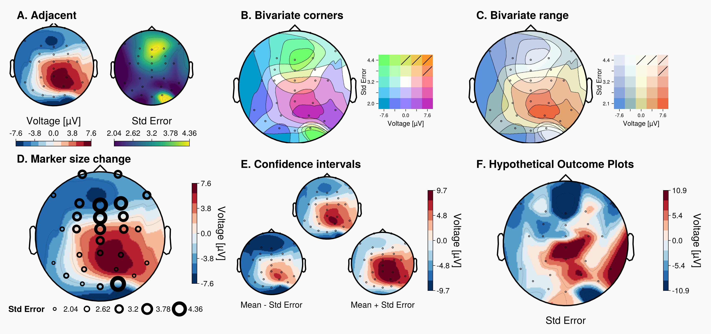

::::: columns
::: {.column width="40%"}
## The study

How can uncertainty be added to topoplots without making them harder to read?

This study compares seven uncertainty-visualization approaches using comparison, detection, and subjective-evaluation tasks.

[Explore the sample](pages/sample.qmd){.btn .btn-primary}
:::

::: {.column width="60%"}
{fig-alt="Animated examples of uncertainty visualizations for topoplots."}
:::
:::::

## Site structure

- [**Summary**](pages/summary.qmd)**:** conclusions for each research question, recommendations for each visualization, and the publication figures with their print PDFs.
- [**Sample**](pages/sample.qmd)**:** participants and background characteristics.
- [**Stimuli preparation**](pages/stimuli.qmd)**:** how the stimuli, the 64-region grid and the Task 2 scores were built.
- [**Quality control**](pages/quality.qmd)**:** participants flagged for answering too fast or giving the same rating everywhere.
- [**Task 1**](pages/task1.qmd)**:** visualization comparison.
- [**Task 2**](pages/task2.qmd)**:** pattern detection.
- [**Hit or miss**](pages/hit_miss.qmd)**:** hits, neighbour hits and misses in Task 2.
- [**Time analysis**](pages/time.qmd)**:** completion time in both tasks.
- [**Subjective evaluation**](pages/subjective.qmd)**:** participant ratings of the visualizations.
- [**Open-ended feedback**](pages/feedback.qmd)**:** visualization-specific and general written comments.
- [**Formative interviews**](pages/interviews.qmd)**:** the nine expert interviews before the survey: participants, interview guide and coding scheme.
- [**Audit**](audit/index.html)**:** open issues in the statistical analysis and a source-to-claim check of the manuscript's literature.