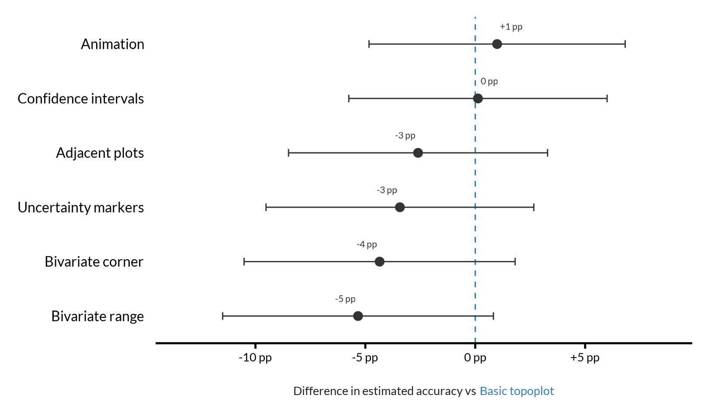
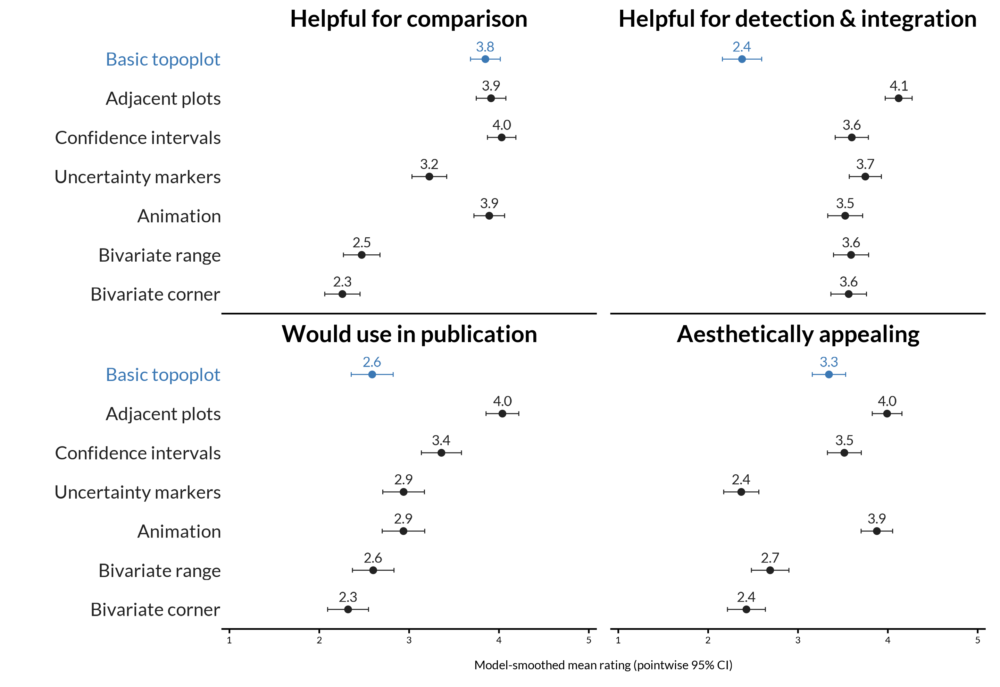

This page contains only the final aggregate figures for copying into
manuscripts, presentations, and other publication materials. Select or open an
image to copy it at full resolution. Each figure also has a print PDF, laid out
at its size in the journal (one column = 246 pt, full width = 504 pt) with 7–8 pt
text and Lato embedded. The figures carry no titles; the captions below give the
definitions that belong in a manuscript caption.

::: {.publication-figures}

## Participant characteristics

{fig-alt="Participant characteristics: stacked bars for self-assessed level and research field, and bar charts of country of work with flags and software used with tool logos."}

::: {.print-pdf}
Print PDF, full width: [participant_characteristics_icons_compact.pdf](../figures/participant_characteristics_icons_compact.pdf)
:::

## Comparison task: model-estimated probability of a correct response

{fig-alt="Model-estimated probability of a correct response for each visualization type, with 95% confidence intervals."}

::: {.print-pdf}
Print PDF, one column: [comparison_accuracy_figure.pdf](../figures/comparison_accuracy_figure.pdf)
:::

## Comparison task: differences relative to Basic topoplot

{fig-alt="Differences in model-estimated comparison-task accuracy relative to Basic topoplot, with simultaneous (max-|z|, six comparisons) 95% confidence intervals."}

::: {.print-pdf}
Print PDF, one column: [comparison_accuracy_contrast_figure.pdf](../figures/comparison_accuracy_contrast_figure.pdf)
:::

## Detection-score analysis: estimated values

![Expected detection score E[y], averaged over participants, stimuli and images. Bars: pointwise 95% confidence intervals (one per visualization, not adjusted for comparisons).](../figures/detection_score_figure.png){fig-alt="Model-estimated expected detection scores (averaged over random effects) for each visualization type, with 95% confidence intervals."}

::: {.print-pdf}
Print PDF, one column: [detection_score_figure.pdf](../figures/detection_score_figure.pdf)
:::

## Detection-score analysis: differences relative to Basic topoplot

![Difference in expected detection score E[y] from Basic topoplot. Bars: Dunnett-adjusted simultaneous 95% confidence intervals for the six comparisons. Dashed line: no difference.](../figures/detection_score_contrast_figure.png){fig-alt="Differences in model-estimated expected detection scores relative to Basic topoplot, with Dunnett-adjusted simultaneous 95% confidence intervals."}

::: {.print-pdf}
Print PDF, one column: [detection_score_contrast_figure.pdf](../figures/detection_score_contrast_figure.pdf)
:::

## Model-estimated subjective ratings

{fig-alt="Expected ratings (typical participant) for helpfulness for comparison, helpfulness for detection and integration, likelihood of use in a publication or presentation, and aesthetic appeal."}

::: {.print-pdf}
Print PDF, full width: [likert_estimate_figure.pdf](../figures/likert_estimate_figure.pdf)
:::

## Subjective-rating differences relative to Basic topoplot

{fig-alt="Differences in expected ratings (typical participant) relative to Basic topoplot for the four rating items, with Dunnett-adjusted 95% confidence intervals."}

::: {.print-pdf}
Print PDF, full width: [likert_contrast_figure.pdf](../figures/likert_contrast_figure.pdf)
:::

:::
