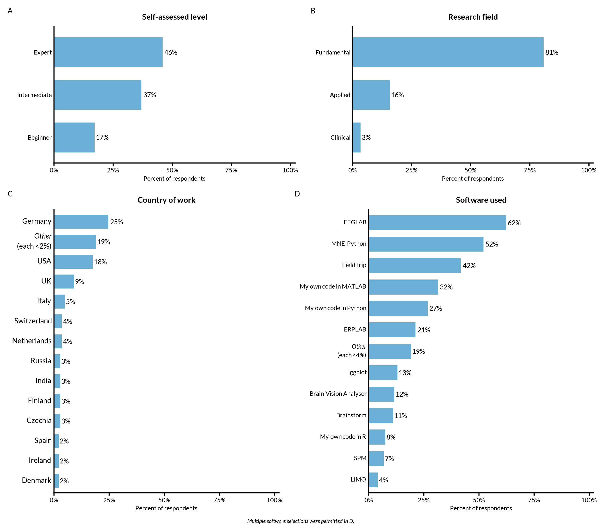
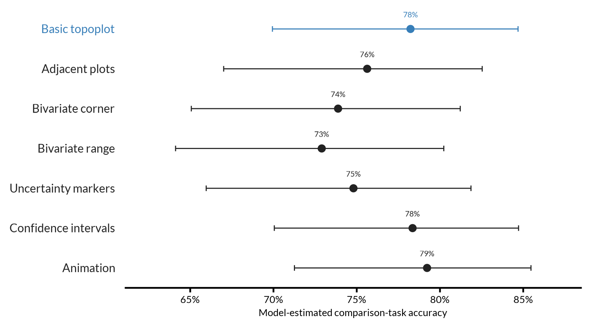
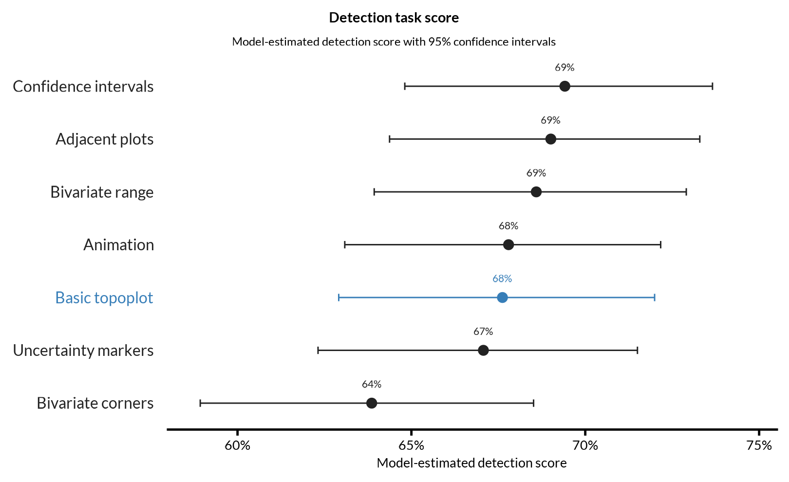
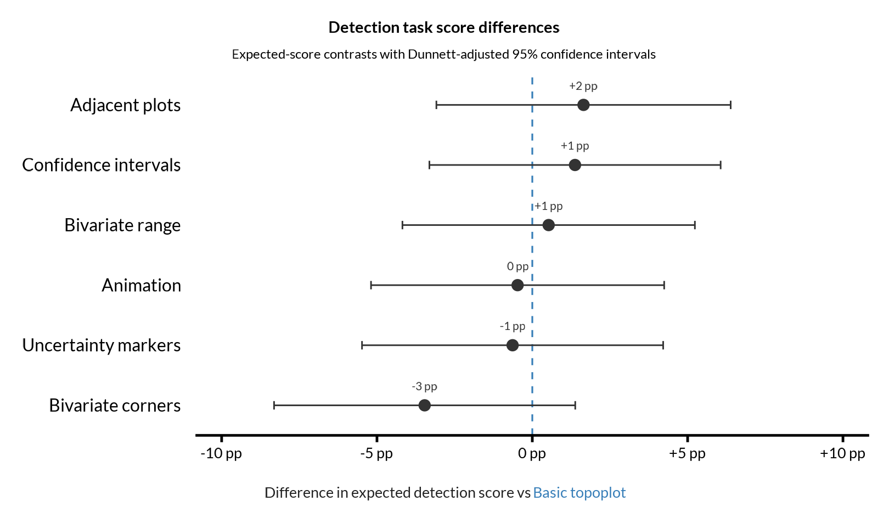
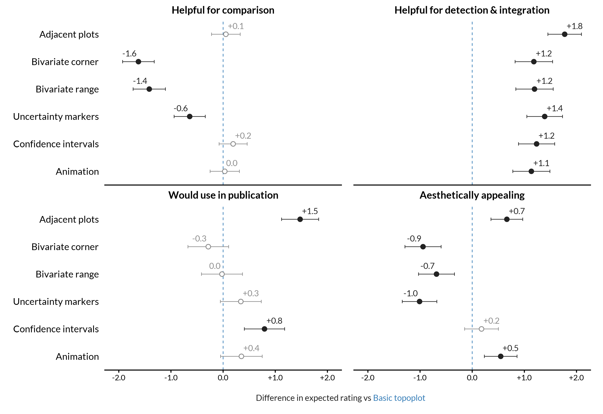

This page contains only the final aggregate figures for copying into
manuscripts, presentations, and other publication materials. Select or open an
image to copy it at full resolution.

::: {.publication-figures}

## Participant characteristics: categories above 3%

{fig-alt="Participant-characteristics panels showing categories above the specified percentage threshold."}

## Comparison task: model-estimated probability of a correct response

{fig-alt="Model-estimated probability of a correct response for each visualization type, with 95% confidence intervals."}

## Comparison task: differences relative to Basic topoplot

{fig-alt="Differences in model-estimated comparison-task accuracy relative to Basic topoplot, with simultaneous (max-|z|, six comparisons) 95% confidence intervals."}

## Detection-score analysis: estimated values

{fig-alt="Model-estimated expected detection scores (averaged over random effects) for each visualization type, with 95% confidence intervals."}

## Detection-score analysis: differences relative to Basic topoplot

{fig-alt="Differences in model-estimated expected detection scores relative to Basic topoplot, with Dunnett-adjusted simultaneous 95% confidence intervals."}

## Model-estimated subjective ratings

{fig-alt="Model-smoothed mean ratings for helpfulness for comparison, helpfulness for detection and integration, likelihood of use in a publication or presentation, and aesthetic appeal."}

## Subjective-rating differences relative to Basic topoplot

{fig-alt="Differences in model-smoothed mean ratings relative to Basic topoplot for the four rating items, with Dunnett-adjusted 95% confidence intervals."}

:::
