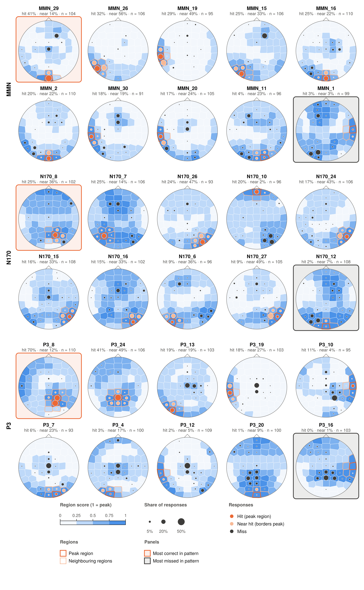
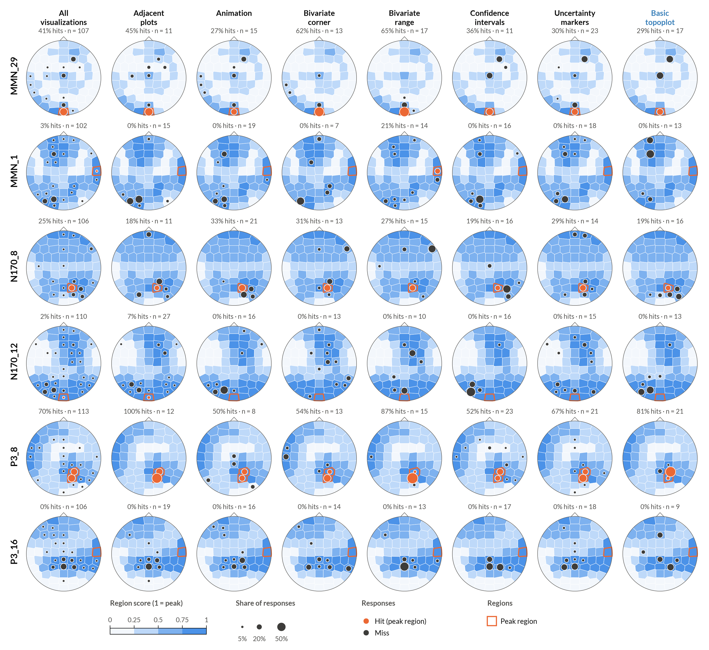
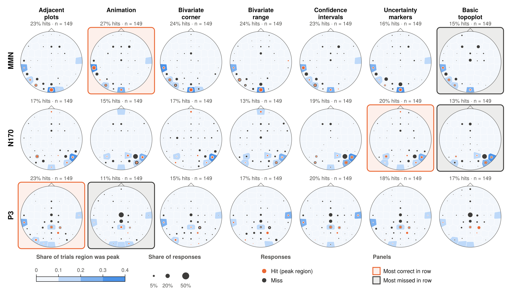

The [Task 2 page](task2.qmd) scores each response on a continuous 0–1 scale. This page asks a simpler question: **did participants click the peak region, a region right next to it, or somewhere else?**

```{r shared-setup}
#| include: false
#| cache: false
source("scripts/analysis_setup.R")
configure_analysis_cache(c(
  project_path("regions.txt"),
  project_path("data", "task2_region_grid64_montage28.svg")
))
```

```{r}
#| file: scripts/task2_trials.R
#| include: false
```

```{r hit-miss-classes}
#| include: false
# Neighbours: regions of the survey's clickable grid that share a border
# (>= 2 common polygon vertices). Corner-only contact does not count.
grid_svg <- paste(
  readLines(project_path("data", "task2_region_grid64_montage28.svg"), warn = FALSE),
  collapse = "\n"
)
grid_polygons <- stringr::str_match_all(
  grid_svg, '<polygon points="([^"]+)" data-region="(R\\d+)"'
)[[1]]
grid_vertices <- setNames(
  lapply(strsplit(trimws(grid_polygons[, 2]), "\\s+"), unique),
  grid_polygons[, 3]
)
stopifnot(length(grid_vertices) == 64L)

region_pairs <- t(combn(names(grid_vertices), 2))
shares_border <- apply(region_pairs, 1, \(p) {
  length(intersect(grid_vertices[[p[1]]], grid_vertices[[p[2]]])) >= 2
})
region_adjacency <- bind_rows(
  tibble(region = region_pairs[shares_border, 1], neighbour = region_pairs[shares_border, 2]),
  tibble(region = region_pairs[shares_border, 2], neighbour = region_pairs[shares_border, 1])
)
neighbour_counts <- count(region_adjacency, region)
stopifnot(nrow(neighbour_counts) == 64L)

# Class of every region for every stimulus: hit (peak), near (borders a peak), miss.
peak_regions <- region_scores |>
  filter(score == 1) |>
  select(stimulus, region)

near_regions <- peak_regions |>
  inner_join(region_adjacency, by = "region", relationship = "many-to-many") |>
  distinct(stimulus, region = neighbour) |>
  anti_join(peak_regions, by = c("stimulus", "region"))

# Runner-up regions: the four regions with the next-highest scores after the
# peak (ranks 2-5 of 64; ties at the last rank are included). A runner-up can
# also border the peak, so it is a separate flag, not a fourth class.
runner_regions <- region_scores |>
  anti_join(peak_regions, by = c("stimulus", "region")) |>
  group_by(stimulus) |>
  filter(min_rank(desc(score)) <= 4) |>
  ungroup() |>
  distinct(stimulus, region)
runner_counts <- count(runner_regions, stimulus, name = "n_runner")
stopifnot(all(runner_counts$n_runner >= 4), nrow(runner_counts) == 30L)

region_classes <- region_scores |>
  select(stimulus, region) |>
  left_join(mutate(peak_regions, peak = TRUE), by = c("stimulus", "region")) |>
  left_join(mutate(near_regions, near = TRUE), by = c("stimulus", "region")) |>
  left_join(mutate(runner_regions, runner = TRUE), by = c("stimulus", "region")) |>
  mutate(
    outcome = case_when(
      !is.na(peak) ~ "hit",
      !is.na(near) ~ "near",
      TRUE ~ "miss"
    ),
    runner = !is.na(runner)
  ) |>
  select(stimulus, region, outcome, runner)
# Share of runner-up regions that also border the peak.
runner_neighbour_share <- mean(region_classes$outcome[region_classes$runner] == "near")

# Chance level: one uniformly random click among the 64 regions.
chance_by_stimulus <- region_classes |>
  count(stimulus, outcome) |>
  tidyr::pivot_wider(names_from = outcome, values_from = n, values_fill = 0) |>
  transmute(stimulus, chance_hit = hit / 64, chance_near = near / 64) |>
  left_join(runner_counts, by = "stimulus") |>
  mutate(chance_runner = n_runner / 64) |>
  select(-n_runner)

hit_miss <- task2 |>
  left_join(region_classes, by = c("stimulus", "region")) |>
  left_join(chance_by_stimulus, by = "stimulus") |>
  mutate(
    ID = factor(ID),
    stimulus = factor(stimulus),
    vistype = relevel(factor(vistype), ref = "basic"),
    pattern = factor(pattern),
    position_c = as.integer(position) - 11,
    outcome = factor(outcome, levels = c("hit", "near", "miss")),
    hit = as.integer(outcome == "hit"),
    close = as.integer(outcome != "miss"),
    runner_up = as.integer(runner),
    hit_or_runner = as.integer(outcome == "hit" | runner)
  )

stopifnot(!anyNA(hit_miss$outcome), all(hit_miss$hit == (hit_miss$score == 1)))
```

## Definitions

- **Hit** — the selected region is the peak (region score = 1). For one stimulus two regions are tied at 1.00, and either counts.
- **Neighbour hit** — the selected region shares a border with the peak region. Regions have `r min(neighbour_counts$n)`–`r max(neighbour_counts$n)` neighbours (mean `r round(mean(neighbour_counts$n), 1)`); touching only at a corner does not count.
- **Runner-up hit** — the selected region has one of the next-highest scores after the peak: ranks 2–5 of the 64 regions (`r min(runner_counts$n_runner)`–`r max(runner_counts$n_runner)` regions per stimulus, with ties at rank 5). A runner-up can also border the peak: `r scales::percent(runner_neighbour_share, 1)` of the runner-up regions are also neighbours, so the two kinds of near hit overlap and are analysed separately.
- **Miss** — neither the peak nor a neighbour of it.
- A random click would give `r scales::percent(mean(hit_miss$chance_hit), 0.1)` hits, `r scales::percent(mean(hit_miss$chance_near), 0.1)` neighbour hits and `r scales::percent(mean(hit_miss$chance_runner), 0.1)` runner-up hits.

## Overview

```{r hit-miss-table}
outcome_shares <- hit_miss |>
  group_by(vistype) |>
  summarise(
    Hit = mean(outcome == "hit"),
    `Neighbour hit` = mean(outcome == "near"),
    Miss = mean(outcome == "miss"),
    `Hit or neighbour hit` = mean(close == 1),
    `Runner-up hit` = mean(runner_up == 1),
    `Hit or runner-up hit` = mean(hit_or_runner == 1),
    n = n(),
    .groups = "drop"
  ) |>
  arrange(desc(`Hit or neighbour hit`))

outcome_shares |>
  mutate(vistype = table_vistype(vistype)) |>
  bind_rows(tibble(
    vistype = "Random click (chance)",
    Hit = mean(hit_miss$chance_hit),
    `Neighbour hit` = mean(hit_miss$chance_near),
    Miss = 1 - mean(hit_miss$chance_hit) - mean(hit_miss$chance_near),
    `Hit or neighbour hit` = mean(hit_miss$chance_hit + hit_miss$chance_near),
    `Runner-up hit` = mean(hit_miss$chance_runner),
    `Hit or runner-up hit` = mean(hit_miss$chance_hit + hit_miss$chance_runner)
  )) |>
  mutate(
    across(c(Hit, `Neighbour hit`, Miss, `Hit or neighbour hit`, `Runner-up hit`,
             `Hit or runner-up hit`), \(x) scales::percent(x, 0.1)),
    n = ifelse(is.na(n), "—", scales::comma(n))
  ) |>
  knitr::kable(
    format = "html",
    col.names = c("Visualization", "Hit", "Neighbour hit", "Miss", "Hit or neighbour hit",
                  "Runner-up hit", "Hit or runner-up hit", "n"),
    caption = paste(
      "Share of responses, all ERP patterns pooled; sorted by hit or neighbour hit.",
      "Hit, neighbour hit and miss add up to 100%; runner-up hits overlap with",
      "neighbour hits and misses."
    ),
    table.attr = kable_table_attributes
  )
```

{#fig-hit-near-miss-bars width="100%" fig-alt="Side-by-side horizontal bars with 95% interval whiskers showing the share of hits and neighbour hits for each of the seven visualization types, in four panels: all patterns, MMN, N170 and P3."}

## Where participants clicked

Each topoplot uses the survey's clickable grid. Region fill shows the ground truth, and dot area shows the share of responses for that region; shares below about 4% get a minimum dot size so that single responses stay visible. Each panel's subtitle gives its hit rate and n; no panel is singled out as most correct or most missed, because with as few as 7 responses per panel those differences are mostly noise.

::: panel-tabset
### By stimulus

{#fig-hit-near-miss-stimulus width="100%" fig-alt="Thirty topoplots in three blocks (MMN, N170, P3) of two rows of five, each showing where participants clicked relative to the peak region and its neighbours."}

### Same stimulus, each visualization

{#fig-hit-miss-stimulus-vistype width="100%" fig-alt="Six rows of topoplots, one per stimulus, with columns for all visualizations pooled and each visualization type."}

### Pattern × visualization

{#fig-hit-miss-pattern-vistype width="100%" fig-alt="A three-by-seven grid of topoplots, ERP patterns by visualization type, showing hits and misses."}
:::

::: {.callout-note title="About these figures" collapse="true"}
The topoplots and bar chart are rendered with UnfoldMakie by `uncertainty_project/working/task2_results/plot_task2_hits_misses.jl` (UnfoldMakie.jl, branch `uncert_bus`) from the aggregated counts written by `scripts/export_task2_hits_misses.R`. After a data refresh, rerun both scripts and copy the PNGs (web) and PDFs (print: 504 pt wide, or narrower to stay within 9 in of height; 7 pt minimum text; Lato embedded) into `figures/`. The script downloads Lato (Google Fonts, OFL) into the git-ignored `uncertainty_project/fonts/` on first use, or reads it from the folder named by `LATO_DIR`; the tables and models on this page update on their own.
:::

## Models

Three logistic mixed models with the predictors of the Task 2 models, `vistype + pattern + position_c + (1 | ID) + (1 | stimulus) + (1 | stimulus:vistype)`: one for an exact **hit**, one for a **hit or neighbour hit**, and one for a **hit or runner-up hit**. The last term gives each of the 210 images (stimulus × visualization) its own intercept, because the ~15 responses to one image are not independent.

```{r hit-miss-models}
hit_miss_models <- list(
  `Hit` = glmmTMB(
    hit ~ vistype + pattern + position_c +
      (1 | ID) + (1 | stimulus) + (1 | stimulus:vistype),
    family = binomial(link = "logit"), data = hit_miss
  ),
  `Hit or neighbour hit` = glmmTMB(
    close ~ vistype + pattern + position_c +
      (1 | ID) + (1 | stimulus) + (1 | stimulus:vistype),
    family = binomial(link = "logit"), data = hit_miss
  ),
  `Hit or runner-up hit` = glmmTMB(
    hit_or_runner ~ vistype + pattern + position_c +
      (1 | ID) + (1 | stimulus) + (1 | stimulus:vistype),
    family = binomial(link = "logit"), data = hit_miss
  )
)

# Overall test of visualization type: likelihood-ratio test against the same
# model without vistype.
hit_miss_overall <- purrr::imap_dfr(hit_miss_models, \(model, name) {
  reduced <- update(model, . ~ . - vistype)
  chi <- as.numeric(2 * (logLik(model) - logLik(reduced)))
  df <- attr(logLik(model), "df") - attr(logLik(reduced), "df")
  tibble(outcome = name, chi = chi, df = df, p = pchisq(chi, df, lower.tail = FALSE))
})
overall_text <- function(name) {
  r <- hit_miss_overall[hit_miss_overall$outcome == name, ]
  sprintf("χ²(%d) = %.1f, p = %.2f", r$df, r$chi, r$p)
}

stopifnot(all(purrr::map_lgl(hit_miss_models, \(m) {
  m$fit$convergence == 0 && isTRUE(m$sdr$pdHess)
})))

# Expected rates averaged over participants, stimuli and images (random
# intercepts integrated out), not the typical-image values of
# emmeans(type = "response"); see marginal_response_by_vistype().
hit_miss_predictions <- purrr::map(
  hit_miss_models,
  \(model) marginal_response_by_vistype(model, include_99 = TRUE, keep_draws = TRUE)
)
hit_miss_estimates <- purrr::imap_dfr(hit_miss_predictions, \(predictions, name) {
  predictions$estimates |>
    transmute(
      outcome = name, vistype, prob = marginal,
      lower = marginal_lower, upper = marginal_upper,
      lower_99 = marginal_lower_99, upper_99 = marginal_upper_99
    )
})

# Primary family as on the other pages: the six comparisons with Basic,
# Dunnett-adjusted (exact multivariate-t; Monte Carlo, hence the seed).
hit_miss_contrasts <- purrr::imap_dfr(hit_miss_models, \(model, name) {
  set.seed(20261118)
  emmeans(model, ~vistype) |>
    contrast(method = "trt.vs.ctrl", ref = "basic", adjust = "mvt") |>
    summary(infer = TRUE, type = "response") |>
    as.data.frame() |>
    transmute(
      outcome = name,
      vistype = stringr::str_remove(contrast, " / basic$"),
      odds.ratio, lower = asymp.LCL, upper = asymp.UCL, p.value
    )
})

# Rows in the display order of every figure and table (audit V1).
hit_miss_estimates |>
  mutate(
    vistype = factor(vistype, levels = vistype_order),
    value = sprintf("%.0f%% [%.0f, %.0f]", 100 * prob, 100 * lower, 100 * upper)
  ) |>
  select(outcome, vistype, value) |>
  tidyr::pivot_wider(names_from = outcome, values_from = value) |>
  left_join(
    hit_miss_contrasts |>
      transmute(
        outcome = paste(outcome, "p"),
        vistype = factor(vistype, levels = vistype_order),
        p = format_pvalue_html(p.value)
      ) |>
      tidyr::pivot_wider(names_from = outcome, values_from = p),
    by = "vistype"
  ) |>
  arrange(vistype) |>
  mutate(
    vistype = table_vistype(vistype),
    across(ends_with(" p"), \(x) tidyr::replace_na(x, "reference"))
  ) |>
  select(vistype, `Hit`, `Hit p`, `Hit or neighbour hit`, `Hit or neighbour hit p`,
         `Hit or runner-up hit`, `Hit or runner-up hit p`) |>
  knitr::kable(
    format = "html",
    escape = FALSE,
    col.names = c("Visualization", "Hit [95% CI]", "p vs Basic",
                  "Hit or neighbour hit [95% CI]", "p vs Basic",
                  "Hit or runner-up hit [95% CI]", "p vs Basic"),
    caption = paste(
      "Model-estimated probabilities, averaged equally over ERP patterns at the middle",
      "presentation position and over participants, stimuli and images (random",
      "intercepts integrated out), so they are comparable with the observed shares.",
      "Intervals: 4,000 draws of the model parameters. p-values compare each",
      "visualization with Basic topoplot, Dunnett-adjusted for the six comparisons",
      "with Basic."
    ),
    table.attr = kable_table_attributes
  )
```

**Overall test of visualization type** (likelihood ratio against the same model
without it): hit `r overall_text("Hit")`; hit or neighbour hit
`r overall_text("Hit or neighbour hit")`; hit or runner-up hit
`r overall_text("Hit or runner-up hit")`. When the overall test is not significant, read the
single comparisons with Basic above as exploratory.

```{r hit-miss-model-ambiguation-plot}
#| cache: false
#| fig-width: 14
#| fig-height: 5.5
#| fig-cap: >-
#|   Model-estimated probabilities at the middle presentation position,
#|   averaged over ERP patterns, participants, stimuli, and images. The white
#|   tick and percentage label show the estimate. Dark blue spans the pointwise
#|   95% confidence interval and the light blue ends reach the 99% limits.
#|   Both intervals use the same 4,000 model-parameter draws.
#|   Design adapted from panel (f) of
#|   [Gschwandtner et al. (2016)](https://doi.org/10.1109/TVCG.2015.2467752).
#| fig-alt: >-
#|   Three panels compare model-estimated probabilities of an exact hit, of a
#|   hit or neighbour hit and of a hit or runner-up hit across seven
#|   visualisation types. Each blue band shows the
#|   95% interval in dark blue and extends to the 99% limits in light blue.

source("scripts/ambiguation_plot.R", local = TRUE)
hit_miss_plot_data <- hit_miss_estimates |>
  transmute(
    outcome = factor(
      outcome,
      levels = c("Hit", "Hit or neighbour hit", "Hit or runner-up hit"),
      labels = c("Exact hit", "Hit or neighbour hit", "Hit or runner-up hit")
    ),
    vistype = order_vistype(vistype, top_first = TRUE),
    y_position = as.numeric(vistype),
    prob, lower_95 = lower, upper_95 = upper, lower_99, upper_99
  )
hit_miss_plot_rows <- hit_miss_plot_data |>
  distinct(vistype, y_position) |>
  arrange(y_position)
hit_miss_axis_max <- ceiling(max(hit_miss_plot_data$upper_99) * 10) / 10

hit_miss_ambiguation_figure <- plot_ambiguation_intervals(hit_miss_plot_data) +
  geom_segment(
    aes(x = prob, xend = prob, y = y_position - 0.20, yend = y_position + 0.20),
    inherit.aes = FALSE,
    colour = "white",
    linewidth = 0.8
  ) +
  geom_text(
    aes(x = prob, y = y_position + 0.43, label = scales::percent(prob, accuracy = 1)),
    inherit.aes = FALSE,
    vjust = 0,
    size = 6
  ) +
  facet_wrap(vars(outcome), nrow = 1) +
  scale_x_continuous(
    "Model-estimated probability",
    limits = c(0, hit_miss_axis_max),
    breaks = scales::breaks_width(0.2),
    labels = scales::label_percent(),
    expand = expansion(add = c(0, 0.01))
  ) +
  scale_y_continuous(
    breaks = hit_miss_plot_rows$y_position,
    labels = figure_vistype(hit_miss_plot_rows$vistype),
    expand = expansion(add = c(0.5, 0.85))
  ) +
  labs(y = NULL) +
  (if (hit_miss_axis_max < 1) x_axis_end_mark()) +
  coord_cartesian(clip = "off") +
  plot_theme(base_size = 20) +
  theme(
    axis.text = element_text(size = 20),
    axis.text.y = element_text(
      colour = vistype_label_colours(hit_miss_plot_rows$vistype, other = "black")
    ),
    axis.ticks.y = element_blank(),
    axis.line.y = element_blank(),
    panel.spacing.x = grid::unit(5, "mm"),
    strip.background = element_blank(),
    strip.text = element_text(face = "bold", size = 21)
  )
hit_miss_ambiguation_figure

# Copies for the Summary page: PNG, and a vector PDF at the same layout size
# (scale to full width).
ggsave_st(
  project_path("figures", "hit_miss_ambiguation_figure.png"),
  hit_miss_ambiguation_figure,
  width = 14, height = 5.5, units = "in", dpi = 180,
  device = ragg::agg_png, bg = "white"
)
ggsave_print(
  project_path("figures", "hit_miss_ambiguation_figure.pdf"),
  hit_miss_ambiguation_figure,
  width = 14, height = 5.5
)
```

```{r hit-miss-model-probability-contrasts}
#| cache: false
#| fig-width: 14
#| fig-height: 5.5
#| fig-cap: >-
#|   Difference in model-estimated probabilities versus Basic topoplot, in
#|   percentage points (pp). Whiskers show approximate simultaneous 95%
#|   confidence intervals for the six comparisons within each model, based on
#|   4,000 joint parameter draws. The dashed blue line marks zero difference.
#| fig-alt: >-
#|   Three panels show the estimated change in exact-hit, hit-or-neighbour-hit
#|   and hit-or-runner-up-hit probability relative to Basic topoplot for each of the
#|   six other visualisation types, with horizontal confidence intervals.

hit_miss_probability_contrasts <- purrr::imap_dfr(
  hit_miss_predictions,
  \(predictions, name) {
    draws <- tidyr::pivot_wider(
      predictions$marginal_draws,
      id_cols = draw, names_from = vistype, values_from = marginal
    )
    # Within each draw, all rates use the same model parameters.
    contrast_draws <- sweep(as.matrix(select(draws, -draw, -basic)), 1, draws$basic, "-")
    types <- colnames(contrast_draws)
    estimates <- setNames(predictions$estimates$marginal, predictions$estimates$vistype)
    difference <- unname(estimates[types] - estimates[["basic"]])

    # As for Task 1, calibrate the interval with the largest absolute
    # standardised deviation across the six comparisons in each draw.
    standard_error <- apply(contrast_draws, 2, sd)
    z_draws <- scale(contrast_draws, scale = standard_error)
    critical <- unname(quantile(apply(abs(z_draws), 1, max), 0.95))
    tibble(
      outcome = name,
      vistype = types,
      difference,
      lower_ci = difference - critical * standard_error,
      upper_ci = difference + critical * standard_error
    )
  }
) |>
  mutate(
    outcome = factor(
      outcome,
      levels = c("Hit", "Hit or neighbour hit", "Hit or runner-up hit"),
      labels = c("Exact hit", "Hit or neighbour hit", "Hit or runner-up hit")
    ),
    vistype = order_vistype(vistype, top_first = TRUE)
  )

format_probability_difference <- function(x) {
  ifelse(abs(x) < 0.005, "0 pp", sprintf("%+.0f pp", 100 * x))
}
s <- interval_figure_sizes()

hit_miss_probability_contrast_plot <- ggplot(
  hit_miss_probability_contrasts,
  aes(x = difference, y = vistype)
) +
  geom_vline(xintercept = 0, linetype = "dashed", linewidth = 0.6, colour = basic_accent) +
  geom_errorbar(
    aes(xmin = lower_ci, xmax = upper_ci),
    orientation = "y",
    width = 0.14,
    linewidth = s$line,
    colour = "#333333"
  ) +
  geom_point(size = s$point, colour = "#333333") +
  geom_text(
    aes(
      hjust = side_away_from_zero(difference),
      label = format_probability_difference(difference)
    ),
    nudge_y = 0.32,
    vjust = 0.5,
    size = s$label,
    colour = "#333333"
  ) +
  facet_wrap(vars(outcome), nrow = 1) +
  scale_x_continuous(
    breaks = scales::breaks_width(0.10),
    labels = format_probability_difference,
    expand = expansion(add = 0.02)
  ) +
  scale_y_discrete(labels = figure_vistype, expand = expansion(add = 0.5)) +
  labs(x = NULL, y = NULL) +
  plot_theme(base_size = s$base) +
  theme(
    axis.text.y = element_text(size = s$axis_y, margin = margin(r = s$margin)),
    axis.text.x = element_text(size = s$axis_x),
    axis.ticks.y = element_blank(),
    axis.line.y = element_blank(),
    panel.spacing.x = grid::unit(5, "mm"),
    strip.background = element_blank(),
    strip.text = element_text(face = "bold", size = 21)
  )

hit_miss_probability_contrast_plot /
  basic_axis_caption("Difference in estimated probability vs", size = s$caption) +
  plot_layout(heights = c(1, 0.10))
```

::: {.callout-note title="Odds ratios vs Basic topoplot" collapse="true"}
```{r hit-miss-odds}
hit_miss_contrasts |>
  # Within each outcome, rows in the display order of every figure (audit V1).
  arrange(factor(outcome, levels = unique(outcome)), order_vistype(vistype)) |>
  mutate(
    vistype = table_vistype(vistype),
    `OR [95% CI]` = sprintf("%.2f [%.2f, %.2f]", odds.ratio, lower, upper),
    p = format_pvalue_html(p.value)
  ) |>
  select(outcome, vistype, `OR [95% CI]`, p) |>
  knitr::kable(
    format = "html",
    escape = FALSE,
    col.names = c("Outcome", "Visualization", "Odds ratio [simultaneous 95% CI]",
                  "p (Dunnett-adjusted)"),
    caption = paste(
      "Odds ratios of each visualization against Basic topoplot. Intervals and",
      "p-values are Dunnett-adjusted (multivariate t) for the six comparisons with",
      "Basic within each outcome, as on the other pages."
    ),
    table.attr = kable_table_attributes
  )
```
:::

## Centre bias (exploratory) {#centre-bias}

```{r centre-bias}
#| include: false
# Region geometry from the survey's clickable grid: distance of each region's
# centre (mean of its vertices) from the head centre, as a share of the head
# radius, and whether the region touches the head outline.
vertex_xy <- lapply(grid_vertices, \(v) {
  m <- do.call(rbind, strsplit(v, ","))
  matrix(as.numeric(m), ncol = 2)
})
all_xy <- do.call(rbind, vertex_xy)
head_centre <- c(mean(range(all_xy[, 1])), mean(range(all_xy[, 2])))
radius_of <- \(m) sqrt((m[, 1] - head_centre[1])^2 + (m[, 2] - head_centre[2])^2)
head_radius <- max(radius_of(all_xy))
region_geometry <- tibble(
  region = names(vertex_xy),
  dist = vapply(vertex_xy, \(m) radius_of(matrix(colMeans(m), ncol = 2)), numeric(1)) / head_radius,
  border = vapply(vertex_xy, \(m) any(radius_of(m) / head_radius > 0.97), logical(1))
) |>
  mutate(ring = cut(dist, c(0, 0.35, 0.6, 0.8, 1.01),
                    labels = c("Centre", "Inner", "Middle", "Outer (border)")))
stopifnot(nrow(region_geometry) == 64L, all(region_geometry$border == (region_geometry$ring == "Outer (border)")))

# Clicks per region in every stimulus x visualization set (0 where nobody clicked).
centre_counts <- distinct(hit_miss, stimulus, vistype) |>
  mutate(stimulus = as.character(stimulus)) |>
  inner_join(select(region_scores, stimulus, region, score), by = "stimulus",
             relationship = "many-to-many") |>
  left_join(count(mutate(hit_miss, stimulus = as.character(stimulus)), stimulus, vistype, region, name = "n"),
            by = c("stimulus", "vistype", "region")) |>
  mutate(n = coalesce(n, 0L), peak = score == 1, set = interaction(stimulus, vistype, drop = TRUE)) |>
  left_join(region_geometry, by = "region")
stopifnot(sum(centre_counts$n) == nrow(hit_miss), !anyNA(centre_counts$border))

centre_peaks <- distinct(filter(centre_counts, peak), stimulus, region, border, ring)
centre_ring_table <- region_geometry |>
  count(ring, name = "regions") |>
  left_join(count(centre_peaks, ring, name = "peaks"), by = "ring") |>
  left_join(summarise(group_by(centre_counts, ring), clicks = sum(n), .groups = "drop"), by = "ring") |>
  mutate(peaks = coalesce(peaks, 0L),
         across(c(regions, peaks, clicks), \(x) x / sum(x)))

# Choice model: the click among the 64 regions of a set as a multinomial logit,
# fitted as a Poisson model with one intercept per set (equivalent), with the
# region's score (cubic) and the border flag. Quasi-Poisson: the clicks are
# overdispersed (participants differ), which widens the intervals.
centre_border_effect <- function(d) {
  m <- glm(n ~ set + poly(score, 3) + border, family = quasipoisson, data = d)
  est <- coef(summary(m))["borderTRUE", ]
  tibble(ratio = exp(est[["Estimate"]]),
         lower = exp(est[["Estimate"]] - 1.96 * est[["Std. Error"]]),
         upper = exp(est[["Estimate"]] + 1.96 * est[["Std. Error"]]),
         p = est[[4]], dispersion = summary(m)$dispersion)
}
centre_all <- centre_border_effect(centre_counts)

# Expected clicks if only the score mattered: the same choice model without the
# border term. Observed / expected per region, pooled over all stimulus x
# visualization sets, is what the head map below shows.
centre_score_model <- glm(n ~ set + poly(score, 3), family = quasipoisson, data = centre_counts)
centre_region_ratio <- centre_counts |>
  mutate(expected = fitted(centre_score_model)) |>
  group_by(region) |>
  summarise(observed = sum(n), expected = sum(expected), .groups = "drop") |>
  mutate(ratio = observed / expected) |>
  left_join(region_geometry, by = "region")
stopifnot(nrow(centre_region_ratio) == 64L,
          abs(sum(centre_region_ratio$expected) / sum(centre_region_ratio$observed) - 1) < 1e-3)
centre_by_vistype <- centre_counts |>
  group_by(vistype) |>
  group_modify(\(d, k) centre_border_effect(d)) |>
  ungroup() |>
  mutate(vistype = order_vistype(vistype)) |>
  arrange(vistype)

# Hit rate by where the peak is.
centre_hit_by_location <- hit_miss |>
  mutate(stimulus = as.character(stimulus)) |>
  left_join(summarise(group_by(centre_peaks, stimulus), peak_border = any(border)), by = "stimulus") |>
  group_by(peak_border) |>
  summarise(stimuli = n_distinct(stimulus), hit = mean(hit), .groups = "drop")
centre_pct <- \(x) scales::percent(x, 1)
```

This analysis was not planned: it checks whether participants avoided regions at the edge of the head, independent of how strong the signal there was. **Border regions** are the `r sum(region_geometry$border)` regions that touch the head outline; rings group the regions by the distance of their centre from the centre of the head.

```{r centre-bias-ring-table}
centre_ring_table |>
  transmute(ring, regions = centre_pct(regions), peaks = centre_pct(peaks),
            clicks = centre_pct(clicks)) |>
  knitr::kable(
    format = "html",
    col.names = c("Ring", "Regions", "Peak regions", "Clicks"),
    caption = "Share of the 64 regions, of the peak regions of the 30 stimuli, and of all clicks in each ring.",
    table.attr = kable_table_attributes
  )
```

```{r centre-bias-head-map}
#| fig-width: 7.5
#| fig-height: 6.5
#| fig-cap: >-
#|   Clicks on each region of the survey's grid relative to what its score
#|   alone predicts (observed / expected under a choice model with the region's
#|   score only), pooled over all stimuli and visualizations. Green: chosen more
#|   often than the score justifies; brown: less often. Bins on a log scale.
#| fig-alt: >-
#|   Head-shaped map of the 64 clickable regions. Regions on the midline and in
#|   the centre are green (chosen more often than their score predicts); most
#|   regions along the front and side edges are brown (chosen less often).
# Region polygons (SVG y runs downward: flipped so the nose points up).
centre_polygons <- purrr::imap_dfr(vertex_xy, \(m, region) {
  tibble(region = region, x = m[, 1], y = -m[, 2])
}) |>
  left_join(select(centre_region_ratio, region, ratio), by = "region")
head_outline <- tibble(
  angle = seq(0, 2 * pi, length.out = 361),
  x = head_centre[1] + head_radius * cos(angle),
  y = -head_centre[2] + head_radius * sin(angle)
)
nose <- tibble(
  x = head_centre[1] + head_radius * c(-0.09, 0, 0.09),
  y = -head_centre[2] + head_radius * c(0.995, 1.09, 0.995)
)
# Five bins centred on 1/4, 1/2, 1, 2 and 4 (edges halfway between on the log
# scale), so "about as expected" is its own neutral bin.
ratio_bin_labels <- c("1/4 or fewer", "1/2", "About 1", "2", "4 or more")
centre_polygons <- centre_polygons |>
  mutate(ratio_bin = cut(log2(ratio), c(-Inf, -1.5, -0.5, 0.5, 1.5, Inf),
                         labels = ratio_bin_labels, include.lowest = TRUE))

centre_head_map <- ggplot(centre_polygons, aes(x, y)) +
  geom_polygon(aes(group = region, fill = ratio_bin), colour = "white", linewidth = 0.5) +
  geom_path(data = head_outline, colour = "#222222", linewidth = 0.6) +
  geom_path(data = nose, colour = "#222222", linewidth = 0.6) +
  scale_fill_manual(
    values = setNames(RColorBrewer::brewer.pal(5, "BrBG"), ratio_bin_labels),
    limits = rev(ratio_bin_labels), drop = FALSE,
    name = "Observed ÷ expected
clicks"
  ) +
  coord_equal(clip = "off") +
  theme_void(base_size = 18, base_family = "Lato") +
  theme(
    legend.position = "right",
    legend.title = element_text(size = 16, lineheight = 0.5),
    legend.text = element_text(size = 15),
    legend.key.height = grid::unit(0.9, "cm")
  )
centre_head_map

# Copies for the Summary page (vector PDF at the same layout size).
ggsave_st(
  project_path("figures", "centre_bias_head_map.png"),
  centre_head_map,
  width = 7.5, height = 6.5, units = "in", dpi = 180,
  device = ragg::agg_png, bg = "white"
)
ggsave_print(
  project_path("figures", "centre_bias_head_map.pdf"),
  centre_head_map,
  width = 7.5, height = 6.5
)
```

- **Where the peaks were** (descriptive): `r sum(centre_peaks$border)` of the `r nrow(centre_peaks)` peak regions lie on the border, in `r n_distinct(centre_peaks$stimulus[centre_peaks$border])` of the 30 stimuli. Border regions held `r centre_pct(centre_ring_table$peaks[centre_ring_table$ring == "Outer (border)"])` of the peaks but received only `r centre_pct(sum(centre_counts$n[centre_counts$border]) / sum(centre_counts$n))` of the clicks, about their share of the grid (`r centre_pct(mean(region_geometry$border))`); the centre ring, which holds no peak, received `r centre_pct(centre_ring_table$clicks[centre_ring_table$ring == "Centre"])`.
- **Border regions are chosen less than their score predicts** (choice model, exploratory): for regions with the same score, a border region received `r sprintf("%.2f", centre_all$ratio)` times as many clicks as an interior one (95% CI `r sprintf("%.2f", centre_all$lower)`–`r sprintf("%.2f", centre_all$upper)`; the interval allows for the overdispersion of the clicks, a factor of `r sprintf("%.1f", centre_all$dispersion)`).
- **Every visualization shows it** (table below), most strongly `r table_vistype(centre_by_vistype$vistype[which.min(centre_by_vistype$ratio)])` and least `r table_vistype(centre_by_vistype$vistype[which.max(centre_by_vistype$ratio)])`.
- **Hit rate by peak location** (descriptive): `r centre_pct(centre_hit_by_location$hit[centre_hit_by_location$peak_border])` when the peak is on the border (`r centre_hit_by_location$stimuli[centre_hit_by_location$peak_border]` stimuli) and `r centre_pct(centre_hit_by_location$hit[!centre_hit_by_location$peak_border])` when it is inside (`r centre_hit_by_location$stimuli[!centre_hit_by_location$peak_border]` stimuli). With so few inner peaks this difference is not tested.

```{r centre-bias-vistype-table}
centre_by_vistype |>
  transmute(
    vistype = table_vistype(vistype),
    ratio = sprintf("%.2f [%.2f, %.2f]", ratio, lower, upper)
  ) |>
  knitr::kable(
    format = "html",
    col.names = c("Visualization", "Clicks on a border region vs an interior region with the same score [95% CI]"),
    caption = "Centre bias by visualization: ratio below 1 = border regions chosen less often. Quasi-Poisson choice model within each visualization; intervals not adjusted for comparisons.",
    table.attr = kable_table_attributes
  )
```

**Interpretation.** Two explanations fit these data, and the study cannot separate them. Participants may avoid the edge of the map, as viewers tend to look at the centre of an image. Or, as EEG researchers, they may distrust maxima at the edge of a topoplot, where the values are extrapolated beyond the outermost electrodes. Either way, the centre bias likely explains much of why exact hits were rare, because most peaks were on the border. That the peaks lay mostly on the border is a property of the 30 stimuli and limits how far the hit rates generalize.

## Summary of the hit-or-miss results

```{r hit-miss-takeaways}
#| include: false
best_close <- slice_max(outcome_shares, `Hit or neighbour hit`, n = 1)
worst_close <- slice_min(outcome_shares, `Hit or neighbour hit`, n = 1)
best_hit <- slice_max(outcome_shares, Hit, n = 1)
best_runner <- slice_max(outcome_shares, `Runner-up hit`, n = 1)
worst_runner <- slice_min(outcome_shares, `Runner-up hit`, n = 1)
stimulus_hits <- hit_miss |>
  group_by(stimulus) |>
  summarise(hit = mean(hit), .groups = "drop")
```

```{r hit-miss-summary-text}
#| include: false
#| cache: false
# Every number below comes from objects computed above. An odds ratio is called
# higher or lower only when its Dunnett-adjusted interval excludes 1 (as on the
# Task 1 page); otherwise the text says that the interval includes 1.
hit_miss_summary_p <- function(p) {
  formatted <- format.pval(p, digits = 2, eps = 0.001)
  if_else(startsWith(formatted, "<"), formatted, paste("=", formatted))
}

hit_miss_range_text <- function(name) {
  rows <- hit_miss_estimates |> filter(outcome == name)
  low <- slice_min(rows, prob, n = 1, with_ties = FALSE)
  high <- slice_max(rows, prob, n = 1, with_ties = FALSE)
  basic <- filter(rows, vistype == "basic")
  sprintf(
    "from %s for %s to %s for %s (Basic topoplot %s, 95%% CI %s–%s)",
    scales::percent(low$prob, 1), table_vistype(low$vistype),
    scales::percent(high$prob, 1), table_vistype(high$vistype),
    scales::percent(basic$prob, 1), scales::percent(basic$lower, 1),
    scales::percent(basic$upper, 1)
  )
}

hit_miss_effects <- function(name, outcome) {
  rows <- hit_miss_contrasts |>
    filter(.data$outcome == name) |>
    mutate(vistype = order_vistype(vistype)) |>
    arrange(vistype)
  describe <- \(i) sprintf(
    "%s (OR = %.2f, simultaneous 95%% CI %.2f–%.2f, adjusted *p* %s)",
    table_vistype(as.character(rows$vistype[i])), rows$odds.ratio[i],
    rows$lower[i], rows$upper[i], hit_miss_summary_p(rows$p.value[i])
  )
  lower_set <- which(rows$upper < 1)
  higher_set <- which(rows$lower > 1)
  unclear_set <- setdiff(seq_len(nrow(rows)), c(lower_set, higher_set))
  sentences <- character()
  if (length(lower_set) > 0) {
    sentences <- c(sentences, paste0(
      "Relative to Basic topoplot, ", outcome, " clearly lower for ",
      knitr::combine_words(describe(lower_set)), "."
    ))
  }
  if (length(higher_set) > 0) {
    sentences <- c(sentences, paste0(
      "Relative to Basic topoplot, ", outcome, " clearly higher for ",
      knitr::combine_words(describe(higher_set)), "."
    ))
  }
  if (length(unclear_set) == nrow(rows)) {
    sentences <- c(sentences, paste0(
      "No visualization type differed clearly from Basic topoplot: all ",
      number_word(nrow(rows)), " intervals included 1."
    ))
  } else if (length(unclear_set) > 0) {
    sentences <- c(sentences, paste0(
      "The intervals for the other ", number_word(length(unclear_set)),
      " visualization type", if (length(unclear_set) > 1) "s" else "",
      " included 1."
    ))
  }
  if (length(unclear_set) > 0) {
    largest <- unclear_set[which.max(abs(log(rows$odds.ratio[unclear_set])))]
    sentences <- c(sentences, paste0(
      "The largest of these was for ", describe(largest),
      ", but its interval also included 1."
    ))
  }
  paste(sentences, collapse = " ")
}

hit_miss_clear <- hit_miss_contrasts |> filter(lower > 1 | upper < 1)
hit_miss_overall_p <- setNames(hit_miss_overall$p, hit_miss_overall$outcome)
hit_miss_clear_without_overall <- hit_miss_clear |>
  filter(hit_miss_overall_p[outcome] >= 0.05)

hit_miss_interpretation <- paste0(
  if (nrow(hit_miss_clear) == 0) {
    paste0(
      "No comparison with Basic topoplot excluded 1 after adjustment, so the data ",
      "give no clear evidence that a visualization changed how often participants ",
      "found the peak, landed next to it or chose one of the next-strongest regions. "
    )
  } else if (nrow(hit_miss_clear_without_overall) == nrow(hit_miss_clear)) {
    paste0(
      "The comparison", if (nrow(hit_miss_clear) > 1) "s" else "",
      " that excluded 1 (",
      knitr::combine_words(paste(
        table_vistype(hit_miss_clear$vistype), "for",
        tolower(hit_miss_clear$outcome)
      )),
      ") come", if (nrow(hit_miss_clear) > 1) "" else "s",
      " from an outcome whose overall test was not significant, so ",
      if (nrow(hit_miss_clear) > 1) "they are" else "it is",
      " exploratory and should not be read as evidence that this visualization ",
      "improved peak detection. "
    )
  } else {
    paste0(
      "At least one comparison with Basic excluded 1 for an outcome whose overall ",
      "test was significant; see the sentences above. "
    )
  },
  "The results should be reported as estimates with intervals."
)
```

- Exact hits are rare for every visualization (`r scales::percent(min(outcome_shares$Hit), 1)`–`r scales::percent(max(outcome_shares$Hit), 1)`), but well above chance (`r scales::percent(mean(hit_miss$chance_hit), 0.1)`). `r table_vistype(best_hit$vistype)` has the most exact hits.
- Counting neighbour hits `r if (best_close$vistype != best_hit$vistype) "changes the ranking" else "keeps the same leader"`: `r table_vistype(best_close$vistype)` lands on or next to the peak most often (`r scales::percent(best_close[["Hit or neighbour hit"]], 1)`), and `r table_vistype(worst_close$vistype)` least often (`r scales::percent(worst_close[["Hit or neighbour hit"]], 1)`).
- Runner-up hits (ranks 2–5) are also above chance (`r scales::percent(mean(hit_miss$chance_runner), 0.1)`) for every visualization: from `r scales::percent(worst_runner[["Runner-up hit"]], 1)` for `r table_vistype(worst_runner$vistype)` to `r scales::percent(best_runner[["Runner-up hit"]], 1)` for `r table_vistype(best_runner$vistype)`. `r scales::percent(runner_neighbour_share, 1)` of the runner-up regions also border the peak.
- **Model-estimated probabilities** (averaged over participants, stimuli and images).
  The probability of a hit ranged `r hit_miss_range_text("Hit")`. The probability of
  a hit or neighbour hit ranged `r hit_miss_range_text("Hit or neighbour hit")`. The
  probability of a hit or runner-up hit ranged `r hit_miss_range_text("Hit or runner-up hit")`.
- Once each image gets its own intercept, the overall effect of visualization type is
  `r if (all(hit_miss_overall$p >= 0.05)) "not statistically significant for any of the three outcomes" else if (all(hit_miss_overall$p < 0.05)) "significant for all three outcomes" else paste("significant for", knitr::combine_words(tolower(hit_miss_overall$outcome[hit_miss_overall$p < 0.05])), "only")`
  (hit `r overall_text("Hit")`; hit or neighbour hit `r overall_text("Hit or neighbour hit")`;
  hit or runner-up hit `r overall_text("Hit or runner-up hit")`).
- **Hit vs Basic topoplot** (odds ratios, Dunnett-adjusted).
  `r hit_miss_effects("Hit", "the odds of a hit were")`
- **Hit or neighbour hit vs Basic topoplot** (odds ratios, Dunnett-adjusted).
  `r hit_miss_effects("Hit or neighbour hit", "the odds of a hit or neighbour hit were")`
- **Hit or runner-up hit vs Basic topoplot** (odds ratios, Dunnett-adjusted).
  `r hit_miss_effects("Hit or runner-up hit", "the odds of a hit or runner-up hit were")`
- The stimulus matters more than the visualization: hit rates range from `r scales::percent(min(stimulus_hits$hit), 1)` to `r scales::percent(max(stimulus_hits$hit), 1)` across the 30 stimuli, against `r scales::percent(min(outcome_shares$Hit), 1)`–`r scales::percent(max(outcome_shares$Hit), 1)` across the seven visualization types.
- **Interpretation.** `r hit_miss_interpretation`