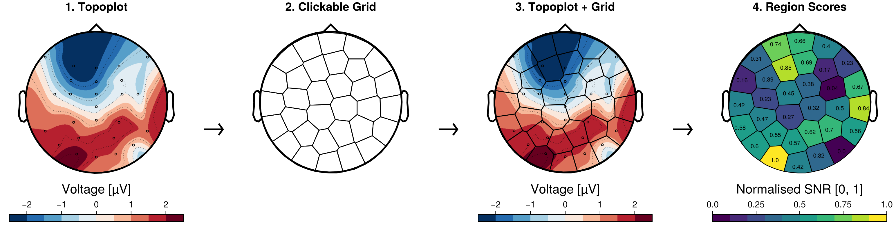
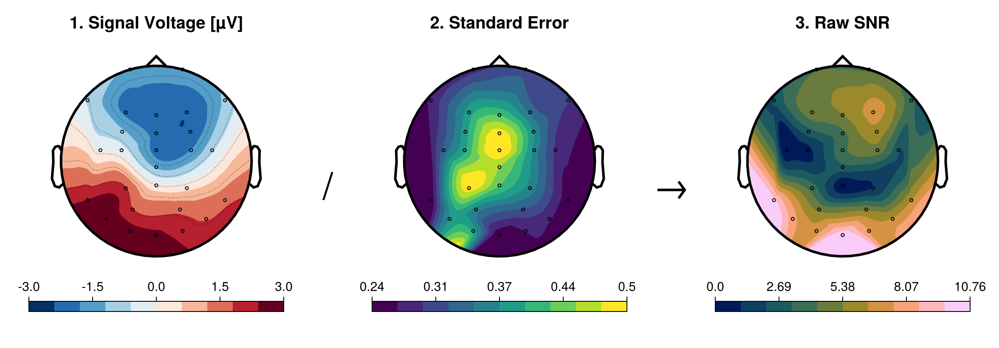
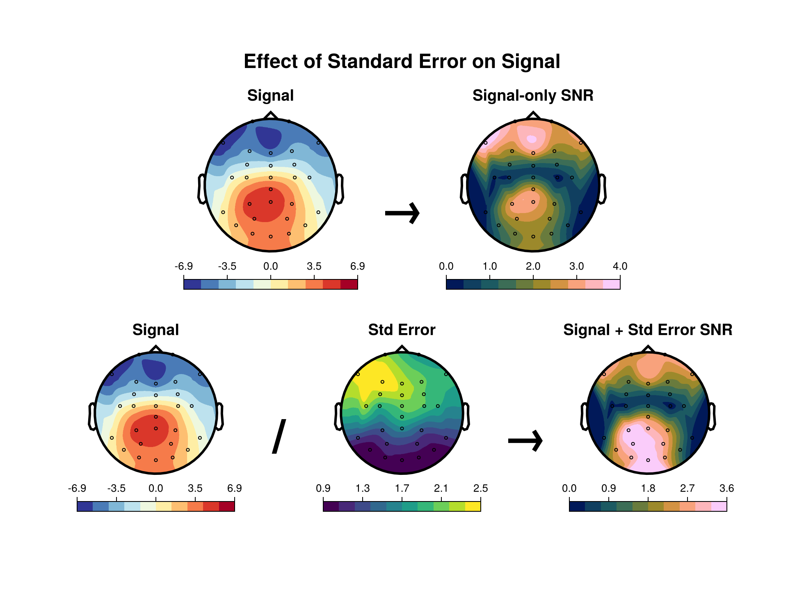
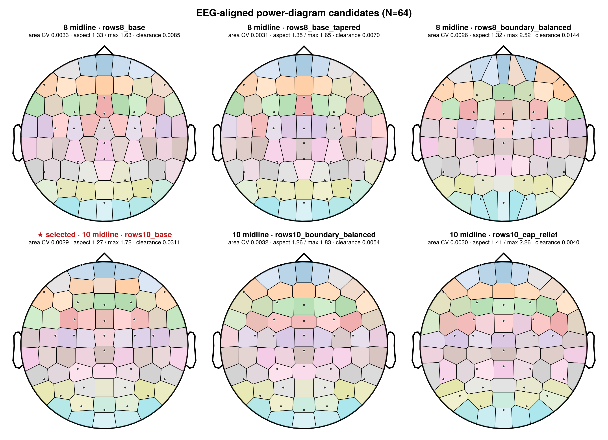
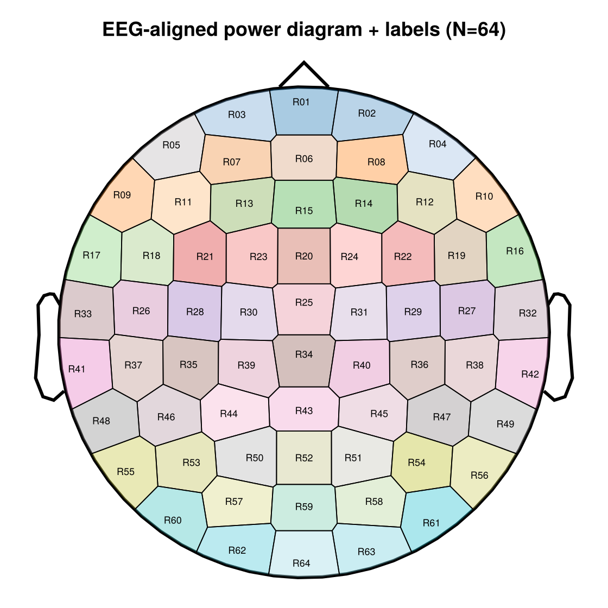
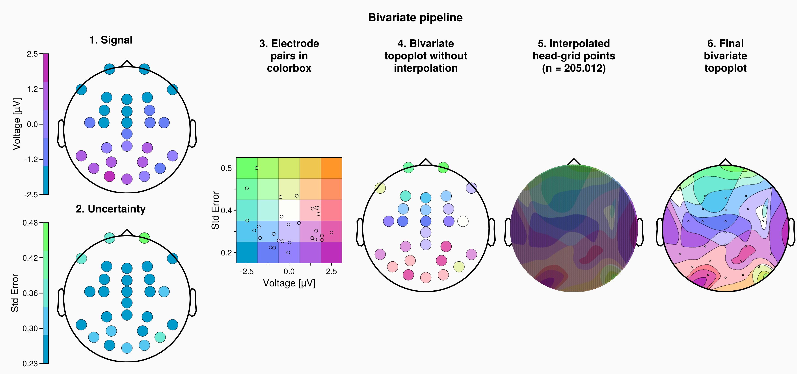

This page shows how the stimuli and the Task 2 scoring were built. The figures were drawn
with UnfoldMakie in the project's worktree (`uncertainty_project/figures/`) and copied
here; they are illustrations of the pipeline, not results.

## Task 2: from a topoplot to region scores

In Task 2, participants clicked one of 64 regions. Each region gets a score from the
signal-to-noise ratio (SNR) of the stimulus: the mean SNR inside the region, rescaled
within each stimulus so that the weakest region scores 0 and the strongest scores 1.

{fig-alt="Four head maps in a row: a voltage topoplot, an empty grid of 64 regions, the grid over the topoplot, and the grid coloured by normalised SNR with a score in each region."}

The SNR divides the absolute voltage by its standard error (SE) at every point of the
head.

{fig-alt="Three head maps: signal voltage, standard error, and raw SNR, connected by a division sign and an arrow."}

## Signal, standard error and SNR

The standard error changes where the strongest signal-to-noise region lies. Without it,
the SNR simply follows the voltage; with it, regions with a large but uncertain voltage
lose weight.

{fig-alt="Head maps of signal and signal-only SNR in the top row, and signal, standard error and signal-plus-standard-error SNR in the bottom row."}

## The 64-region grid

The clickable grid divides the head into 64 regions of equal area, aligned with the
electrode montage. Six candidate layouts were compared on how equal the region areas
are, how elongated the regions are, and how far electrodes sit from region borders; the
layout with ten midline seed points ("rows10_base") was selected.

{fig-alt="Six head-shaped grids of 64 coloured regions in two rows of three, each with its quality metrics; the first grid of the second row is marked as selected."}

The selected grid with its region labels. The labels (R01–R64) are used on the Task 2
and Hit or miss pages.

{fig-alt="A head-shaped grid of 64 coloured regions, each labelled from R01 at the front to R64 at the back."}

## Bivariate maps

The bivariate corner design combines voltage and standard error in one colour. Each
electrode's pair of values is placed in a two-dimensional colour box, and the colours are
then interpolated over the head.

{fig-alt="Six panels showing how electrode voltages and standard errors are mapped to a two-dimensional colour box and interpolated into a bivariate topoplot."}
