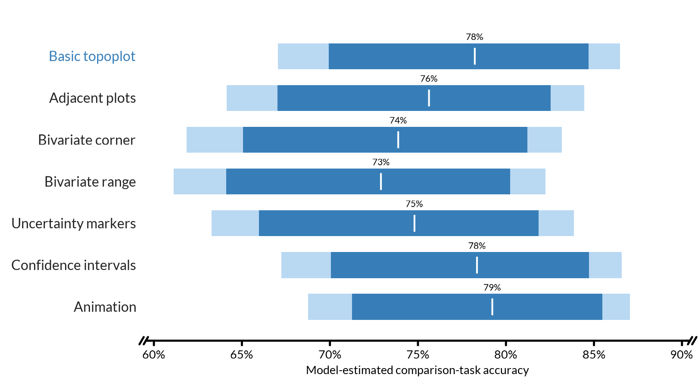
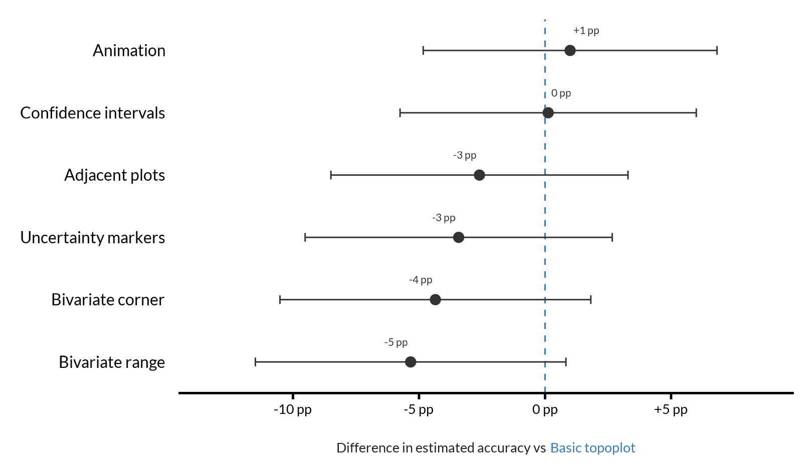
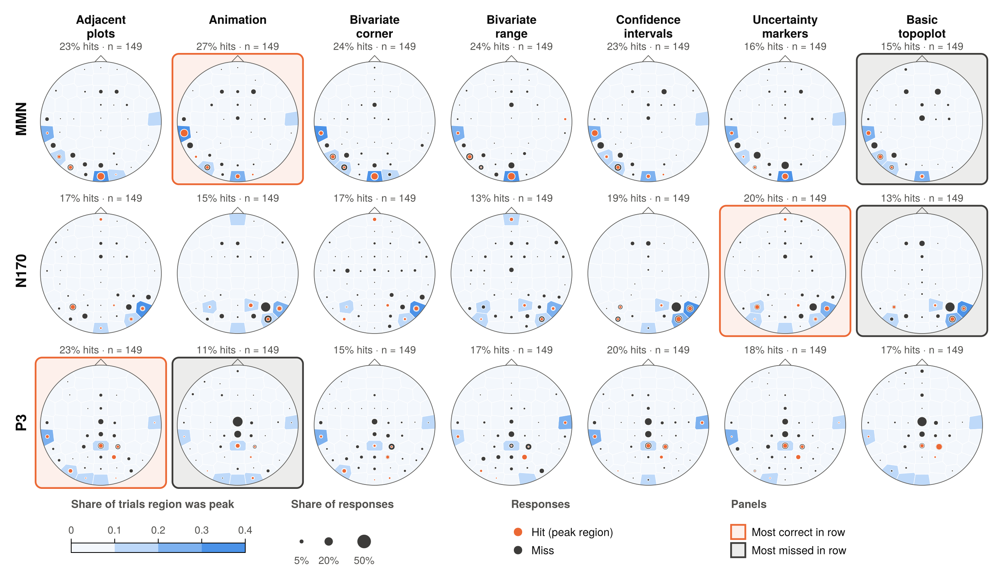
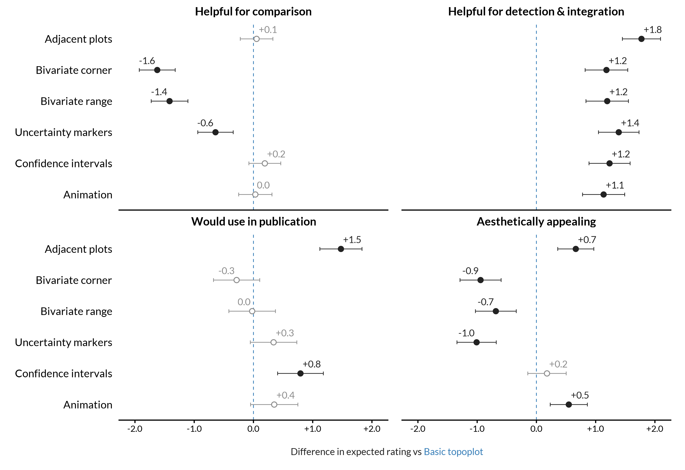
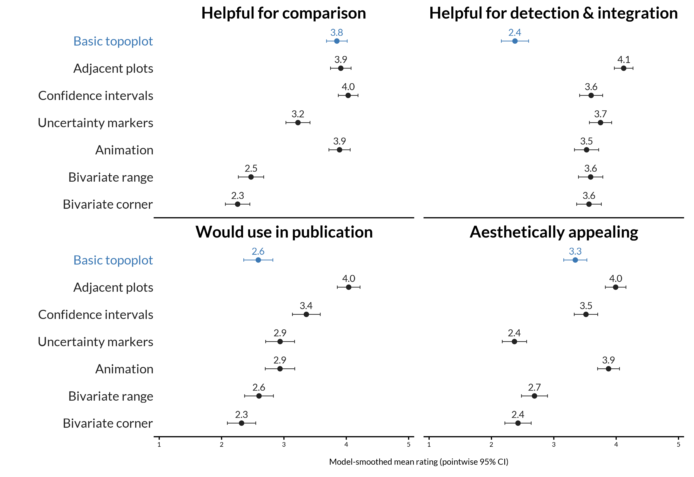

```{r summary-numbers}
#| include: false
#| cache: false
# Numbers that the analysis pages already write to numbers.json; everything else
# is typed from the page named in the HTML comment next to it.
nums <- jsonlite::read_json(file.path("The Art of Uncertain Topoplots", "numbers.json"))
n_participants <- nums$sample$n_participants
n_flagged <- nums$quality$n_flagged
task1_overall_p <- nums$task1$overall_p_all
```

`r n_participants` EEG/ERP researchers worked with seven visualizations. In Task 1 they
compared patterns. In Task 2 they looked for the region with the strongest signal. In
Task 3 they rated the visualizations. Each visualization is compared with **Basic
topoplot**. Every figure has a print PDF below it.

Each finding has a label:

- **Tested:** a statistical test supports it.
- **Descriptive:** we saw it in the data, but did not test it or it was not significant.
- **Interpretation:** our reading of the results.

## At a glance

- Showing uncertainty **did not measurably change task performance**. Accuracy in Task 1
  and detection scores in Task 2 were similar for all seven visualizations.
- Showing uncertainty **cost time**: every uncertainty visualization took longer than
  Basic topoplot in both tasks.
- Participants' **opinions differed much more than their performance**. Adjacent plots
  was rated highest overall; the two bivariate colour maps were rated lowest.

## Who took part

::: {.publication-figures}
{fig-alt="Participant characteristics: stacked bars for self-assessed level and research field, and bar charts of country of work with flags and software used with tool logos."}

::: {.print-pdf}
Print PDF, full width: [participant_characteristics_icons_compact.pdf](../figures/participant_characteristics_icons_compact.pdf)
:::
:::

Details: [Sample](sample.qmd) and [Quality control](quality.qmd).

## RQ1. Pattern comparison: do uncertainty visualizations keep the pattern recognisable?

::: {.publication-figures}
::: {.panel-tabset}
### Estimates

{fig-alt="Two-tone bands of model-estimated comparison accuracy for the seven visualizations, all between about 73% and 79% with widely overlapping intervals; Basic topoplot at 78%."}

::: {.print-pdf}
Print PDF, one column: [comparison_accuracy_ambiguation_figure.pdf](../figures/comparison_accuracy_ambiguation_figure.pdf)
:::

### Differences from Basic topoplot

{fig-alt="Differences in model-estimated comparison-task accuracy relative to Basic topoplot, with simultaneous (max-|z|, six comparisons) 95% confidence intervals."}

::: {.print-pdf}
Print PDF, one column: [comparison_accuracy_contrast_figure.pdf](../figures/comparison_accuracy_contrast_figure.pdf)
:::
:::
:::

**Conclusion.** Adding uncertainty to a topoplot left the spatial pattern about as
recognisable as in the basic map. Participants matched the target pattern correctly in
roughly three of four trials with every visualization.

- **Tested:** the overall test of visualization type was borderline
  (χ²(6) = 12.61, *p* = `r task1_overall_p`), and none of the six adjusted contrasts with
  Basic topoplot excluded zero. <!-- task1: Key findings -->
- **Descriptive:** the two bivariate colour maps had the lowest estimates, Bivariate range
  −5.3 pp (95% CI −11.5 to +0.8) and Bivariate corner −4.3 pp (−10.5 to +1.8).
  <!-- task1: Key findings -->
- **Interpretation:** the intervals are compatible both with no cost and with a moderate
  cost of about 5–10 pp for the bivariate maps. Encodings that mix voltage and uncertainty
  in one colour are the likeliest to blur the pattern, but this study cannot show it.

Details: [Task 1](task1.qmd).

## RQ2. Uncertainty integration: can users find the regions with the strongest signal?

::: {.publication-figures}
::: {.panel-tabset}
### Estimates

![Detection task: expected detection score E[y], averaged over participants, stimuli and images. Dark band: pointwise 95% confidence interval; light ends: 99%; white tick: estimate (one interval per visualization, not adjusted for comparisons).](../figures/detection_score_ambiguation_figure.png){fig-alt="Two-tone bands of expected detection score for the seven visualizations, all between about 68% and 73% with overlapping intervals; Basic topoplot at 71%."}

::: {.print-pdf}
Print PDF, one column: [detection_score_ambiguation_figure.pdf](../figures/detection_score_ambiguation_figure.pdf)
:::

### Differences from Basic topoplot

![Detection task: difference in expected detection score E[y] from Basic topoplot. Bars: Dunnett-adjusted simultaneous 95% confidence intervals for the six comparisons. Dashed line: no difference.](../figures/detection_score_contrast_figure.png){fig-alt="Differences in model-estimated expected detection scores relative to Basic topoplot, with Dunnett-adjusted simultaneous 95% confidence intervals."}

::: {.print-pdf}
Print PDF, one column: [detection_score_contrast_figure.pdf](../figures/detection_score_contrast_figure.pdf)
:::
:::
:::

**Conclusion.** No visualization clearly helped participants combine signal and
uncertainty better than the basic map, which shows no uncertainty at all. What made
detection easy or hard was mainly the stimulus, not the visualization.

- **Tested:** once each image (stimulus × visualization) had its own random intercept,
  the overall test of visualization type on the detection score was not significant
  (χ²(6) = 8.7, *p* = .19). <!-- task2: Key findings -->
- **Descriptive:** expected detection scores ranged only from 67.8% (Bivariate corner)
  to 72.7% (Adjacent plots), with Basic topoplot at 71.2%. Hit rates ranged from 0% to
  70% across the 30 stimuli. <!-- task2: Key findings; hit_miss: Summary -->
- **Interpretation:** the uncertainty displays may help users get *close* to the
  strongest region rather than hit it exactly. A second possibility is that participants
  partly looked for the voltage peak instead of the SNR peak: for 4 of 10 P3 stimuli, the
  most chosen region ranked only 10th–14th by score.

Details: [Task 2](task2.qmd).

### Hits, neighbour hits and runner-up hits

A click is a **hit** when it selects the peak region, a **neighbour hit** when it
selects a region bordering the peak, and a **runner-up hit** when it selects one of the
next four strongest regions (ranks 2–5).

::: {.publication-figures}
::: {.panel-tabset}
#### Model estimates

{fig-alt="Three panels of two-tone bands for the seven visualizations: exact hit about 13% to 22%, hit or neighbour hit about 35% to 46%, hit or runner-up hit about 47% to 56%; all intervals overlap."}

::: {.print-pdf}
Print PDF (vector, scale to full width): [hit_miss_ambiguation_figure.pdf](../figures/hit_miss_ambiguation_figure.pdf)
:::

#### Where participants clicked

{fig-alt="Grid of 21 topoplots, three ERP patterns by seven visualizations, showing where the peak regions were and where participants clicked."}

::: {.print-pdf}
Print PDF, full width: [task2_hits_misses_pattern_by_vistype.pdf](../figures/task2_hits_misses_pattern_by_vistype.pdf)
:::
:::
:::

- **Tested:** no overall test of visualization type was significant: exact hit
  χ²(6) = 8.4, *p* = .21; hit or neighbour hit χ²(6) = 9.3, *p* = .16; hit or runner-up
  hit χ²(6) = 7.4, *p* = .29. <!-- hit_miss: Summary -->
- **Tested, exploratory:** one adjusted contrast excluded no difference: Adjacent plots
  gave more exact hits than Basic topoplot (odds ratio 2.48, 95% CI 1.06–5.83,
  *p* = .032). Because the overall test was not significant, it needs confirmation in
  a new study. <!-- hit_miss: Summary -->
- **Descriptive:** exact hits were rare for every visualization (15%–21%), though far
  above chance (1.6%). Counting neighbour hits, Uncertainty markers landed on or next to
  the peak most often (49% of responses) and Basic topoplot least often (38%).
  Runner-up hits ranged from 27% (Bivariate corner) to 37% (Confidence intervals),
  against 6.6% by chance. <!-- hit_miss: Overview and Summary -->

### Centre bias (exploratory)

::: {.publication-figures}
{fig-alt="Head-shaped map of the 64 clickable regions. Regions on the midline and in the centre are green; most regions along the front and side edges are brown."}

::: {.print-pdf}
Print PDF (vector, scale to column width): [centre_bias_head_map.pdf](../figures/centre_bias_head_map.pdf)
:::
:::

- **Descriptive:** 26 of the 30 stimuli had their peak on the border of the head, yet
  border regions received only 36% of the clicks, about their share of the grid; the
  centre ring, which held no peak, received 16%. <!-- hit_miss: Centre bias -->
- **Tested, exploratory:** for regions with the same score, a border region received
  0.23 times as many clicks as an interior one (95% CI 0.20–0.28). Every visualization
  showed this, from 0.12 (Uncertainty markers) to 0.49 (Bivariate corner).
  <!-- hit_miss: Centre bias -->
- **Interpretation:** participants either avoided the edge of the map or, as EEG
  researchers, distrusted maxima there, where the values are extrapolated beyond the
  outermost electrodes. Either way, this centre bias likely explains much of why exact
  hits were rare, because most peaks lay on the border.

Details: [Hit or miss](hit_miss.qmd).

## RQ3. Subjective evaluation: how do users judge the approaches?

::: {.publication-figures}
::: {.panel-tabset}
### Differences from Basic topoplot

{fig-alt="Four panels of rating differences from Basic topoplot. Helpful for detection: all six above zero. Helpful for comparison: the bivariate maps and uncertainty markers below zero. Publication: adjacent plots and confidence intervals above zero. Aesthetics: adjacent plots and animation above zero, the bivariate maps and uncertainty markers below."}

::: {.print-pdf}
Print PDF, full width: [likert_contrast_figure.pdf](../figures/likert_contrast_figure.pdf)
:::

### Estimates

{fig-alt="Expected ratings (typical participant) for helpfulness for comparison, helpfulness for detection and integration, likelihood of use in a publication or presentation, and aesthetic appeal."}

::: {.print-pdf}
Print PDF, full width: [likert_estimate_figure.pdf](../figures/likert_estimate_figure.pdf)
:::
:::
:::

**Conclusion.** Participants clearly wanted uncertainty for detection, but not at the
price of a harder-to-read map. Designs that keep the familiar voltage map intact
(Adjacent plots, Confidence intervals) were preferred. Designs that alter its colours
or cover it (the bivariate maps, Uncertainty markers) were penalised for comparison and
appearance.

- **Tested:** all six uncertainty visualizations were rated more helpful for detection
  than Basic topoplot (+1.13 to +1.77 points on the 1–5 scale). For comparison, the
  bivariate maps (−1.62 corner, −1.42 range) and Uncertainty markers (−0.64) were rated
  less helpful. <!-- subjective: Summary -->
- **Tested:** only Adjacent plots (+1.48) and Confidence intervals (+0.79) were more
  likely to be used in a publication than Basic topoplot. Adjacent plots (+0.66) and
  Animation (+0.55) were rated more appealing; Uncertainty markers (−1.01), Bivariate
  corner (−0.94) and Bivariate range (−0.68) less appealing. <!-- subjective: Summary -->
- **Tested:** these conclusions held without the `r n_flagged` flagged participants and in
  a linear mixed model (24 of 24 contrasts unchanged). <!-- subjective: Summary -->
- **Interpretation:** ratings and comments agree with each other but not with
  performance. Preferences therefore reflect familiarity and reading effort more than
  measurable accuracy; they still matter, because a display that researchers will not use
  communicates nothing.

Details: [Subjective evaluation](subjective.qmd).

### What participants wrote

::: {.publication-figures}
{fig-alt="Matrix of 13 evaluation themes by seven visualizations. Each commented cell is coloured by the median intensity and holds one dot per participant in five rows from +2 to −2. Bivariate corner interpretability is a single row of dots at −2; Animation interpretability has dots both at −2 and at +2."}

::: {.print-pdf}
Print PDF (vector, scale to full width): [a305_intensity_distribution_figure.pdf](../figures/a305_intensity_distribution_figure.pdf)
:::
:::

- **Descriptive:** 70 participants commented. Feedback was mostly positive for Adjacent
  plots (29 positive, 4 negative) and Confidence intervals (22, 4), mixed for Uncertainty
  markers (20, 30) and Animation (16, 20), and mostly negative for Bivariate corner (10,
  28). By theme: <!-- feedback: Summary; counts: feedback page, distribution matrix -->
  - *Interpretability:* nearly unanimous for two designs. 10 of the 11 participants who
    discussed Bivariate corner gave the strongest negative rating, and all 7 who discussed
    Adjacent plots were positive. Animation split opinion: 9 negative, 4 strongly positive.
  - *Preference:* Adjacent plots (6 of 7) and Confidence intervals (6 of 6) were
    preferred.
  - *Aesthetics:* 13 of the 14 participants who discussed the look of Uncertainty markers
    were negative.
  - *Medium compatibility* (suitability for print, papers and talks): 7 of the 11
    participants who discussed Animation were negative, but its ratings spanned the whole
    scale.
- **Interpretation:** where the comments split, the median hides real disagreement.
  Animation divides participants rather than leaving them lukewarm, so whether to use it
  depends on the audience and the medium.

Details: [Open-ended feedback](feedback.qmd).

## Completion time

::: {.publication-figures}
{fig-alt="Two panels of time ratios to Basic topoplot. Comparison task: all six above 1, from 1.12 to 1.39. Detection task: all six above 1, from 1.28 to 1.59. Bivariate corner is slowest in both."}

::: {.print-pdf}
Print PDF, full width: [time_ratio_figure.pdf](../figures/time_ratio_figure.pdf)
:::
:::

- **Tested:** every uncertainty visualization took longer than Basic topoplot (about 10 s
  per trial) in both tasks: 12%–39% longer in Task 1 and 28%–59% longer in Task 2.
  Bivariate corner was the slowest in both tasks (×1.39 and ×1.59).
  <!-- time: Summary -->
- **Interpretation:** the extra time is the cost of reading a second quantity. It was
  not repaid by higher accuracy, so it is best spent where uncertainty changes a
  decision.

Details and figures: [Time analysis](time.qmd).

## Recommendations

The recommendations combine the performance results, the ratings and the comments. Since
performance hardly differed, they rest mainly on time, ratings and comments, and are
therefore **interpretations**.

| Visualization | Strengths | Limitations | Suitable use |
|---|---|---|---|
| Basic topoplot | Fastest to read; familiar; pattern comparison as good as any alternative | Shows no uncertainty; rated least helpful for detection | Quick overviews and pattern comparison when uncertainty is reported elsewhere |
| Adjacent plots | Highest ratings for detection, publication and appeal; mostly positive comments; most exact hits (exploratory) | About 40% slower; two maps to compare region by region | Default choice for papers and reports that show uncertainty |
| Bivariate corner | Single compact map | Lowest rating for comparison, low appeal; slowest; mostly negative comments, on interpretability and the colour legend | Not recommended for EEG/ERP topoplots |
| Bivariate range | Single compact map that keeps the cool–warm polarity | Rated less helpful for comparison and less appealing; lowest Task 1 estimate† | Only when space allows one map; prefer it to the corner version |
| Uncertainty markers | Keeps the voltage colours; most hits or neighbour hits†; rated helpful for detection | Rated least appealing; markers cover the map; less helpful for comparison | Exploratory analysis of where an effect is reliable |
| Confidence intervals | Highest rating for comparison†; rated more likely to be used in publications; mostly positive comments | Three maps; shows ±1 SE, which must be stated | Papers and teaching where the range of plausible maps matters |
| Animation | Rated more appealing; helpful for detection | Does not suit print; comments found it hard to interpret and unsuited to papers | Talks, web pages and teaching, not print |

† Not significantly different from Basic topoplot.

<!-- Sources: subjective, feedback, time, task1, task2 and hit_miss summaries. "Three
maps" and "±1 SE": manuscript, Design Space. -->

## Limits of these conclusions

- The stimuli were 30 sampled ERP topographies, ten per pattern. The results generalise
  to new data only as far as these represent the topographies researchers encounter.
- "No clear difference" does not mean "no difference": with `r n_participants`
  participants, the intervals still allow differences of several percentage points in
  accuracy and score.
- The rating items listed the visualizations in the same order for every participant
  (Basic topoplot last), so order effects cannot be separated from preferences.
- The open-ended comments were coded by language models and have not yet been checked by
  a human coder; their counts are provisional.
- The Task 2 score rewards the SNR peak; where participants aimed for the voltage peak,
  the score may understate their performance.
