Findings move here from [Figures vs Wilke](figures-wilke.md) once the figure is
fixed. IDs keep their review numbers.

| | Issue | Figures | Fixed on |
|--|------------------|----|----|
| [High]{.badge .sev-high} | [V3. Hit/miss "most correct / most missed" frames highlight noise and ties](#v3) | Hit or miss | 25 Nov 2026 |
| [Low]{.badge .sev-low} | [V17d. Task 2 peak contrasts: open circles, alphabetical order](#v17d) | Task 2 | 25 Nov 2026 |
| [Low]{.badge .sev-low} | [V17e. Task 2 score histogram looks like a comb](#v17e) | Task 2 | 25 Nov 2026 |
| [Low]{.badge .sev-low} | [V17h. Sample charts: the same "1%" for different bars](#v17h) | Sample | 25 Nov 2026 |
| [Low]{.badge .sev-low} | [V17i. Reduced figure: country labels larger than the rest](#v17i) | Sample | 25 Nov 2026 |
| [Moderate]{.badge .sev-moderate} | [V14. Logo labels carry unequal visual weight](#v14) | Sample | 25 Nov 2026 |
| [Low]{.badge .sev-low} | [V17b. Rating contrast labels on the zero line](#v17b) | Subjective | 25 Nov 2026 |
| [Low]{.badge .sev-low} | [V17c. Rating contrast figure: red for gains and losses alike](#v17c) | Subjective | 25 Nov 2026 |
| [Low]{.badge .sev-low} | [V17f. Task 1 gradient plot: mean labels touch the band](#v17f) | Task 1 | 25 Nov 2026 |
| [Low]{.badge .sev-low} | [V17g. Sample experience chart: Beginner on top](#v17g) | Sample | 25 Nov 2026 |
| [Moderate]{.badge .sev-moderate} | [V11. Boxplots for 3–10 ordinal values](#v11) | Feedback | 25 Nov 2026 |
| [Moderate]{.badge .sev-moderate} | [V16. Time violin: alphabetical, rotated labels, no task in title](#v16) | Time | 25 Nov 2026 |
| [Moderate]{.badge .sev-moderate} | [V15. Compact figure: nominal field on a sequential ramp](#v15) | Sample | 25 Nov 2026 |
| [Moderate]{.badge .sev-moderate} | [V8. No time contrast-vs-Basic figure](#v8) | Time | 25 Nov 2026 |
| [Low]{.badge .sev-low} | [V17a. Time-position checks: tiny ticks, no ribbon, linear axis](#v17a) | Time | 24 Nov 2026 |
| [Low]{.badge .sev-low} | [V17j. Two typefaces across the figures](#v17j) | All pages | 24 Nov 2026 |
| [Moderate]{.badge .sev-moderate} | [V10. One score, several names and units](#v10) | Task 2 | 24 Nov 2026 |
| [Moderate]{.badge .sev-moderate} | [V12. Hit/near-miss bars show no uncertainty](#v12) | Hit or miss | 24 Nov 2026 |
| [Low]{.badge .sev-low} | [V18. Orphaned figure files in `pages/*_files`](#v18) | Project | 24 Nov 2026 |
| [High]{.badge .sev-high} | [V2. Text sizes are unbalanced at final size](#v2) | Ratings, Task 2, Time, Feedback | 24 Nov 2026 |
| [Moderate]{.badge .sev-moderate} | [V7. Publication figures: 180-dpi PNG, in-figure titles and subtitles](#v7) | `figures/` | 24 Nov 2026 |
| [Moderate]{.badge .sev-moderate} | [V13. Country map is a choropleth of raw counts](#v13) | Sample | 24 Nov 2026 |
| [Moderate]{.badge .sev-moderate} | [V5. Visualization names differ between figures](#v5) | All pages | 24 Nov 2026 |
| [Moderate]{.badge .sev-moderate} | [V6. Basic topoplot is highlighted only in some figures](#v6) | All pages | 24 Nov 2026 |
| [High]{.badge .sev-high} | [V4. Feedback panels re-sort the visualizations in each panel](#v4) | Feedback | 24 Nov 2026 |
| [Moderate]{.badge .sev-moderate} | [V9. Task 2 gradient plot sorted by median, shows means](#v9) | Task 2 | 23 Nov 2026 |

: {.findings-table}

## V3. Hit/miss "most correct / most missed" frames highlight noise and ties {#v3}

::: {.finding-meta .sev-high .status-resolved}
**Severity:** High · **Fixed:** 25 Nov 2026 · **Figures:** `figures/task2_hits_misses_stimulus_by_vistype.png`, `task2_hits_misses_pattern_by_vistype.png` · **Principle:** ch. 16 (no differences without uncertainty); ch. 4 (keep the accent for real emphasis)
:::

**Problem.**

- **Row P3_16 (checked):** every panel has 0% hits, yet Confidence intervals is framed
  "Most correct in row" and Basic topoplot "Most missed in row".
- **Rows MMN_1 and N170_12:** one "most missed" panel is framed out of several tied at
  0%.
- **Cell sizes:** cells hold n = 7–26, so these winners are mostly noise.
- **Pattern grid:** it singles out differences such as 16% vs 12%.

**Fix.**

- Preferred: remove the frames.
- Otherwise:
  - name the metric (hit rate or mean score);
  - skip rows where the extreme value is tied;
  - print n or an interval.

The plotting code is in the UnfoldMakie worktree
(`uncertainty_project/working/task2_results/plot_task2_hits_misses.jl`).

**Resolution (25 Nov 2026).** The frames are removed (the preferred fix): no panel is
marked as most correct or most missed, and the legend's "Panels" block is gone. Each
panel's subtitle keeps its hit rate and n. In the plotting script the frames are behind
one switch (`T2_SHOW_MARKS = false`), so they can be restored. The Hit or miss page text
now says why no panel is singled out.

::: {layout-ncol=2}
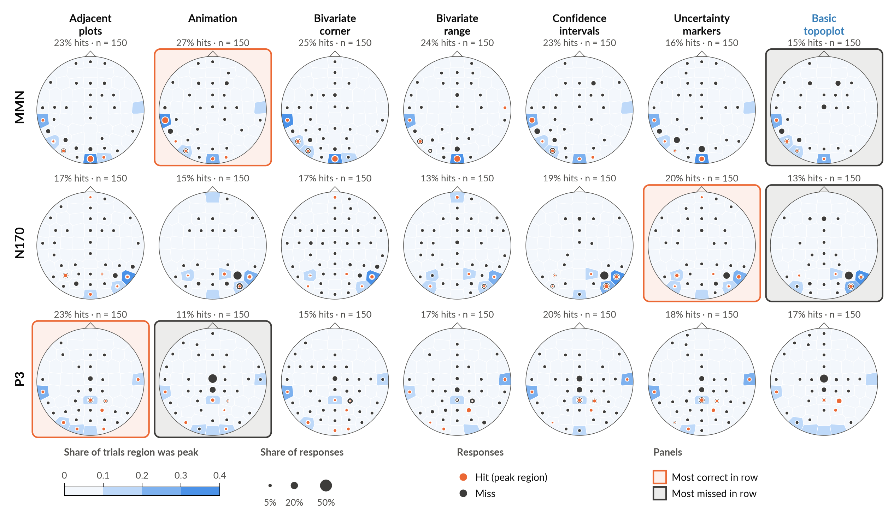{fig-alt="Hit/miss pattern grid with frames, before"}

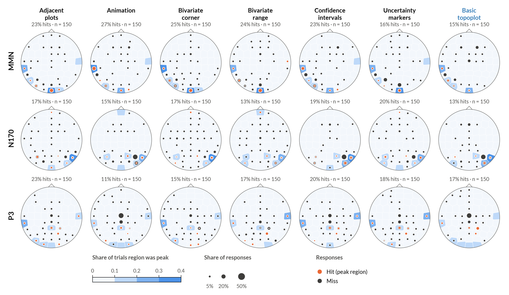{fig-alt="Hit/miss pattern grid without frames, after"}
:::

::: {layout-ncol=2}
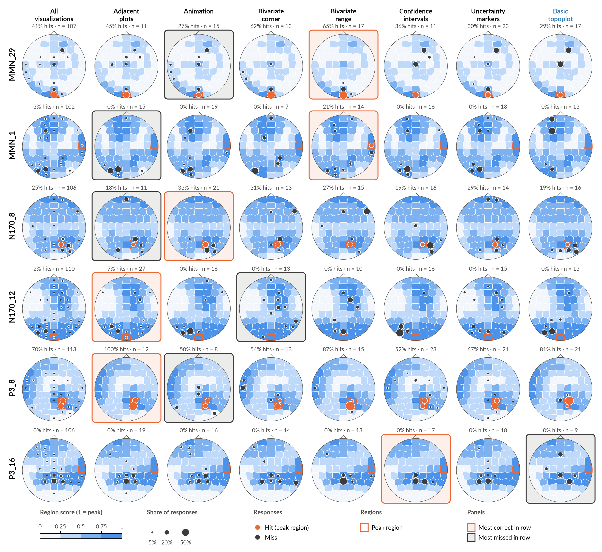{fig-alt="Hit/miss stimulus grid with frames, before"}

{fig-alt="Hit/miss stimulus grid without frames, after"}
:::

## V17d. Task 2 peak contrasts: open circles, alphabetical order {#v17d}

::: {.finding-meta .sev-low .status-resolved}
**Severity:** Low · **Figure:** `task2-peak-contrast-figure` (Task 2) · **Fixed:** 25 Nov 2026
:::

**Problem.** Open circles and alphabetical order (ch. 25, V1). Part of the smaller issues (V17).

**Fix.** Same neutral encoding as [V17c](#v17c): a filled dark point and bar when the
Dunnett-adjusted interval excludes zero, an open point with a grey bar when it includes
zero; no red. Rows follow the Task 2 contrast figure on the same page (highest expected
score at the top) in all three panels; one order for all figures is still open
([V1](figures-wilke.md#v1)). In-figure caption: "Filled points: Dunnett-adjusted 95%
confidence interval excludes zero; open grey points: interval includes zero." The table
above the figure still marks such intervals in dark red, like the other tables.

::: {layout-ncol=2}
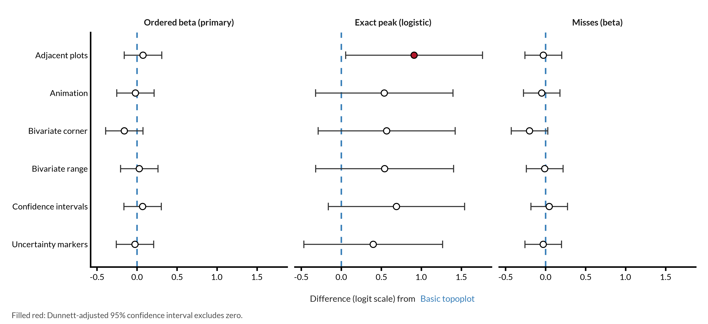{fig-alt="Task 2 peak contrast figure, before"}

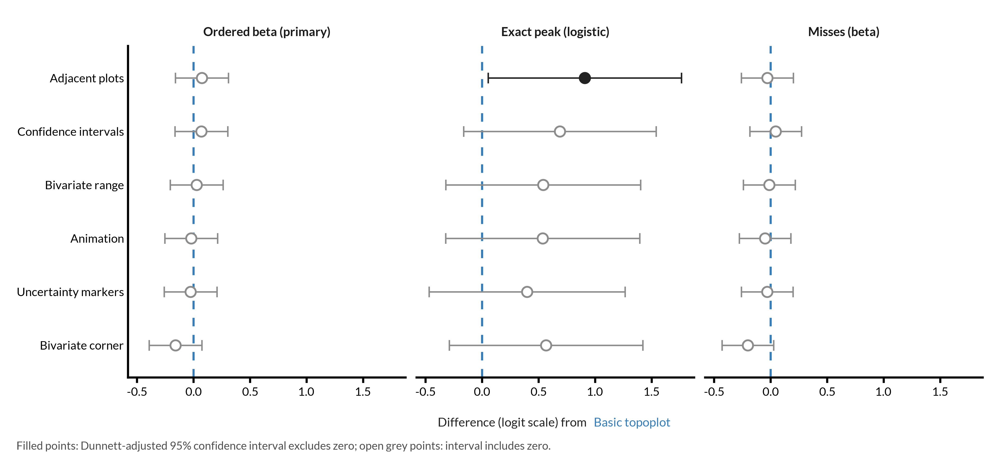{fig-alt="Task 2 peak contrast figure, after"}
:::

## V17e. Task 2 score histogram looks like a comb {#v17e}

::: {.finding-meta .sev-low .status-resolved}
**Severity:** Low · **Figure:** `task2-score-distribution` (Task 2) · **Fixed:** 25 Nov 2026
:::

**Problem.** The 0.01-bin histogram looks like a comb (ch. 7–8). Part of the smaller issues (V17).

**Fix.** A cumulative distribution (ECDF) in a first tab, one step line per visualization,
Basic topoplot in blue on top and the other six in greys, with a legend ordered like the
lines near 100%; the histogram stays in a second tab. The six greys are hard to tell
apart where the lines overlap; the figure mainly contrasts Basic with the rest.

::: {layout-ncol=2}
{fig-alt="Task 2 score distribution, before"}

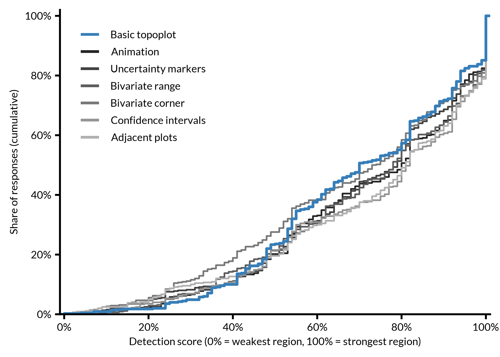{fig-alt="Task 2 score distribution, after"}
:::

## V17h. Sample charts: the same "1%" for different bars {#v17h}

::: {.finding-meta .sev-low .status-resolved}
**Severity:** Low · **Figure:** all-tools chart, full participant figure, continent chart (Sample) · **Fixed:** 25 Nov 2026
:::

**Problem.** Bars of different lengths carried the same "1%" label (for example 1.4% and
0.7%) (ch. 22). Part of the smaller issues (V17).

**Fix.** Values that round below 2% get one decimal (shared helper `percent_label()`):
the all-tools chart now shows 1.3% and 0.7%, the full participant figure 1.4%, 1.3% and
0.7%, and the continent chart 1.4% for Oceania. The all-countries chart needed no change:
it already merges the smallest countries into "1 respondent" and "2 respondents" rows.

::: {layout-ncol=2}
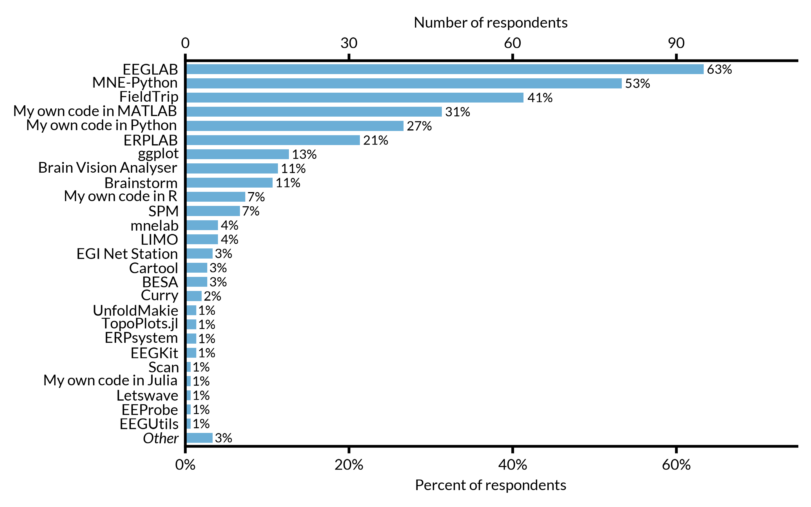{fig-alt="All tools chart, before"}

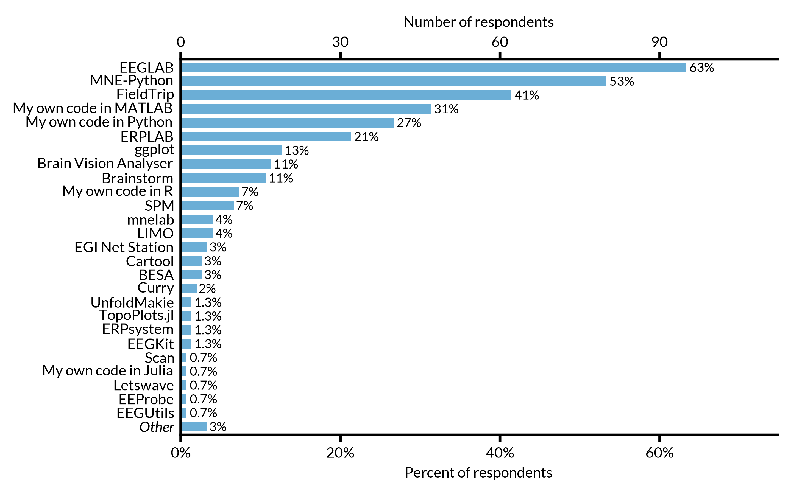{fig-alt="All tools chart, after"}
:::

## V17i. Reduced figure: country labels larger than the rest {#v17i}

::: {.finding-meta .sev-low .status-resolved}
**Severity:** Low · **Figure:** reduced participant figure (Sample) · **Fixed:** 25 Nov 2026
:::

**Problem.** The country panel's labels were larger than the other panels' labels (ch. 21).
Part of the smaller issues (V17).

**Fix.** The country panel's axis labels now have the same size as the other panels
(site version; the print version already used 8 pt throughout).

::: {layout-ncol=2}
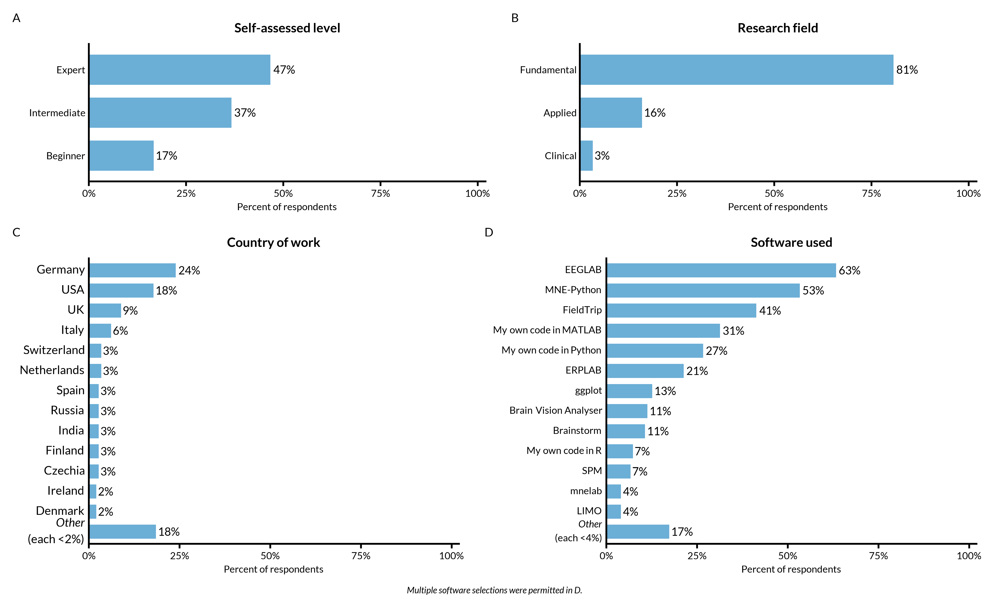{fig-alt="Reduced participant figure, before"}

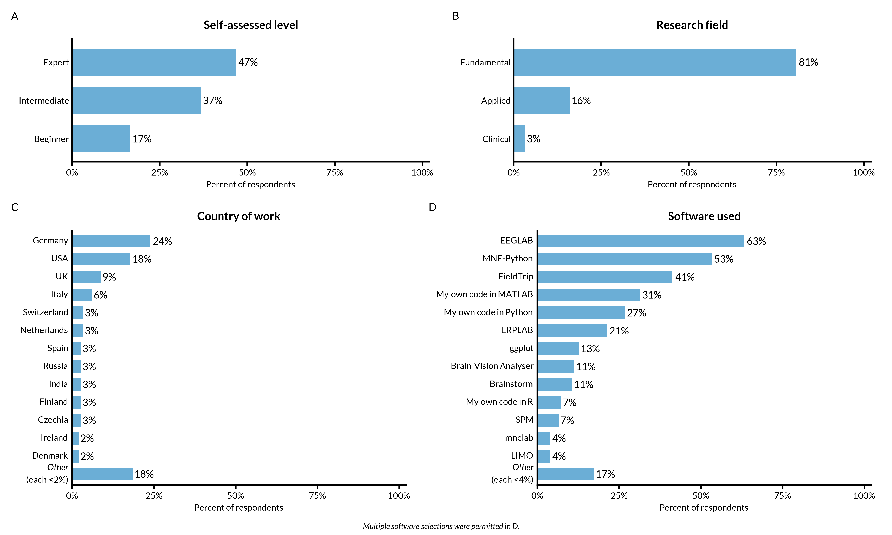{fig-alt="Reduced participant figure, after"}
:::

## V14. Logo labels carry unequal visual weight {#v14}

::: {.finding-meta .sev-moderate .status-resolved}
**Severity:** Moderate · **Fixed:** 25 Nov 2026 · **Figures:** `participant-characteristics-icons-figure`, `-icons-compact`, `software-reduced-logos` · **Principle:** ch. 29 "Add distinctiveness without sacrificing quick comprehension"; ch. 4, ch. 19
:::

**Problem.**

- The logos differ in visual weight in ways unrelated to the data: multicolour MNE, the
  red BrainVision block, the dark Brainstorm block.
- Some logos are harder to read than plain names ("erplab", the R logo with an
  asterisk).

**Fix.** Keep text labels for the journal, as in the reduced figure. The logo version
can stay on the web as an extra.

**Resolution (25 Nov 2026).** The Sample page's "Figure with icons" now opens with the
compact layout ("(alternative)" dropped) and has a third tab with the same compact
figure in plain text labels: country names, and "MATLAB (own code)" etc. for the "My
own code in …" answers, so no asterisk is needed. The logo version stays on the web.
Open: the exported print PDF (`participant_characteristics_icons_compact.pdf`) is still
the logo version; switch it to text labels if this figure goes into the journal.

::: {layout-ncol=2}
{fig-alt="Compact participant figure, before"}

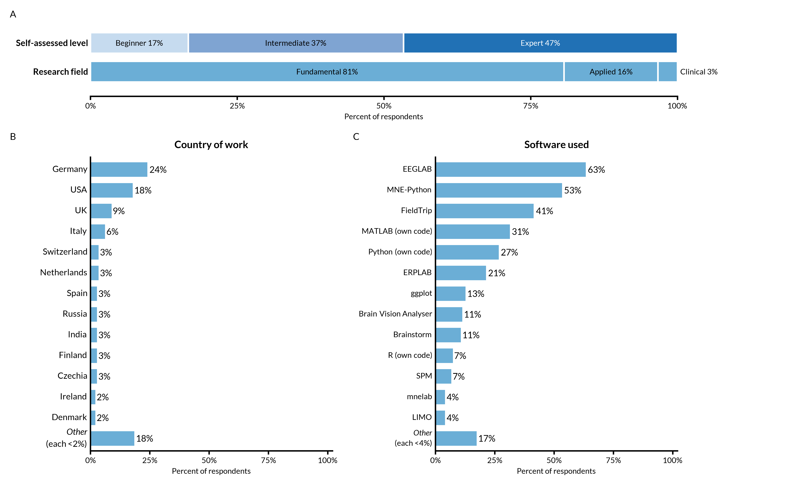{fig-alt="Compact participant figure, after"}
:::

## V17b. Rating contrast labels on the zero line {#v17b}

::: {.finding-meta .sev-low .status-resolved}
**Severity:** Low · **Figure:** rating contrast figure (Subjective, Figures page) · **Fixed:** 25 Nov 2026
:::

**Problem.** The value labels ("+0.1", "0.0", "+0.2") were centred above each point and
overlapped the dashed zero line (ch. 24). Part of the smaller issues (V17).

**Fix.** Each label sits beside its point on the side away from zero, as in the Task 1 and
Task 2 contrast figures. PNG and print PDF re-exported. The after image also shows V17c.

::: {layout-ncol=2}
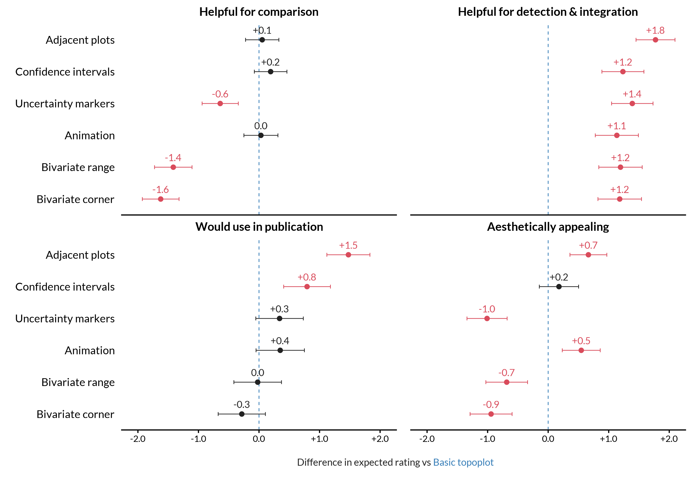{fig-alt="Rating contrast figure labels, before"}

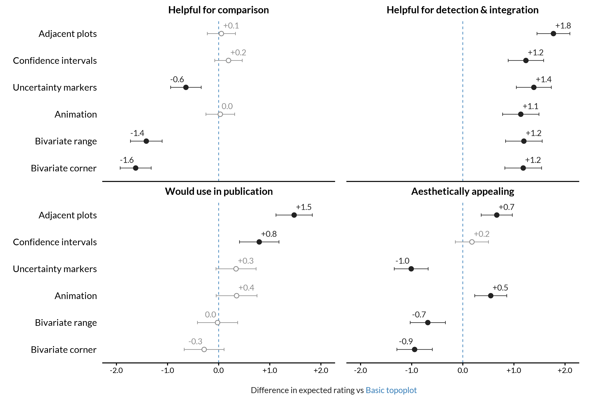{fig-alt="Rating contrast figure labels, after"}
:::

## V17c. Rating contrast figure: red for gains and losses alike {#v17c}

::: {.finding-meta .sev-low .status-resolved}
**Severity:** Low · **Figure:** rating contrast figure (Subjective, Figures page) · **Fixed:** 25 Nov 2026
:::

**Problem.** Red marked "interval excludes zero" for gains and losses alike. Red reads as
"bad", and colour was the only cue (ch. 20, ch. 4). Part of the smaller issues (V17).

**Fix.** Neutral encoding: a filled dark point, bar and label when the interval excludes
zero; an open point with grey bar and label when it includes zero. No red; works in
greyscale. Captions on the Subjective and Figures pages updated ("Filled points: interval
excludes zero; open grey points: interval includes zero").

::: {layout-ncol=2}
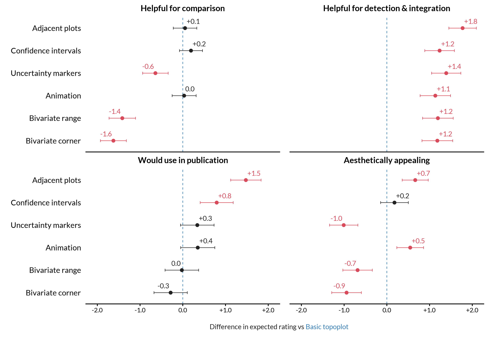{fig-alt="Rating contrast figure colour, before"}

{fig-alt="Rating contrast figure colour, after"}
:::

## V17f. Task 1 gradient plot: mean labels touch the band {#v17f}

::: {.finding-meta .sev-low .status-resolved}
**Severity:** Low · **Figure:** `task1-descriptive-gradient-plot` (Task 1) · **Fixed:** 25 Nov 2026
:::

**Problem.** The mean labels collided with the top of the band (ch. 24); the wrap of
"Confidence intervals" was already fixed under [V5](#v5). Part of the smaller issues (V17).

**Fix.** Each label's baseline now sits clearly above its band and below the band of the
row above it.

::: {layout-ncol=2}
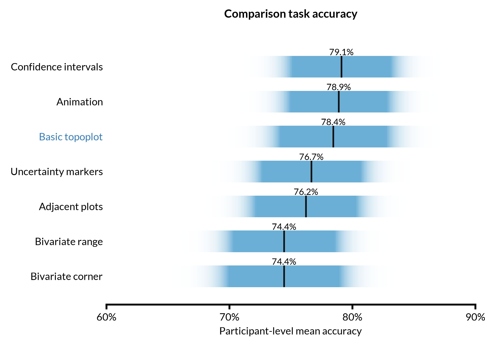{fig-alt="Task 1 gradient plot, before"}

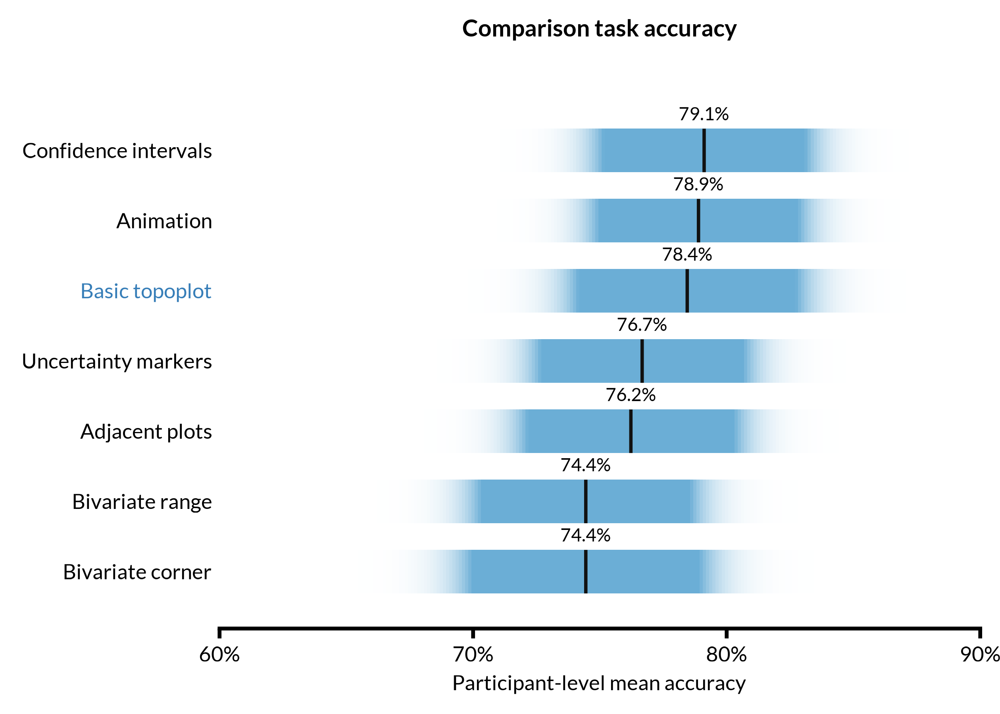{fig-alt="Task 1 gradient plot, after"}
:::

## V17g. Sample experience chart: Beginner on top {#v17g}

::: {.finding-meta .sev-low .status-resolved}
**Severity:** Low · **Figure:** self-assessed level bar chart (Sample) · **Fixed:** 25 Nov 2026
:::

**Problem.** Beginner → Expert ran top to bottom, while the multipanel figures put Expert on
top (ch. 21). Part of the smaller issues (V17).

**Fix.** Expert on top, as in the multipanel figures.

::: {layout-ncol=2}
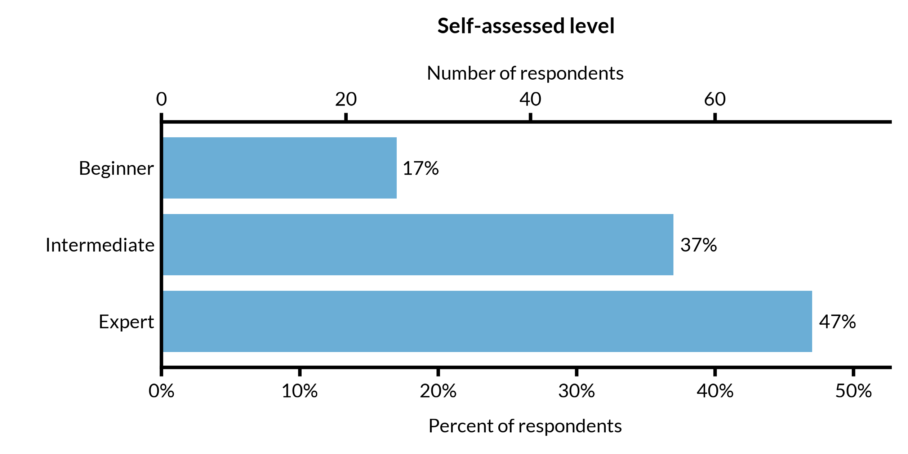{fig-alt="Self-assessed level chart, before"}

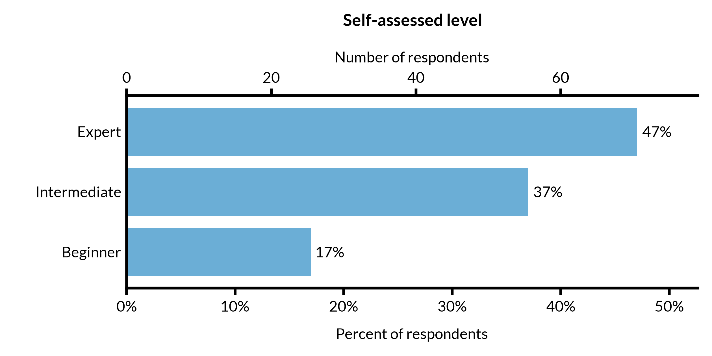{fig-alt="Self-assessed level chart, after"}
:::

## V11. Boxplots for 3–10 ordinal values {#v11}

::: {.finding-meta .sev-moderate .status-resolved}
**Severity:** Moderate · **Fixed:** 25 Nov 2026 · **Principle:** ch. 9 "Show observations when smoothed group shapes may overstate evidence"
:::

**Problem.** The feedback figures draw boxplots for 3–10 values on a 5-point scale. A
box suggests more distributional detail than the data hold.

**Fix.**

- Show the points with a median tick.
- Alternatively, use a theme × visualization matrix: diverging colour for the median
  intensity, with n printed in each cell (ch. 6, ch. 4).
- Also:
  - lighten the boxed strips (ch. 23);
  - add a reference line at 0 (ch. 23);
  - enlarge the caption (ch. 24).

**Resolution (25 Nov 2026).** Both fixes were made, and the Feedback page shows them in
tabs:

- **Theme × visualization matrix (first tab).** Colour: median of the participant-level
  medians, binned in half-point steps (9 colours, brown negative to green positive; blue
  stays the Basic accent). One dot per participant, growing as a square from the
  lower-right corner; "● 1 participant" in the legend; empty cells white. Other tabs
  keep variants for comparison: grey cut-off for 1–2 participants, all cells with n,
  dots centred under the value.
- **Points with a median tick** instead of boxplots, a dashed reference line at 0, light
  grey strips and a larger caption. Cells with 1–2 participants keep faded points and get
  no tick, as they get no median in the table.

::: {layout-ncol=2}
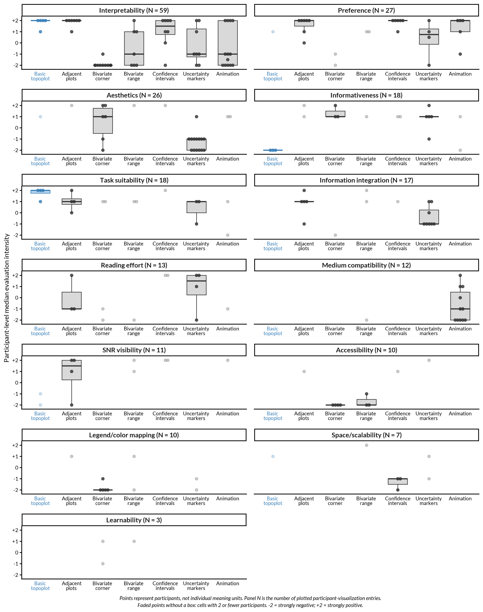{fig-alt="Feedback intensity boxplots, before"}

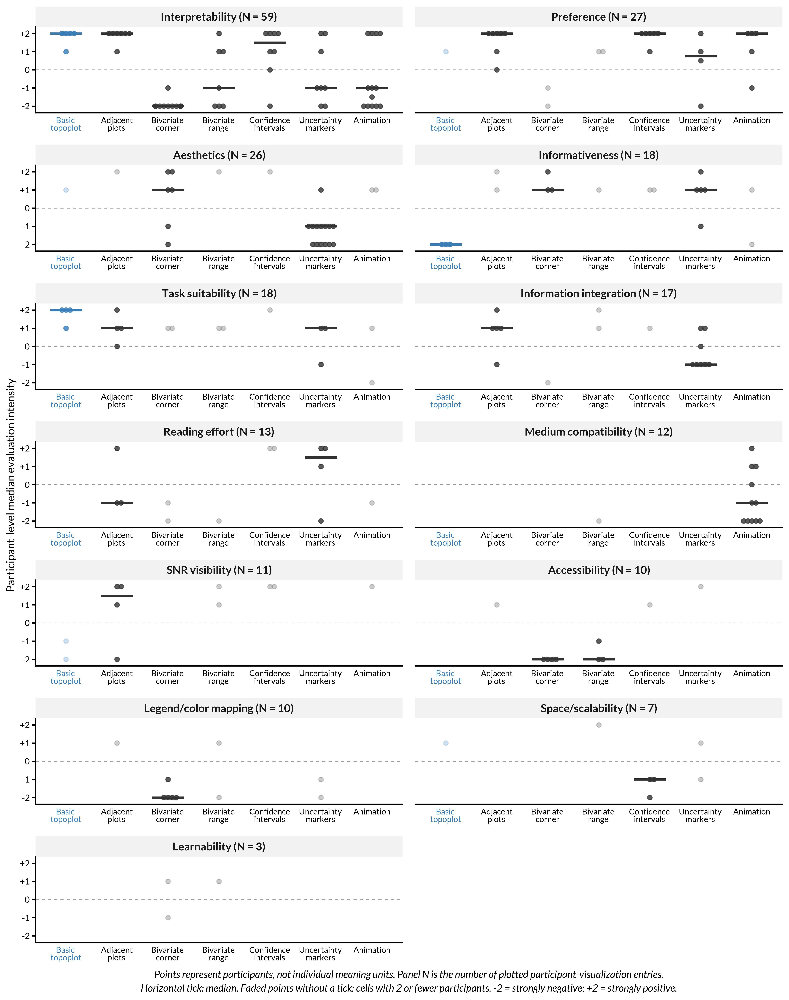{fig-alt="Feedback intensity points with median tick, after"}
:::

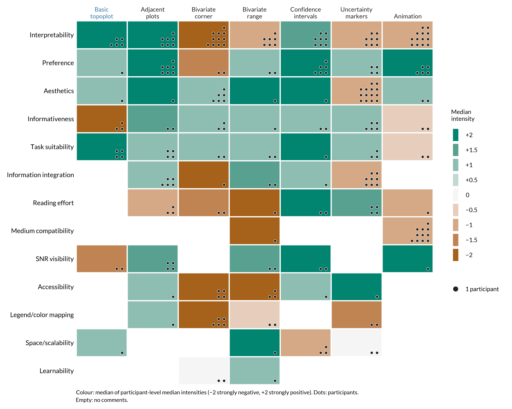{fig-alt="Theme by visualization matrix with binned median colour and one dot per participant"}

## V16. Time violin: alphabetical, rotated labels, no task in title {#v16}

::: {.finding-meta .sev-moderate .status-resolved}
**Severity:** Moderate · **Fixed:** 25 Nov 2026 · **Figure:** `task1-time-violin` · **Principle:** ch. 6 "Turn bars horizontal when category labels are long", "Order categories by a meaningful rule"; ch. 22
:::

**Problem.**

- The violins are in alphabetical order.
- The labels are rotated 35°.
- The title does not name the task.

**Fix.**

- Make the violins horizontal, in the canonical order (V1).
- Title the plot "Comparison task".

The log scale is already right.

**Resolution (25 Nov 2026).** The violins are horizontal, so the labels read without
rotation. Rows follow the time figures below them on the page (observed geometric
mean, slowest at the top); one order for all figures is still open ([V1](figures-wilke.md#v1)).
The title is "Comparison task", the geometric-mean line is now vertical ("Vertical line:
observed geometric mean"), and the log scale is unchanged, now with a tick at 1 s
(a log axis cannot show 0; the shortest trial is just under 1 s). Visualization names are
larger than the tick numbers and the axis title (ch. 24).

::: {layout-ncol=2}
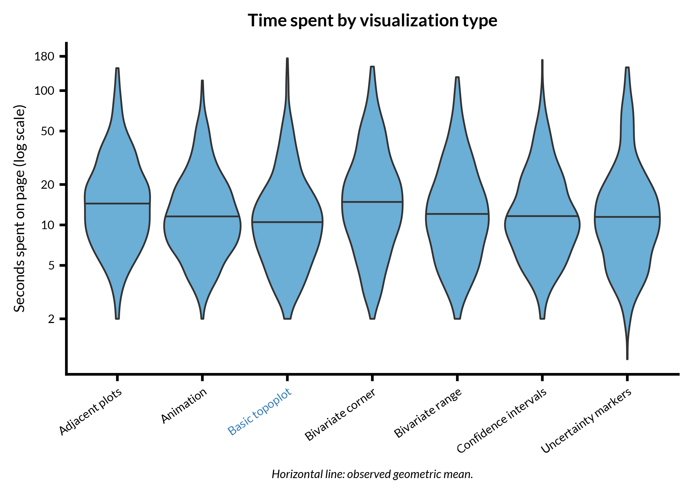{fig-alt="Time violin, vertical and alphabetical, before"}

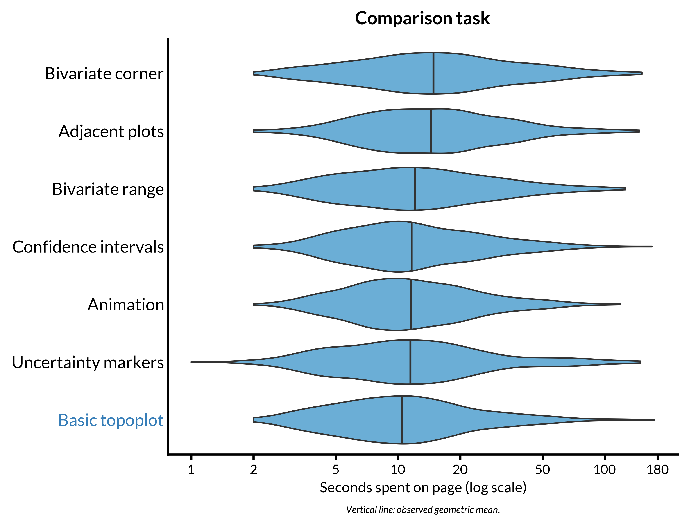{fig-alt="Time violin, horizontal and sorted, after"}
:::

## V15. Compact figure: nominal field on a sequential ramp {#v15}

::: {.finding-meta .sev-moderate .status-resolved}
**Severity:** Moderate · **Fixed:** 25 Nov 2026 · **Figure:** `participant-characteristics-icons-compact`, panel A · **Principle:** ch. 4 "Use equal-prominence colors for unordered categories"
:::

**Problem.** Research field is a nominal variable, but it is coloured light to dark
blue, which implies an order. Self-assessed level is ordered, so its ramp is fine.

**Fix.** Give field a qualitative palette, or a single colour with direct labels.

**Resolution (25 Nov 2026).** Research field is one flat mid-blue (`#6BAED6`, the bar
colour of panels B and C), its segments separated by white gaps and named by their
labels. Self-assessed level keeps its light-to-dark ramp, so only the ordered variable
is shown as ordered. PNG and print PDF re-exported.

::: {layout-ncol=2}
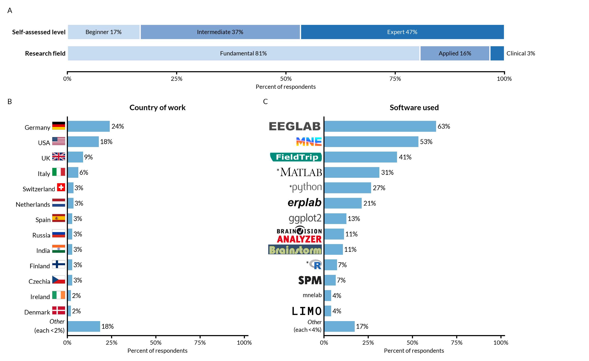{fig-alt="Compact participant figure, field on a blue ramp"}

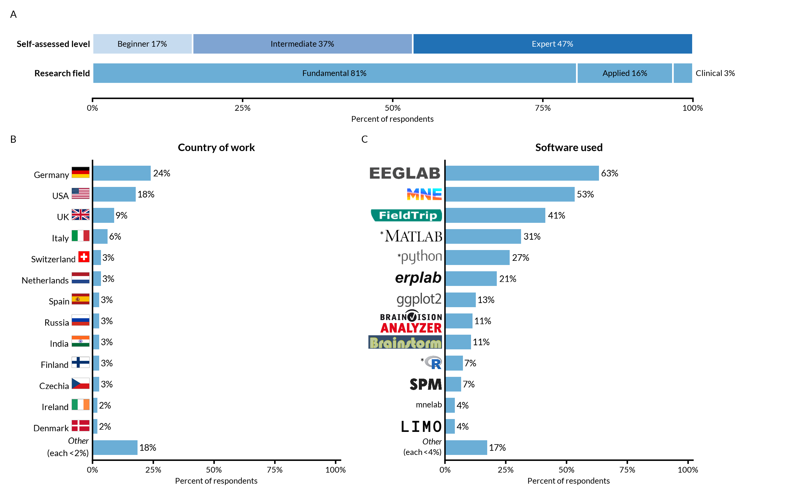{fig-alt="Compact participant figure, field in one mid-blue"}
:::

## V8. No time contrast-vs-Basic figure {#v8}

::: {.finding-meta .sev-moderate .status-resolved}
**Severity:** Moderate · **Fixed:** 25 Nov 2026 · **Principle:** ch. 16 "Plot uncertainty for the comparison you actually want to make"; ch. 3, ch. 17 (log axes start at 1)
:::

**Problem.** The time-estimate plots show intervals for levels and say they are "not
for differences". The Dunnett ratios exist only as tables.

**Fix.** Plot the ratios to Basic with Dunnett CIs on a log axis centred at 1.

**Resolution (25 Nov 2026).** Both tasks on the Time page now have a figure of the
ratios to Basic topoplot with their Dunnett-adjusted 95% CIs, just above the ratio
table. The axis is logarithmic (a ratio and its inverse lie equally far from 1) and
covers only the intervals plus the reference line at 1, so it does not leave an empty
half when all ratios lie above 1; dashed line at 1 in the Basic accent; rows in the order of the estimate figure above (slowest at the top); value
labels on the side away from 1. Same style as the Task 1 contrast figure.

::: {layout-ncol=2}
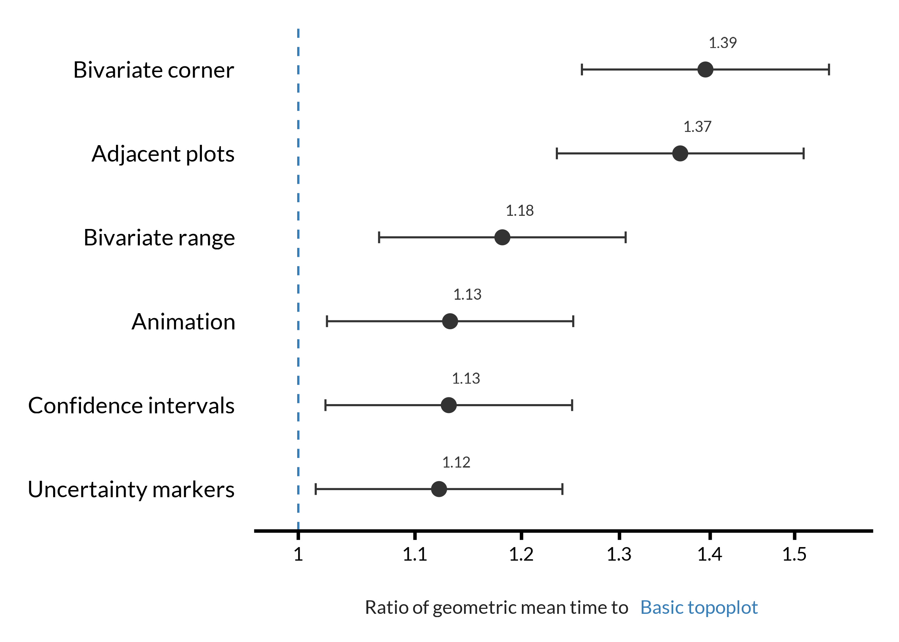{fig-alt="Ratio of geometric mean time to Basic topoplot, comparison task"}

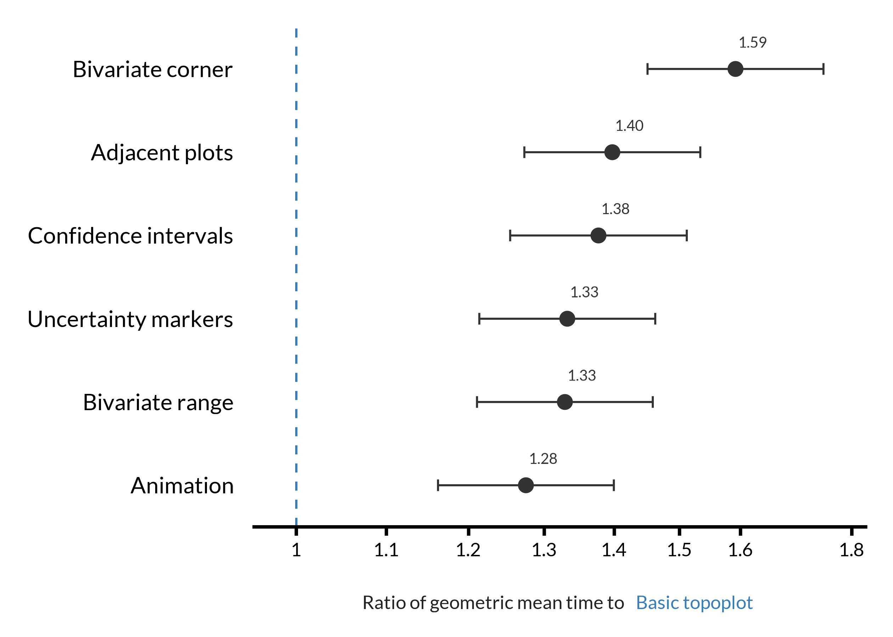{fig-alt="Ratio of geometric mean time to Basic topoplot, detection task"}
:::

## V17a. Time-position checks: tiny ticks, no ribbon, linear axis {#v17a}

::: {.finding-meta .sev-low .status-resolved}
**Severity:** Low · **Figures:** time-position checks (Time page, both tasks) · **Fixed:** 24 Nov 2026
:::

**Problem.** The time-position checks had tiny tick labels, no 95% ribbon around the
line, and a linear axis for geometric means (ch. 24, ch. 16, ch. 3). Part of the
smaller issues (V17).

**Fix.** Larger ticks ([V2](#v2)), a 95% ribbon and a log time axis.

::: {layout-ncol=2}
{fig-alt="Task 1 time-position check, before"}

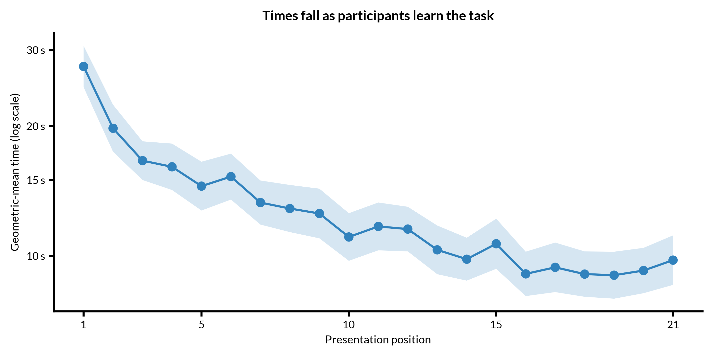{fig-alt="Task 1 time-position check, after"}
:::

## V17j. Two typefaces across the figures {#v17j}

::: {.finding-meta .sev-low .status-resolved}
**Severity:** Low · **Figures:** all · **Fixed:** 24 Nov 2026
:::

**Problem.** The Makie figures used a Helvetica-like font and the R figures used Lato;
each R chunk restated `theme_classic()` (ch. 21, ch. 28). Part of the smaller issues (V17).

**Fix.** `plot_theme()` sets Lato and replaces the 24 restated `theme_classic()` calls;
the Makie figures use Lato (`lato_fonts()`, downloaded into a git-ignored cache).
Figures are unchanged except the two Quality figures, now in Lato.

## V10. One score, several names and units {#v10}

::: {.finding-meta .sev-moderate .status-resolved}
**Severity:** Moderate · **Principle:** ch. 22 "Label quantitative axes … with variables and units"; ch. 21
:::

**Problem.** The same Task 2 score is described differently in different figures:

- The gradient plot is titled "Detection task accuracy", its axis says "score", and its
  values are 0–1 decimals.
- The model figures say "Detection task score" and use %.
- `task2-peak-ppc-figure` labels a difference axis "%" where "pp" is meant.

**Fix.** Use one name and one unit for the score, and "pp" for differences. Define the
fade beyond 95% in the gradient plots, e.g. "fades from 95% to 99.9% confidence"
(ch. 16).

**Resolution (24 Nov 2026).** One name ("detection score") and one unit (%) in every
Task 2 figure, "pp" for differences.

- **Histogram:** axis "Detection score (0% = weakest region, 100% = strongest region)";
  the in-figure title is removed (the caption is the title).
- **Gradient plot:** axis "Detection score (mean of participant means)" in %.
- **PPC figure:** rebuilt as two panels; the share panel keeps %, the difference panel
  shows pp.
- **Fade defined:** the gradient captions (Task 1 and Task 2) say the band is opaque
  inside the 95% interval and fades to transparent between 95% and 100% confidence.

::: {layout-ncol=2}
{fig-alt="Task 2 score histogram, before"}

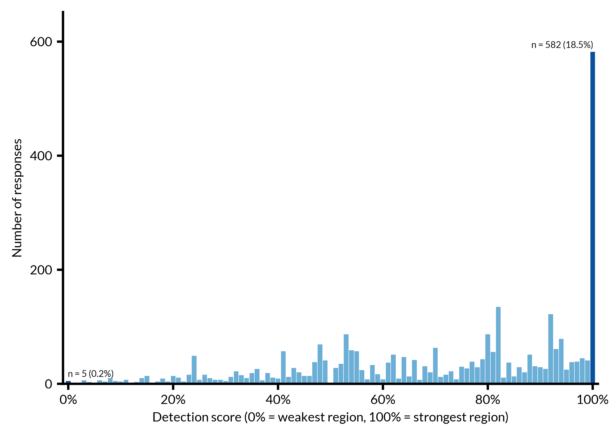{fig-alt="Task 2 score histogram, after"}
:::

::: {layout-ncol=2}
{fig-alt="Task 2 gradient plot, before"}

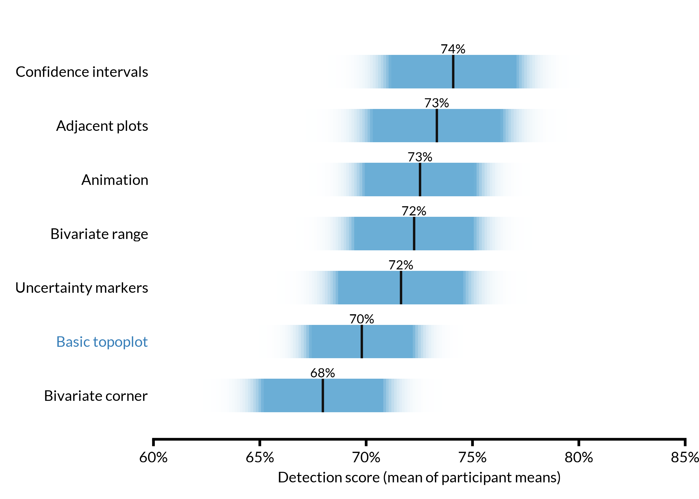{fig-alt="Task 2 gradient plot, after"}
:::

::: {layout-ncol=2}
{fig-alt="Task 2 posterior predictive check, before"}

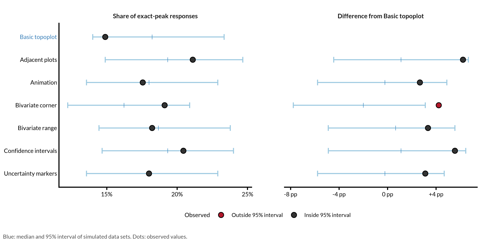{fig-alt="Task 2 posterior predictive check, after"}
:::

## V12. Hit/near-miss bars show no uncertainty {#v12}

::: {.finding-meta .sev-moderate .status-resolved}
**Severity:** Moderate · **Figure:** `figures/task2_hit_near_miss_by_vistype.png` · **Principle:** ch. 16; ch. 19 (dot size)
:::

**Problem.**

- Some differences between bars are 2–5 pp, yet the bars carry no intervals.
- The small orange and black dots on blue fills are hard to tell apart.

**Fix.**

- Add Wilson 95% whiskers, or point the caption to the contrast models.
- Set a minimum dot size, or give the dots a white halo.

**Resolution (24 Nov 2026).**

- **Intervals:** every hit and near-hit bar has a Wilson 95% whisker (450 responses per
  bar for all patterns, 150 per pattern). The caption says they treat responses as
  independent, so they are somewhat too narrow; the models on the page account for
  participants and stimuli.
- **Dots:** the hit/miss dots on the topoplots have a minimum size and a thicker white
  outline, so they stay visible on blue fills.

::: {layout-ncol=2}
{fig-alt="Hit and near-hit bars, before"}

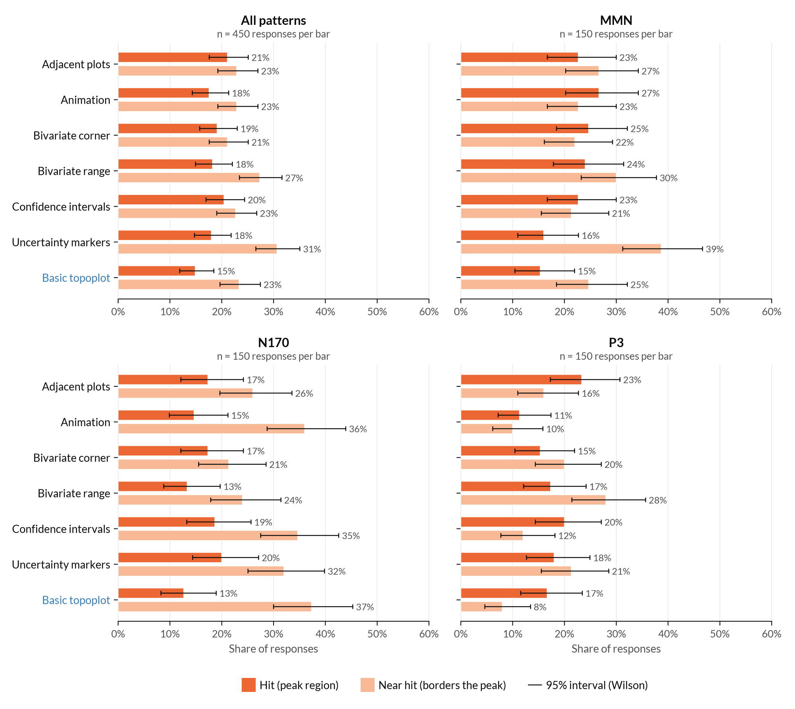{fig-alt="Hit and near-hit bars, after"}
:::

## V18. Orphaned figure files in `pages/*_files` {#v18}

::: {.finding-meta .sev-low .status-resolved}
**Severity:** Low · **Area:** Project hygiene · **Fixed:** 24 Nov 2026
:::

**Problem.** Several tracked PNGs under `pages/*_files/figure-html/` are referenced by
no page and produced by no chunk:

- **Task 1:** `unnamed-chunk-4/7/11/12`;
- **Task 2:** `task2-descriptive-plot-1`, `unnamed-chunk-9/10/11`;
- **Sample:** `unnamed-chunk-6/8`;
- **Subjective:** `likert-basic-contrast-figure-1`, `unnamed-chunk-3-1`.

One of them, Task 1 `unnamed-chunk-4`, is an old bar chart with ±1 SD error bars, a
literal `<U+00B1>` in its caption, and bars cut off at 100%. It could be reused by
mistake.

**Fix.** Check each file against the current chunks, then remove the stale ones with
`git rm`. **Not done:** deleting files needs your go-ahead.

**Resolution (24 Nov 2026).** A check of every figure file found:

- **Published site (`docs/pages/*_files/`, tracked):** no orphans; every PNG there is
  used by its page (Quarto cleans that folder on each render).
- **`pages/*_files/`:** git-ignored render leftovers, not tracked (the "tracked" in the
  problem statement was wrong). 19 of them were used by no page, including the files
  listed above, two Quality figures left in `sample_files/` and old time figures in
  `task1_files/` and `task2_files/`. They were deleted; the 35 files that the current
  renders still use were kept.

## V2. Text sizes are unbalanced at final size {#v2}

::: {.finding-meta .sev-high .status-resolved}
**Severity:** High (for the journal) · **Principle:** ch. 24 "Judge text and mark balance at final reproduction size"
:::

**Problem.**

- **Likert figures** (`figures/likert_estimate_figure.png`,
  `figures/likert_contrast_figure.png`): panel titles are 50 pt and y labels 40 pt, but
  the 1–5 and ±2 tick numbers are tiny.
- **Tiny tick text elsewhere:** the PPC and peak-contrast figures, the time-position
  plots, the feedback y axes and the feedback caption.
- **Sizes not as coded:** exports use showtext at 96 dpi on 180-dpi devices, so the
  point sizes in the code are not the printed sizes.

**Fix.**

- Export at the journal column widths (about 3.5 in or 7 in).
- Set real point sizes: ticks 8–9 pt, labels 9–10 pt.
- Drop the dpi-ratio workaround for exports.
- Add anchor labels to the rating axis (what 1 and 5 mean).

**Resolution (24 Nov 2026).**

- **Print sizes.** The publication figures have print PDFs at the journal widths with
  real point sizes (8 pt text, 7 pt ticks), exported with `cairo_pdf` rather than the
  showtext dpi workaround ([V7](#v7)).
- **Website figures rebalanced** (sizes at the ~1100 px display width):
  - Task 2 PPC figure: ticks about 9.5 → 13 px, panel titles, legend and caption larger.
  - Task 2 peak-contrast figure: ticks about 8.7 → 13 px, panel titles and captions larger.
  - Time-position checks: ticks and axis titles larger.
  - Feedback figures: y ticks about 8.7 → 12 px; caption 14 → 22 (two lines); panel and
    axis titles 40 → 28.
  - Likert figures: panel titles 50 → 36, tick numbers 20 → 28, labels 40 → 34.
- **Rating anchors.** Every panel of the Likert estimate figure shows its 1–5 axis with
  the item's anchors at the ends: very unhelpful / very helpful (comparison, detection),
  very unlikely / very likely (publication use), very unappealing / very appealing
  (aesthetics). Web and print (7 pt).

## V7. Publication figures: 180-dpi PNG, in-figure titles and subtitles {#v7}

::: {.finding-meta .sev-moderate .status-resolved}
**Severity:** Moderate (for the journal) · **Figures:** `figures/comparison_accuracy*`, `detection_score*`, `likert_*` · **Principle:** ch. 27 "Match vector or bitmap storage to figure complexity", "Preserve a maximum-quality master"; ch. 22 "Give every figure one title in the location its medium expects"
:::

**Problem.**

- The publication figures are 180-dpi PNGs.
- They carry their own titles and subtitles. One subtitle, for example, defines the CI
  ("Dunnett-adjusted simultaneous 95% CIs").

**Fix.**

- Export the ggplot figures as PDF or SVG (`cairo_pdf`, `svglite`).
- Export the Makie grids as PDF, or as PNG/TIFF at 300 dpi or more.
- Add a `title = FALSE` switch for the exports and move the CI definition into the
  manuscript caption.

The Sample page already works this way.

**Resolution (24 Nov 2026).**

- **Print PDFs at the template's widths.** Every figure on the Figures page has a PDF in
  `figures/` laid out at its print size (IEEE VGTC template: full width 504 pt = 7.0 in,
  one column 246 pt), with 8 pt text, 7 pt ticks and value labels, and Lato embedded:
  participant characteristics, both Likert figures (full width); comparison accuracy and
  its contrasts, detection score and its contrasts (one column). Helpers in
  `scripts/analysis_setup.R`: `print_width`, `print_text`, `ggsave_print()`
  (`cairo_pdf`); each figure is built by one function with a `print` switch, so the web
  PNG and the PDF come from the same code.
- **No in-figure titles.** The titles and subtitles of the accuracy and detection
  figures are removed (web and print). Their definitions moved into figure captions,
  for example "Bars: Dunnett-adjusted simultaneous 95% confidence intervals for the six
  comparisons" (Task 2 contrast figure); the same text belongs in the manuscript
  captions.
- **Makie grids.** The four hit/miss figures also get print PDFs at 504 pt width (one
  narrower to stay under 9 in tall), with the smallest text at 7 pt and Lato.
- **Figures page.** Each figure shows its caption and a link to its print PDF.

## V13. Country map is a choropleth of raw counts {#v13}

::: {.finding-meta .sev-moderate .status-resolved}
**Severity:** Moderate · **Figure:** `country-count-map` · **Principle:** ch. 15 "Use choropleths primarily for densities, and check area bias"
:::

**Problem.** Russia, Canada, Australia, Brazil and China dominate the map visually with
1–6 participants each. Europe, at about two-thirds of the sample, is barely visible.

**Fix.** Use proportional symbols at the country centroids, or add a Europe inset, or
drop the map in favour of the bar charts. The 6 bins and the equal-area projection are
already good.

**Resolution (24 Nov 2026).** The Sample page's map is now a tabset with two versions
under "Map of participants by country":

- **Shaded countries:** the existing choropleth, unchanged.
- **Proportional symbols** (`country-count-symbol-map`, also
  `figures/country_work_participant_symbol_map.png`): countries in grey, one blue
  circle per country of work whose **area** is proportional to the count. Each circle
  sits at the area-weighted centroid of the country's mainland, computed in the
  equal-area projection, so Alaska or overseas territories do not pull it away.
- **Europe inset:** an enlarged Europe panel on the same circle scale, framed on the world
  map, with counts of 5 or more written in the circles (Germany 35, UK 13, Italy 9, …);
  the size legend sits under it.
- **No wasted space:** the world map's extent ignores specks near the antimeridian, and
  the column widths, row heights and figure height are computed from the maps' aspect
  ratios (chunk `country-symbol-map-geometry`).

## V5. Visualization names differ between figures {#v5}

::: {.finding-meta .sev-moderate .status-resolved}
**Severity:** Moderate · **Principle:** ch. 21 (consistency); ch. 22 (unambiguous labels)
:::

**Problem.** The same visualizations appear under different names:

- "Bivariate corner" and "Bivariate corners";
- "Confidence interval" and "Confidence intervals";
- "Basic" and "Basic topoplot";
- "Adjacent" and "Adjacent plots".

In the Task 2 gradient plot, "Confidence intervals" also wraps onto two lines with a
large gap.

**Fix.**

- Use one label vector (`vistype_labels`) for every R figure and the Makie exports.
- Use a short-name variant only where space requires it, and then use it everywhere.

**Resolution (24 Nov 2026).** Every R figure takes its names from the shared
`vistype_labels` (Adjacent plots, Animation, Bivariate corner, Bivariate range,
Confidence intervals, Uncertainty markers, Basic topoplot) through new helpers in
`scripts/analysis_setup.R`: `figure_vistype()` gives the one-line name, or one word per
line (`stacked = TRUE`) for narrow axes. Page-local label vectors with other spellings
(for example "Bivariate corners" in the Task 1 contrast figure) are removed. Changed
figures: Task 1 gradient, accuracy, contrast and hard-trials figures; Task 2 gradient,
detection-score, contrast, PPC and peak-contrast figures; the time estimate and violin
figures; the Likert labels; both feedback figures, whose codebook labels (Basic,
Adjacent, Confidence interval, …) are mapped to the canonical names on the axis only
(the coding data are unchanged). The Makie hit/miss figures already used the canonical
names. Horizontal axes now use one-line names, which also removes the wrapped
"Confidence intervals" gap in the Task 2 gradient plot.

## V6. Basic topoplot is highlighted only in some figures {#v6}

::: {.finding-meta .sev-moderate .status-resolved}
**Severity:** Moderate · **Principle:** ch. 4 "Make baseline colors recede behind highlights"; ch. 21
:::

**Problem.**

- The blue Basic accent appears in the accuracy, score and Likert figures.
- It is missing from the time estimates, the gradient plots, the PPC figure, the peak
  contrasts and the hit/miss bars.

**Fix.** Apply the same accent to Basic in every figure that shows all seven
conditions.

**Resolution (24 Nov 2026).** Shared constants `basic_accent` (#377EB8) and
`basic_accent_fill` (#B9D8F2) and helpers `vistype_label_colours()`,
`markdown_vistype()` and `basic_axis_caption()` in `scripts/analysis_setup.R`.

- **Time estimates (both tasks):** blue axis label, point, interval and value, as in the
  accuracy figure.
- **Time violin, both gradient plots, PPC figure:** blue axis label; their marks keep
  their own colours (a blue line would not show on the blue gradient).
- **Peak contrasts:** caption "Difference (logit scale) from **Basic topoplot**" with
  Basic topoplot in blue, as in the main contrast figures.
- **Likert figures:** Basic and the zero lines now use the same blue (was #3B78B4).
- **Makie hit/miss figures:** Basic topoplot in blue in the bar chart's labels and in
  the Basic column titles of the topoplot grids (re-run and copied to `figures/`).

Figures without a Basic row (six-row contrast figures, Likert odds ratios) keep their
blue zero line.

## V4. Feedback panels re-sort the visualizations in each panel {#v4}

::: {.finding-meta .sev-high .status-resolved}
**Severity:** High · **Figures:** `a305-intensity-theme-figure`, `…-general-bivariates` · **Principle:** ch. 21 "Order panels by a logical sequence"; ch. 6 (horizontal labels)
:::

**Problem.**

- Every theme panel orders the visualizations differently, so Basic and the others
  move between panels.
- The general-bivariates version also has rotated labels.

**Fix.**

- Use one fixed x order in all panels.
- Keep empty slots, so that columns line up vertically.

**Resolution (24 Nov 2026).** Both feedback figures now use one x axis for all panels
(`scales = "fixed"`, `drop = FALSE`), in the page's visualization order (Basic first),
with empty slots kept, so the columns line up. The axis labels are repeated in every
panel and are horizontal in both versions; the eight-column general-bivariates version
uses slightly smaller labels instead of rotated ones. Cause of the re-sorting: each
panel took its x categories first from the boxplot layer, which skips sparse cells, and
appended the rest. The boxplots for small cells remain (V11).

## V9. Task 2 gradient plot sorted by median, shows means {#v9}

::: {.finding-meta .sev-moderate .status-resolved}
**Severity:** Moderate · **Location:** `pages/task2.qmd:317–320` (`task2_gradient_order` uses `arrange(median)`) · **Principle:** ch. 6 "Order categories by a meaningful rule"
:::

**Problem.** The plot shows means but is ordered by medians. Bivariate corner (0.68)
therefore sits above Basic (0.70).

**Fix.** Sort by `mean_score`.

**Resolution (23 Nov 2026, [F28](fixed.md#f28)).** The rows are ordered by the mean of
participant means, the value the figure shows, and the in-figure title is removed.
