Findings move here from [Figures vs Wilke](figures-wilke.md) once the figure is
fixed. IDs keep their review numbers.

| | Issue | Figures | Fixed on |
|--|------------------|----|----|
| [Moderate]{.badge .sev-moderate} | [V10. One score, several names and units](#v10) | Task 2 | 24 Nov 2026 |
| [Moderate]{.badge .sev-moderate} | [V12. Hit/near-miss bars show no uncertainty](#v12) | Hit or miss | 24 Nov 2026 |
| [Low]{.badge .sev-low} | [Further figure fixes](#further-figure-fixes) | Several | 24 Nov 2026 |
| [Low]{.badge .sev-low} | [V18. Orphaned figure files in `pages/*_files`](#v18) | Project | 24 Nov 2026 |
| [High]{.badge .sev-high} | [V2. Text sizes are unbalanced at final size](#v2) | Ratings, Task 2, Time, Feedback | 24 Nov 2026 |
| [Moderate]{.badge .sev-moderate} | [V7. Publication figures: 180-dpi PNG, in-figure titles and subtitles](#v7) | `figures/` | 24 Nov 2026 |
| [Moderate]{.badge .sev-moderate} | [V13. Country map is a choropleth of raw counts](#v13) | Sample | 24 Nov 2026 |
| [Moderate]{.badge .sev-moderate} | [V5. Visualization names differ between figures](#v5) | All pages | 24 Nov 2026 |
| [Moderate]{.badge .sev-moderate} | [V6. Basic topoplot is highlighted only in some figures](#v6) | All pages | 24 Nov 2026 |
| [High]{.badge .sev-high} | [V4. Feedback panels re-sort the visualizations in each panel](#v4) | Feedback | 24 Nov 2026 |
| [Moderate]{.badge .sev-moderate} | [V9. Task 2 gradient plot sorted by median, shows means](#v9) | Task 2 | 23 Nov 2026 |

: {.findings-table}

## Further figure fixes {#further-figure-fixes}

::: {.finding-meta .sev-low .status-resolved}
**Severity:** Low · **Fixed:** 24 Nov 2026 · Requested during the review, not separate findings
:::

- **Time-position checks** (Time page): a 95% ribbon around the line and a log time
  axis for the geometric means (open points of V17).

::: {layout-ncol=2}
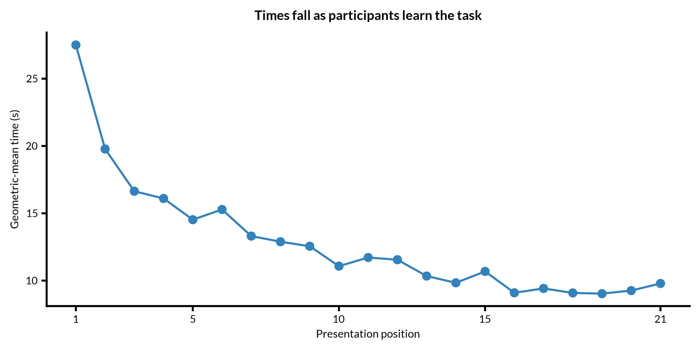{fig-alt="Task 1 time-position check, before"}

{fig-alt="Task 1 time-position check, after"}
:::

- **Proportional-odds figure** (Subjective page): text rebalanced for the display size,
  Lato via `plot_theme()`.

::: {layout-ncol=2}
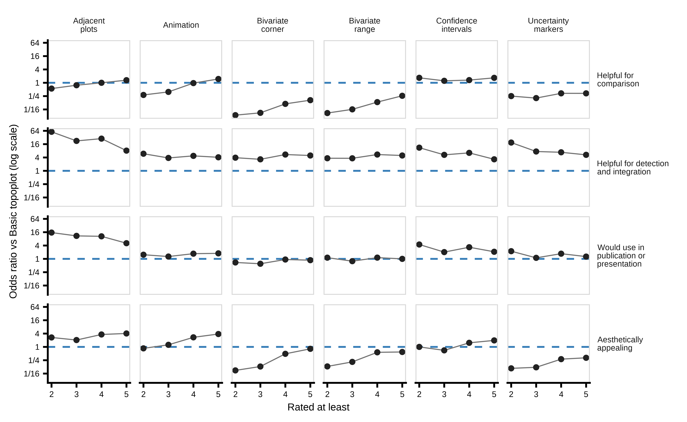{fig-alt="Proportional-odds figure, before"}

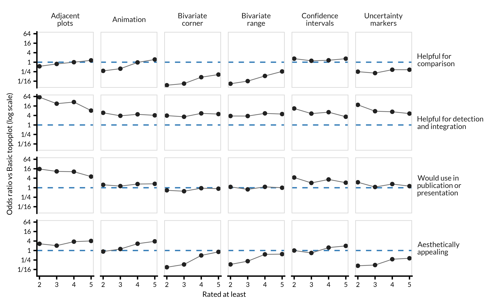{fig-alt="Proportional-odds figure, after"}
:::

- **Feedback figures:** two-line axis labels with normal line spacing (showtext drew the
  gap about 1.9 times too wide).

::: {layout-ncol=2}
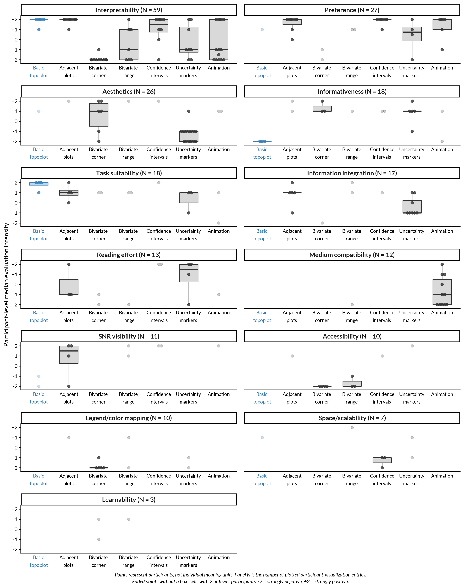{fig-alt="Feedback intensity figure, before"}

{fig-alt="Feedback intensity figure, after"}
:::

- **Compact participant figure:** print PDF at full width; now the main participant
  figure on the Figures page.

::: {layout-ncol=2}
{fig-alt="Compact participant figure, before"}

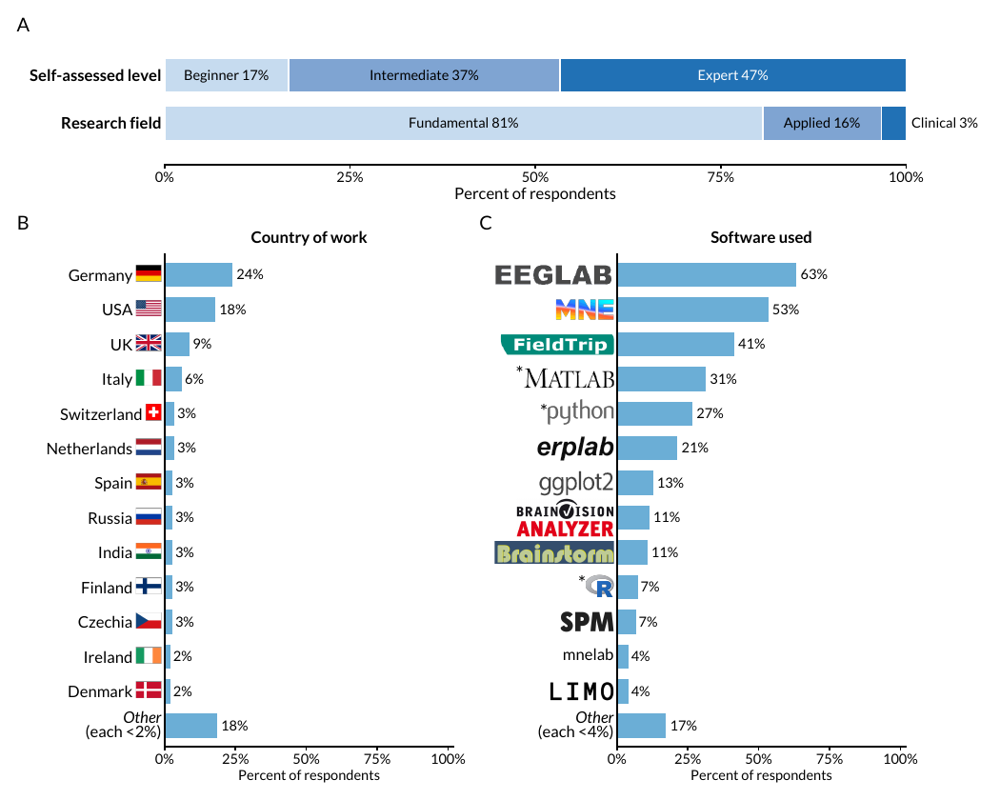{fig-alt="Compact participant figure, after"}
:::

- **Hit/miss key legends** (Makie print PDFs): the "Share of responses" labels were cut
  off at the bottom; now complete.

::: {layout-ncol=2}
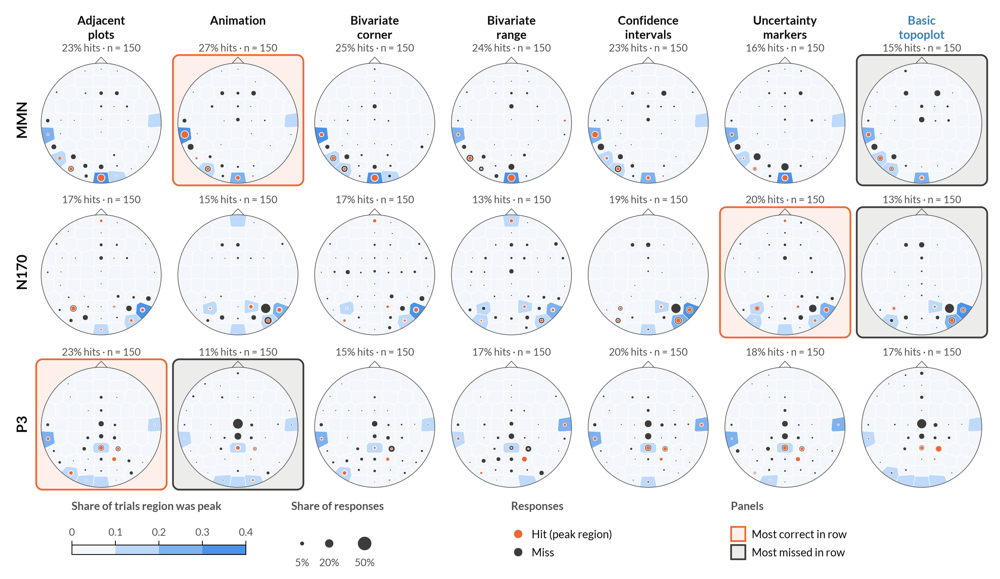{fig-alt="Hit/miss pattern grid, before"}

{fig-alt="Hit/miss pattern grid, after"}
:::

- **Figure 1 of the paper** (teaser): regenerated in Lato at the print width (504 pt,
  7–9 pt text) by a separate driver, `make_figure1.jl`, from the same data (P3, subject
  8, 129 ms, condition 1; checked against all four colour bars of the old figure).

::: {layout-ncol=2}
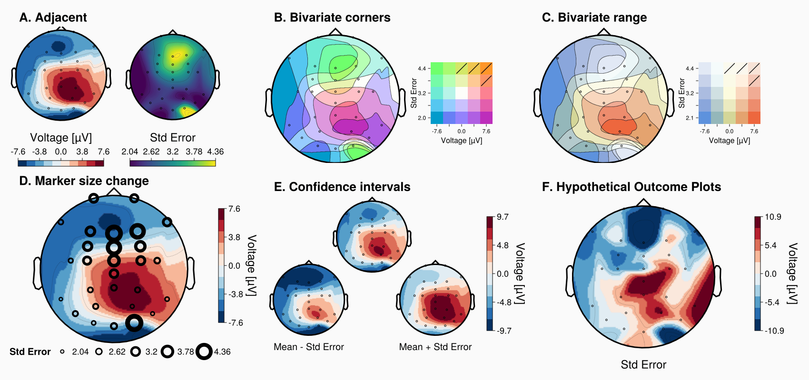{fig-alt="Figure 1 teaser, before"}

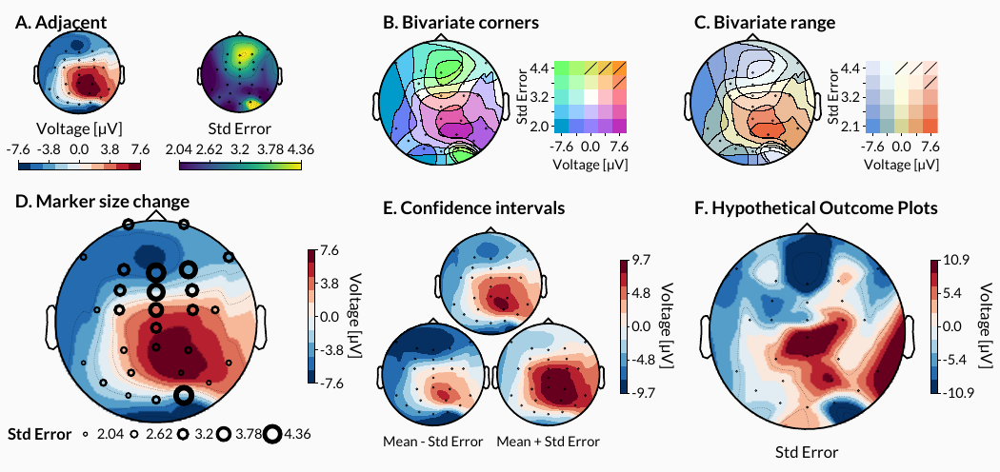{fig-alt="Figure 1 teaser, after"}
:::

## V10. One score, several names and units {#v10}

::: {.finding-meta .sev-moderate .status-resolved}
**Severity:** Moderate · **Principle:** ch. 22 "Label quantitative axes … with variables and units"; ch. 21
:::

**Problem.** The same Task 2 score is described differently in different figures:

- The gradient plot is titled "Detection task accuracy", its axis says "score", and its
  values are 0–1 decimals.
- The model figures say "Detection task score" and use %.
- `task2-peak-ppc-figure` labels a difference axis "%" where "pp" is meant.

**Fix.** Use one name and one unit for the score, and "pp" for differences. Define the
fade beyond 95% in the gradient plots, e.g. "fades from 95% to 99.9% confidence"
(ch. 16).

**Resolution (24 Nov 2026).** One name ("detection score") and one unit (%) in every
Task 2 figure, "pp" for differences.

- **Histogram:** axis "Detection score (0% = weakest region, 100% = strongest region)";
  the in-figure title is removed (the caption is the title).
- **Gradient plot:** axis "Detection score (mean of participant means)" in %.
- **PPC figure:** rebuilt as two panels; the share panel keeps %, the difference panel
  shows pp.
- **Fade defined:** the gradient captions (Task 1 and Task 2) say the band is opaque
  inside the 95% interval and fades to transparent between 95% and 100% confidence.

::: {layout-ncol=2}
{fig-alt="Task 2 score histogram, before"}

{fig-alt="Task 2 score histogram, after"}
:::

::: {layout-ncol=2}
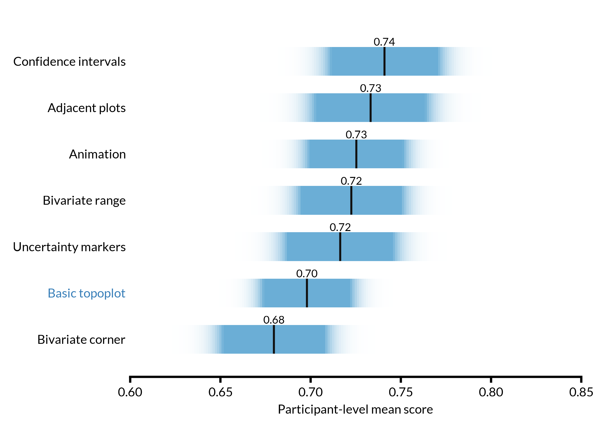{fig-alt="Task 2 gradient plot, before"}

{fig-alt="Task 2 gradient plot, after"}
:::

::: {layout-ncol=2}
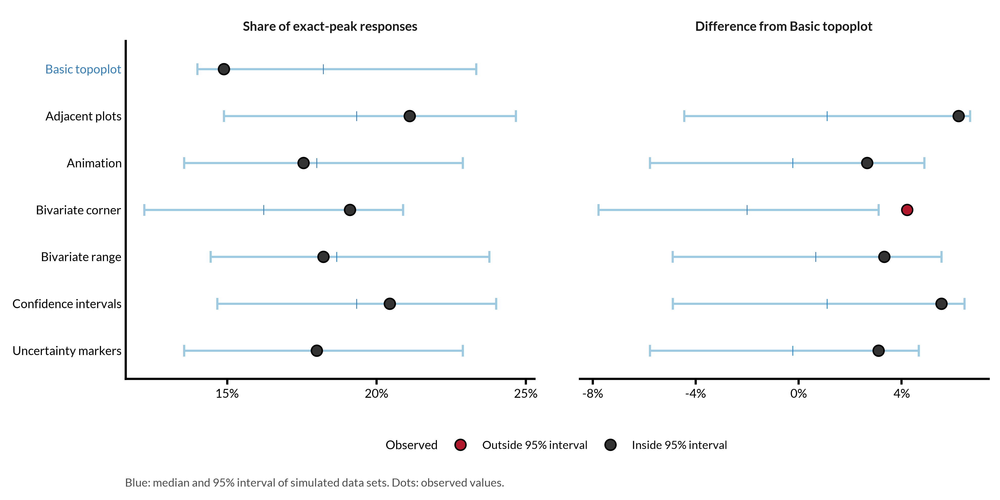{fig-alt="Task 2 posterior predictive check, before"}

{fig-alt="Task 2 posterior predictive check, after"}
:::

## V12. Hit/near-miss bars show no uncertainty {#v12}

::: {.finding-meta .sev-moderate .status-resolved}
**Severity:** Moderate · **Figure:** `figures/task2_hit_near_miss_by_vistype.png` · **Principle:** ch. 16; ch. 19 (dot size)
:::

**Problem.**

- Some differences between bars are 2–5 pp, yet the bars carry no intervals.
- The small orange and black dots on blue fills are hard to tell apart.

**Fix.**

- Add Wilson 95% whiskers, or point the caption to the contrast models.
- Set a minimum dot size, or give the dots a white halo.

**Resolution (24 Nov 2026).**

- **Intervals:** every hit and near-hit bar has a Wilson 95% whisker (450 responses per
  bar for all patterns, 150 per pattern). The caption says they treat responses as
  independent, so they are somewhat too narrow; the models on the page account for
  participants and stimuli.
- **Dots:** the hit/miss dots on the topoplots have a minimum size and a thicker white
  outline, so they stay visible on blue fills.

::: {layout-ncol=2}
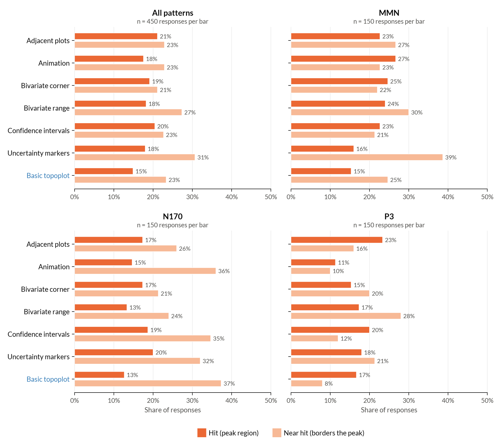{fig-alt="Hit and near-hit bars, before"}

{fig-alt="Hit and near-hit bars, after"}
:::

## V18. Orphaned figure files in `pages/*_files` {#v18}

::: {.finding-meta .sev-low .status-resolved}
**Severity:** Low · **Area:** Project hygiene
:::

**Problem.** Several tracked PNGs under `pages/*_files/figure-html/` are referenced by
no page and produced by no chunk:

- **Task 1:** `unnamed-chunk-4/7/11/12`;
- **Task 2:** `task2-descriptive-plot-1`, `unnamed-chunk-9/10/11`;
- **Sample:** `unnamed-chunk-6/8`;
- **Subjective:** `likert-basic-contrast-figure-1`, `unnamed-chunk-3-1`.

One of them, Task 1 `unnamed-chunk-4`, is an old bar chart with ±1 SD error bars, a
literal `<U+00B1>` in its caption, and bars cut off at 100%. It could be reused by
mistake.

**Fix.** Check each file against the current chunks, then remove the stale ones with
`git rm`. **Not done:** deleting files needs your go-ahead.

## Done well

- Model estimates are dots with CIs on a restricted axis, not bars, and the CI type is
  always stated (ch. 6, ch. 16, ch. 17).
- The contrast-vs-Basic plots, with simultaneous CIs and a zero line, are close to
  Wilke Fig. 16-8 (ch. 16, ch. 23).
- Bar charts:
  - start at zero;
  - are horizontal, which suits the long labels;
  - are sorted by value with "Other" last.

  The participant multipanel uses a shared 0–100% scale (ch. 6, ch. 17, ch. 21).
- The section heading serves as the figure title on the Sample page (ch. 22).
- The map uses 6 bins and an equal-area projection (ch. 15).
- Time violins use a log scale, and the line is labelled as the geometric mean (ch. 3,
  ch. 8).
- Everything is generated in code, with a cache tied to the data (ch. 28).

## Priorities

1. One canonical order, one set of names, and the Basic accent everywhere (V1, V5, V6).
2. Re-export the publication figures at column size with balanced text, as vector files,
   without in-figure titles (V2, V7).
3. Remove or fix the hit/miss frames (V3).
4. Feedback figure: a fixed order across panels and no boxplots for tiny n (V4, V11).
5. Task 2 gradient sorted by mean, one score name and unit, and a time contrast figure
   (V8–V10).

**Resolution (24 Nov 2026).** A check of every figure file found:

- **Published site (`docs/pages/*_files/`, tracked):** no orphans; every PNG there is
  used by its page (Quarto cleans that folder on each render).
- **`pages/*_files/`:** git-ignored render leftovers, not tracked (the "tracked" in the
  problem statement was wrong). 19 of them were used by no page, including the files
  listed above, two Quality figures left in `sample_files/` and old time figures in
  `task1_files/` and `task2_files/`. They were deleted; the 35 files that the current
  renders still use were kept.

## V2. Text sizes are unbalanced at final size {#v2}

::: {.finding-meta .sev-high .status-resolved}
**Severity:** High (for the journal) · **Principle:** ch. 24 "Judge text and mark balance at final reproduction size"
:::

**Problem.**

- **Likert figures** (`figures/likert_estimate_figure.png`,
  `figures/likert_contrast_figure.png`): panel titles are 50 pt and y labels 40 pt, but
  the 1–5 and ±2 tick numbers are tiny.
- **Tiny tick text elsewhere:** the PPC and peak-contrast figures, the time-position
  plots, the feedback y axes and the feedback caption.
- **Sizes not as coded:** exports use showtext at 96 dpi on 180-dpi devices, so the
  point sizes in the code are not the printed sizes.

**Fix.**

- Export at the journal column widths (about 3.5 in or 7 in).
- Set real point sizes: ticks 8–9 pt, labels 9–10 pt.
- Drop the dpi-ratio workaround for exports.
- Add anchor labels to the rating axis (what 1 and 5 mean).

**Resolution (24 Nov 2026).**

- **Print sizes.** The publication figures have print PDFs at the journal widths with
  real point sizes (8 pt text, 7 pt ticks), exported with `cairo_pdf` rather than the
  showtext dpi workaround ([V7](#v7)).
- **Website figures rebalanced** (sizes at the ~1100 px display width):
  - Task 2 PPC figure: ticks about 9.5 → 13 px, panel titles, legend and caption larger.
  - Task 2 peak-contrast figure: ticks about 8.7 → 13 px, panel titles and captions larger.
  - Time-position checks: ticks and axis titles larger.
  - Feedback figures: y ticks about 8.7 → 12 px; caption 14 → 22 (two lines); panel and
    axis titles 40 → 28.
  - Likert figures: panel titles 50 → 36, tick numbers 20 → 28, labels 40 → 34.
- **Rating anchors.** Every panel of the Likert estimate figure shows its 1–5 axis with
  the item's anchors at the ends: very unhelpful / very helpful (comparison, detection),
  very unlikely / very likely (publication use), very unappealing / very appealing
  (aesthetics). Web and print (7 pt).

## V7. Publication figures: 180-dpi PNG, in-figure titles and subtitles {#v7}

::: {.finding-meta .sev-moderate .status-resolved}
**Severity:** Moderate (for the journal) · **Figures:** `figures/comparison_accuracy*`, `detection_score*`, `likert_*` · **Principle:** ch. 27 "Match vector or bitmap storage to figure complexity", "Preserve a maximum-quality master"; ch. 22 "Give every figure one title in the location its medium expects"
:::

**Problem.**

- The publication figures are 180-dpi PNGs.
- They carry their own titles and subtitles. One subtitle, for example, defines the CI
  ("Dunnett-adjusted simultaneous 95% CIs").

**Fix.**

- Export the ggplot figures as PDF or SVG (`cairo_pdf`, `svglite`).
- Export the Makie grids as PDF, or as PNG/TIFF at 300 dpi or more.
- Add a `title = FALSE` switch for the exports and move the CI definition into the
  manuscript caption.

The Sample page already works this way.

**Resolution (24 Nov 2026).**

- **Print PDFs at the template's widths.** Every figure on the Figures page has a PDF in
  `figures/` laid out at its print size (IEEE VGTC template: full width 504 pt = 7.0 in,
  one column 246 pt), with 8 pt text, 7 pt ticks and value labels, and Lato embedded:
  participant characteristics, both Likert figures (full width); comparison accuracy and
  its contrasts, detection score and its contrasts (one column). Helpers in
  `scripts/analysis_setup.R`: `print_width`, `print_text`, `ggsave_print()`
  (`cairo_pdf`); each figure is built by one function with a `print` switch, so the web
  PNG and the PDF come from the same code.
- **No in-figure titles.** The titles and subtitles of the accuracy and detection
  figures are removed (web and print). Their definitions moved into figure captions,
  for example "Bars: Dunnett-adjusted simultaneous 95% confidence intervals for the six
  comparisons" (Task 2 contrast figure); the same text belongs in the manuscript
  captions.
- **Makie grids.** The four hit/miss figures also get print PDFs at 504 pt width (one
  narrower to stay under 9 in tall), with the smallest text at 7 pt and Lato.
- **Figures page.** Each figure shows its caption and a link to its print PDF.

## V13. Country map is a choropleth of raw counts {#v13}

::: {.finding-meta .sev-moderate .status-resolved}
**Severity:** Moderate · **Figure:** `country-count-map` · **Principle:** ch. 15 "Use choropleths primarily for densities, and check area bias"
:::

**Problem.** Russia, Canada, Australia, Brazil and China dominate the map visually with
1–6 participants each. Europe, at about two-thirds of the sample, is barely visible.

**Fix.** Use proportional symbols at the country centroids, or add a Europe inset, or
drop the map in favour of the bar charts. The 6 bins and the equal-area projection are
already good.

**Resolution (24 Nov 2026).** The Sample page's map is now a tabset with two versions
under "Map of participants by country":

- **Shaded countries:** the existing choropleth, unchanged.
- **Proportional symbols** (`country-count-symbol-map`, also
  `figures/country_work_participant_symbol_map.png`): countries in grey, one blue
  circle per country of work whose **area** is proportional to the count. Each circle
  sits at the area-weighted centroid of the country's mainland, computed in the
  equal-area projection, so Alaska or overseas territories do not pull it away.
- **Europe inset:** an enlarged Europe panel on the same circle scale, framed on the world
  map, with counts of 5 or more written in the circles (Germany 35, UK 13, Italy 9, …);
  the size legend sits under it.
- **No wasted space:** the world map's extent ignores specks near the antimeridian, and
  the column widths, row heights and figure height are computed from the maps' aspect
  ratios (chunk `country-symbol-map-geometry`).

## V5. Visualization names differ between figures {#v5}

::: {.finding-meta .sev-moderate .status-resolved}
**Severity:** Moderate · **Principle:** ch. 21 (consistency); ch. 22 (unambiguous labels)
:::

**Problem.** The same visualizations appear under different names:

- "Bivariate corner" and "Bivariate corners";
- "Confidence interval" and "Confidence intervals";
- "Basic" and "Basic topoplot";
- "Adjacent" and "Adjacent plots".

In the Task 2 gradient plot, "Confidence intervals" also wraps onto two lines with a
large gap.

**Fix.**

- Use one label vector (`vistype_labels`) for every R figure and the Makie exports.
- Use a short-name variant only where space requires it, and then use it everywhere.

**Resolution (24 Nov 2026).** Every R figure takes its names from the shared
`vistype_labels` (Adjacent plots, Animation, Bivariate corner, Bivariate range,
Confidence intervals, Uncertainty markers, Basic topoplot) through new helpers in
`scripts/analysis_setup.R`: `figure_vistype()` gives the one-line name, or one word per
line (`stacked = TRUE`) for narrow axes. Page-local label vectors with other spellings
(for example "Bivariate corners" in the Task 1 contrast figure) are removed. Changed
figures: Task 1 gradient, accuracy, contrast and hard-trials figures; Task 2 gradient,
detection-score, contrast, PPC and peak-contrast figures; the time estimate and violin
figures; the Likert labels; both feedback figures, whose codebook labels (Basic,
Adjacent, Confidence interval, …) are mapped to the canonical names on the axis only
(the coding data are unchanged). The Makie hit/miss figures already used the canonical
names. Horizontal axes now use one-line names, which also removes the wrapped
"Confidence intervals" gap in the Task 2 gradient plot.

## V6. Basic topoplot is highlighted only in some figures {#v6}

::: {.finding-meta .sev-moderate .status-resolved}
**Severity:** Moderate · **Principle:** ch. 4 "Make baseline colors recede behind highlights"; ch. 21
:::

**Problem.**

- The blue Basic accent appears in the accuracy, score and Likert figures.
- It is missing from the time estimates, the gradient plots, the PPC figure, the peak
  contrasts and the hit/miss bars.

**Fix.** Apply the same accent to Basic in every figure that shows all seven
conditions.

**Resolution (24 Nov 2026).** Shared constants `basic_accent` (#377EB8) and
`basic_accent_fill` (#B9D8F2) and helpers `vistype_label_colours()`,
`markdown_vistype()` and `basic_axis_caption()` in `scripts/analysis_setup.R`.

- **Time estimates (both tasks):** blue axis label, point, interval and value, as in the
  accuracy figure.
- **Time violin, both gradient plots, PPC figure:** blue axis label; their marks keep
  their own colours (a blue line would not show on the blue gradient).
- **Peak contrasts:** caption "Difference (logit scale) from **Basic topoplot**" with
  Basic topoplot in blue, as in the main contrast figures.
- **Likert figures:** Basic and the zero lines now use the same blue (was #3B78B4).
- **Makie hit/miss figures:** Basic topoplot in blue in the bar chart's labels and in
  the Basic column titles of the topoplot grids (re-run and copied to `figures/`).

Figures without a Basic row (six-row contrast figures, Likert odds ratios) keep their
blue zero line.

## V4. Feedback panels re-sort the visualizations in each panel {#v4}

::: {.finding-meta .sev-high .status-resolved}
**Severity:** High · **Figures:** `a305-intensity-theme-figure`, `…-general-bivariates` · **Principle:** ch. 21 "Order panels by a logical sequence"; ch. 6 (horizontal labels)
:::

**Problem.**

- Every theme panel orders the visualizations differently, so Basic and the others
  move between panels.
- The general-bivariates version also has rotated labels.

**Fix.**

- Use one fixed x order in all panels.
- Keep empty slots, so that columns line up vertically.

**Resolution (24 Nov 2026).** Both feedback figures now use one x axis for all panels
(`scales = "fixed"`, `drop = FALSE`), in the page's visualization order (Basic first),
with empty slots kept, so the columns line up. The axis labels are repeated in every
panel and are horizontal in both versions; the eight-column general-bivariates version
uses slightly smaller labels instead of rotated ones. Cause of the re-sorting: each
panel took its x categories first from the boxplot layer, which skips sparse cells, and
appended the rest. The boxplots for small cells remain (V11).

## V9. Task 2 gradient plot sorted by median, shows means {#v9}

::: {.finding-meta .sev-moderate .status-resolved}
**Severity:** Moderate · **Location:** `pages/task2.qmd:317–320` (`task2_gradient_order` uses `arrange(median)`) · **Principle:** ch. 6 "Order categories by a meaningful rule"
:::

**Problem.** The plot shows means but is ordered by medians. Bivariate corner (0.68)
therefore sits above Basic (0.70).

**Fix.** Sort by `mean_score`.

**Resolution (23 Nov 2026, [F28](fixed.md#f28)).** The rows are ordered by the mean of
participant means, the value the figure shows, and the in-figure title is removed.
