Changes you asked for while the figures were reviewed. They have no V number because the
[Wilke review](figures-wilke.md) did not list them; review findings that were fixed are
on [Fixed figures](fixed-figures.md). Newest first; each entry shows the figure before and
after.

| | Change | Figure | Changed on |
|--|------------------|----|----|
| [Done]{.badge .status-resolved} | [R6. Compact participant figure: own axis range per panel](#r6) | Sample, Figures page | 25 Nov 2026 |
| [Done]{.badge .status-resolved} | [R1. Figure 1 (paper teaser): Lato, print width, labels, map size](#r1) | Paper Figure 1 | 25 Nov 2026 |
| [Done]{.badge .status-resolved} | [R2. Hit/miss key legends cut off](#r2) | Hit or miss (Makie) | 24 Nov 2026 |
| [Done]{.badge .status-resolved} | [R3. Compact participant figure as the main figure](#r3) | Sample | 24 Nov 2026 |
| [Done]{.badge .status-resolved} | [R4. Feedback figures: line spacing in axis labels](#r4) | Feedback | 24 Nov 2026 |
| [Done]{.badge .status-resolved} | [R5. Proportional-odds figure: text sizes and Lato](#r5) | Subjective | 24 Nov 2026 |

: {.findings-table}

## R6. Compact participant figure: own axis range per panel {#r6}

::: {.finding-meta .sev-low .status-resolved}
**Figure:** compact participant figure (Sample, Figures page, print PDF) · **Changed:** 25 Nov 2026
:::

**Request.** The country panel wasted most of its width on a 0–100% axis (largest bar
24%). **Change.** Country (B) now ends at 40% and software (C) at 75% (largest bar 63%);
panel A keeps 0–100%. The panels answer different questions (country sums to 100%,
software allows several answers), so a shared axis gave no comparison worth the space.
The caption states the two ranges. Also applies to the text-label tab.

::: {layout-ncol=2}
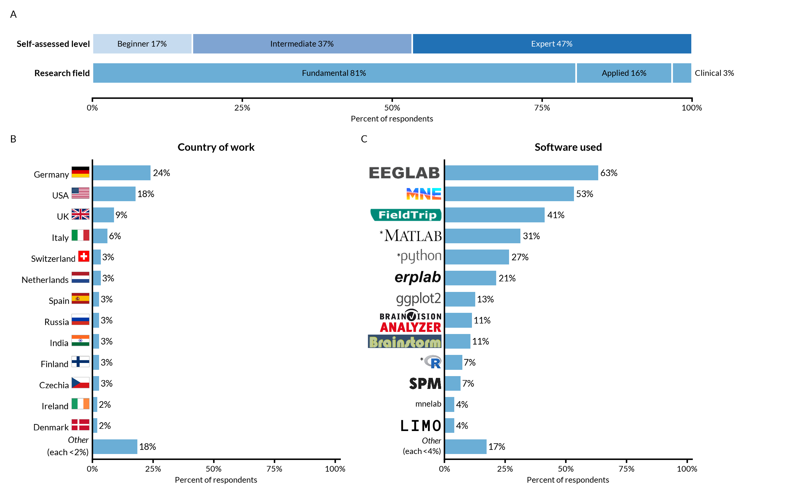{fig-alt="Compact participant figure with 0-100% axes, before"}

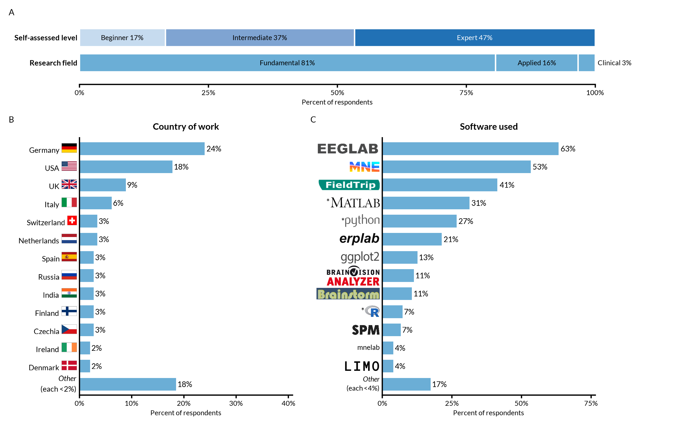{fig-alt="Compact participant figure with own axis ranges, after"}
:::

## R1. Figure 1 (paper teaser): Lato, print width, labels, map size {#r1}

::: {.finding-meta .sev-low .status-resolved}
**Figure:** paper Figure 1 (`make_figure1.jl`, UnfoldMakie) · **Changed:** 24–25 Nov 2026 · Three passes, newest first
:::

**Third pass (25 Nov 2026):** the second pass made room for the lifted labels
by adding vertical space, which shrank the maps in row 2 (D and F) and pushed the
three heads in E into each other. The original spacing is back, so the maps have
their original size and E its original spacing. The labels now take no layout space:
row 1's labels sit in the top margin, row 2's in the empty band below row 1's colour
bars, still on one line per row and clear of the noses and electrode markers.

::: {layout-ncol=2}
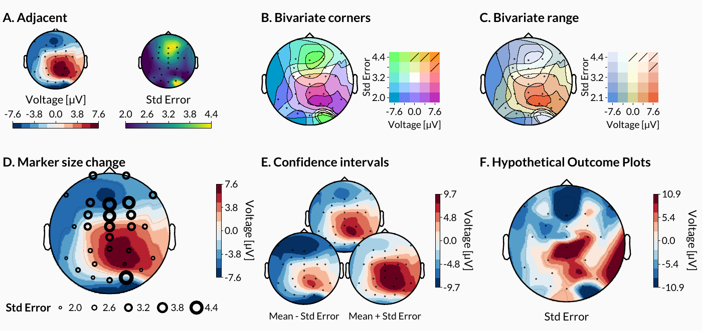{fig-alt="Figure 1 before the map-size fix"}

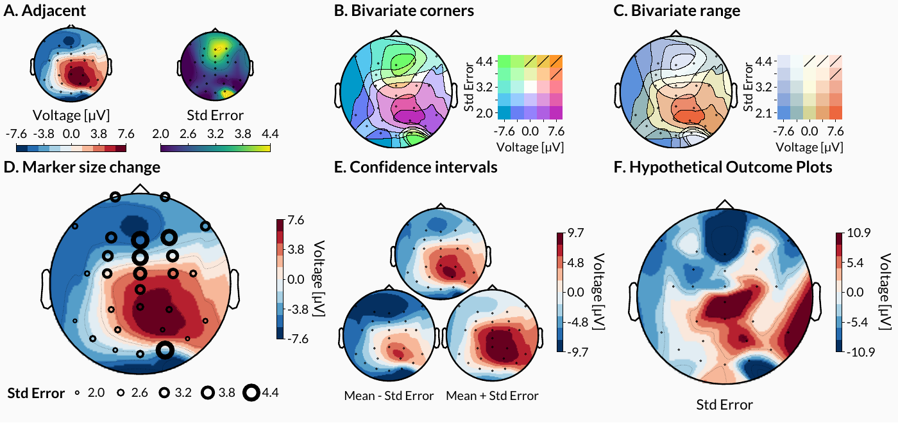{fig-alt="Figure 1 after the map-size fix"}
:::

**Second pass (25 Nov 2026):** panel labels on one line per row (anchored to
the top of each panel's slot) and lifted clear of the topoplots ("A. Adjacent" no
longer touches the nose, "D. Marker size change" clears the electrode markers); more
space between the marker legend and the head and between each value and the next
marker; standard-error values with one decimal (2.0 … 4.4) in the legend and on the
colour bar, whose 4.4 end tick was missing.

::: {layout-ncol=2}
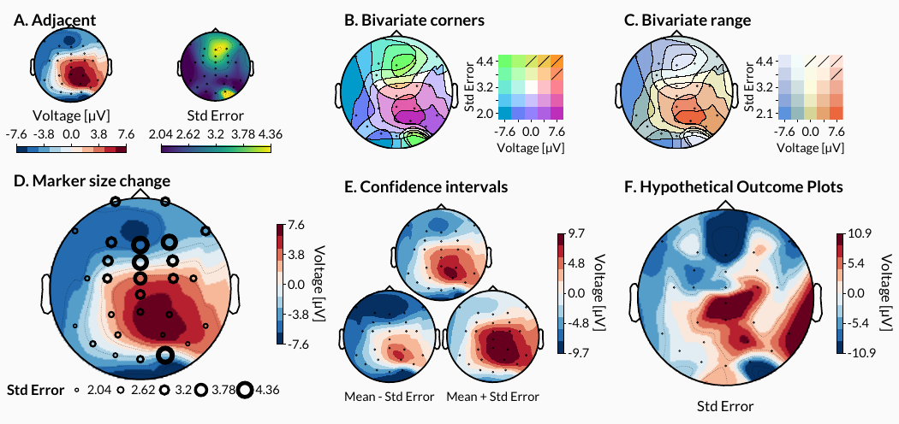{fig-alt="Figure 1 before the label fix"}

{fig-alt="Figure 1 after the label fix"}
:::

**First pass (24 Nov 2026):** regenerated in Lato at the print width (504 pt,
7–9 pt text) by a separate driver, `make_figure1.jl`, from the same data (P3, subject
8, 129 ms, condition 1; checked against all four colour bars of the old figure).

::: {layout-ncol=2}
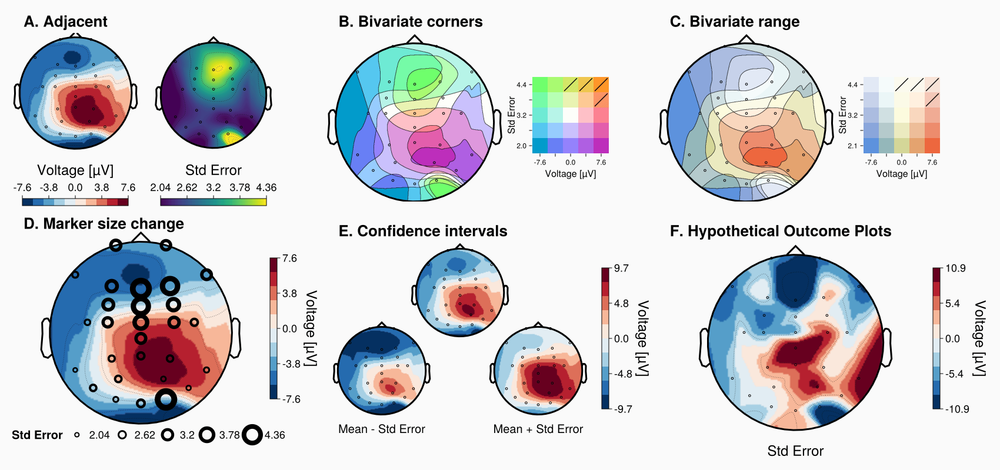{fig-alt="Figure 1 teaser, before"}

{fig-alt="Figure 1 teaser, after"}
:::

## R2. Hit/miss key legends cut off {#r2}

::: {.finding-meta .sev-low .status-resolved}
**Figure:** hit/miss print PDFs (Makie) · **Changed:** 24 Nov 2026
:::

**Hit/miss key legends** (Makie print PDFs): the "Share of responses" labels were cut
off at the bottom; now complete.

::: {layout-ncol=2}
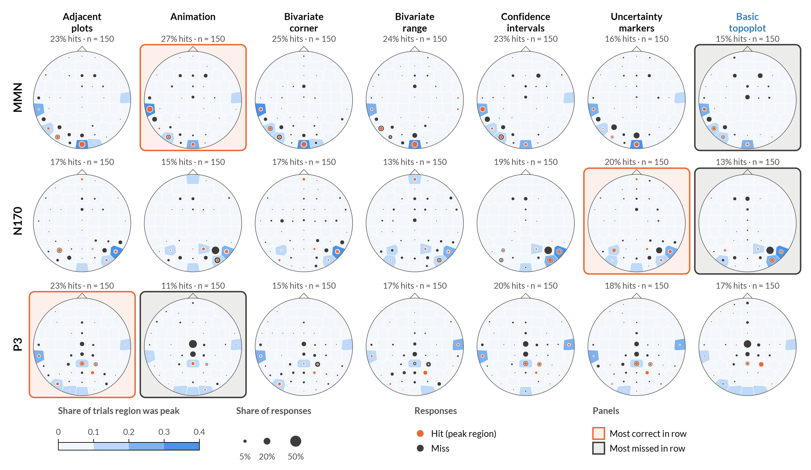{fig-alt="Hit/miss pattern grid, before"}

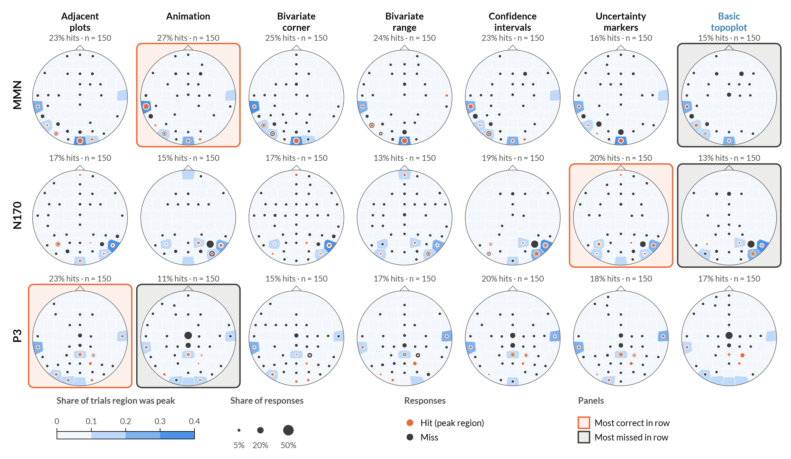{fig-alt="Hit/miss pattern grid, after"}
:::

## R3. Compact participant figure as the main figure {#r3}

::: {.finding-meta .sev-low .status-resolved}
**Figure:** compact participant figure (Sample, Figures page) · **Changed:** 24 Nov 2026
:::

**Compact participant figure:** print PDF at full width; now the main participant
figure on the Figures page.

::: {layout-ncol=2}
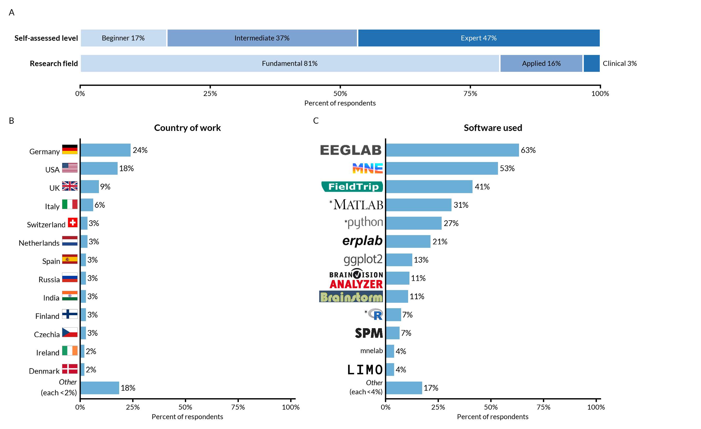{fig-alt="Compact participant figure, before"}

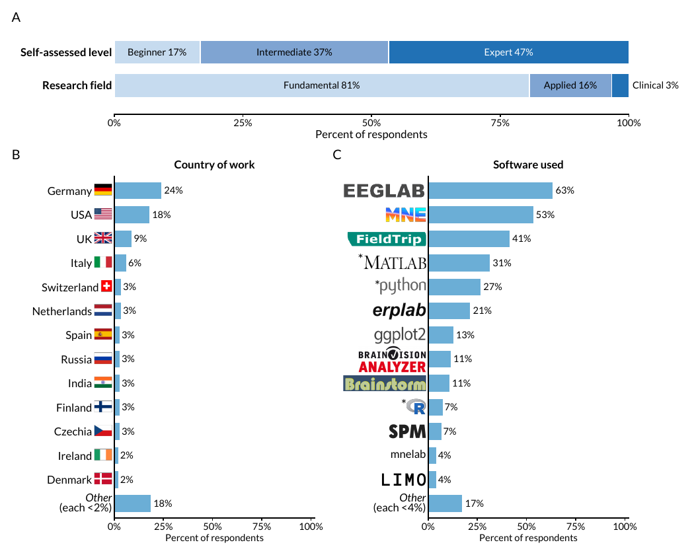{fig-alt="Compact participant figure, after"}
:::

## R4. Feedback figures: line spacing in axis labels {#r4}

::: {.finding-meta .sev-low .status-resolved}
**Figure:** feedback intensity figures · **Changed:** 24 Nov 2026
:::

**Feedback figures:** two-line axis labels with normal line spacing (showtext drew the
gap about 1.9 times too wide).

::: {layout-ncol=2}
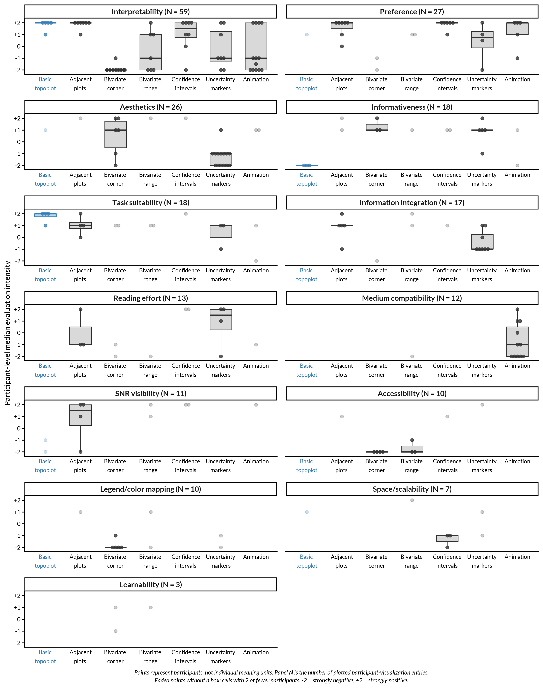{fig-alt="Feedback intensity figure, before"}

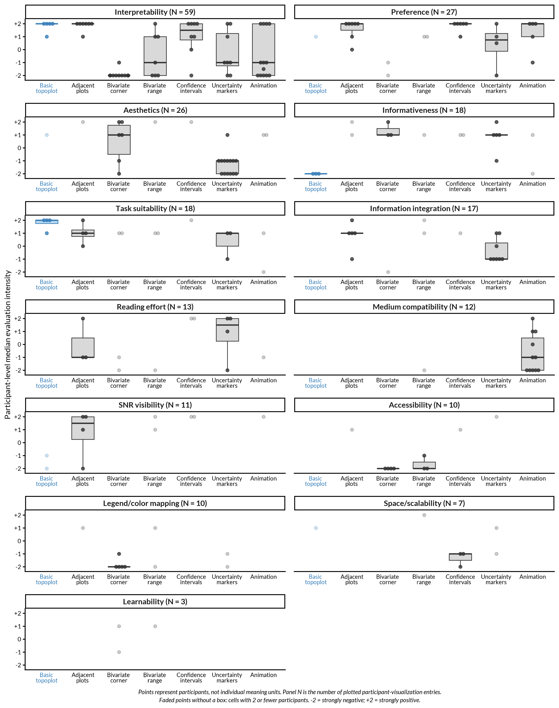{fig-alt="Feedback intensity figure, after"}
:::

## R5. Proportional-odds figure: text sizes and Lato {#r5}

::: {.finding-meta .sev-low .status-resolved}
**Figure:** proportional-odds figure (Subjective) · **Changed:** 24 Nov 2026
:::

**Proportional-odds figure** (Subjective page): text rebalanced for the display size,
Lato via `plot_theme()`.

::: {layout-ncol=2}
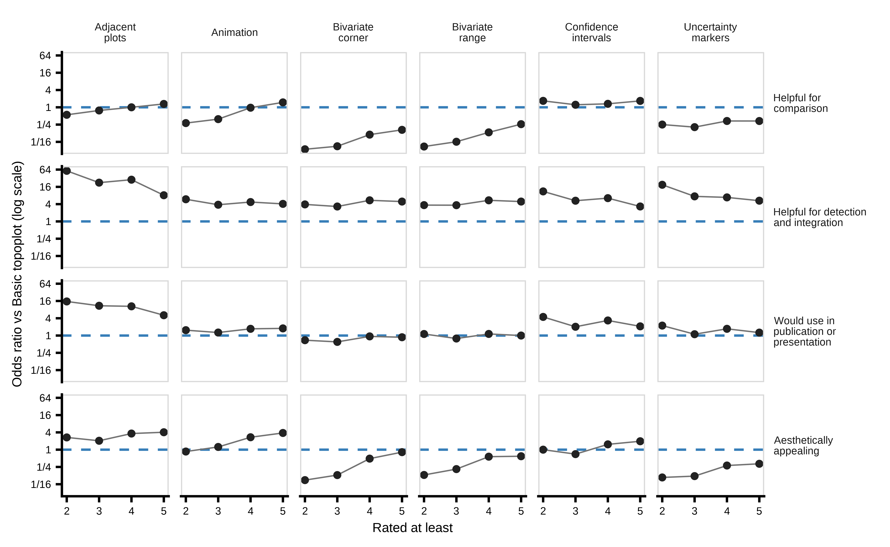{fig-alt="Proportional-odds figure, before"}

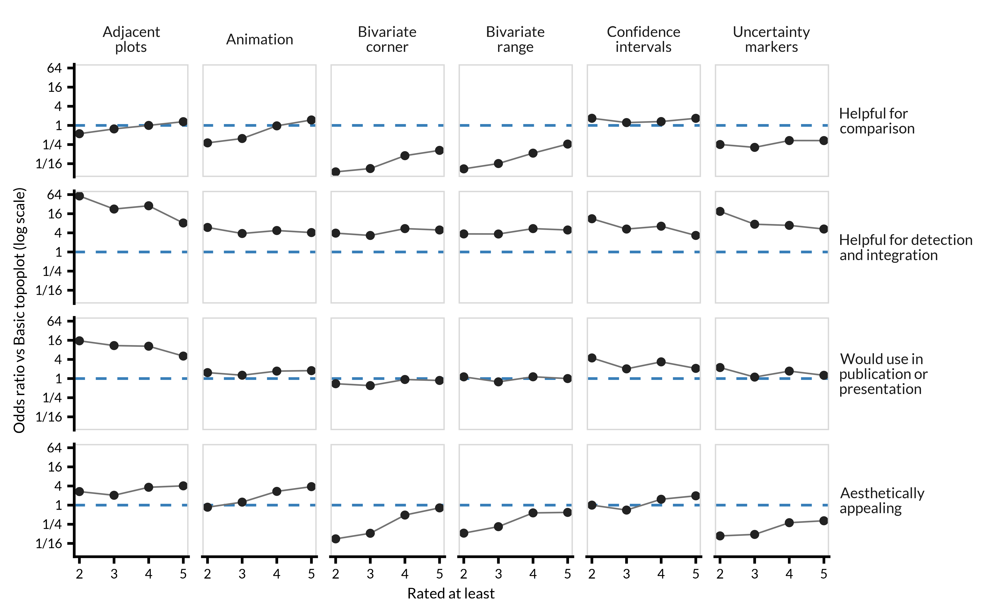{fig-alt="Proportional-odds figure, after"}
:::
